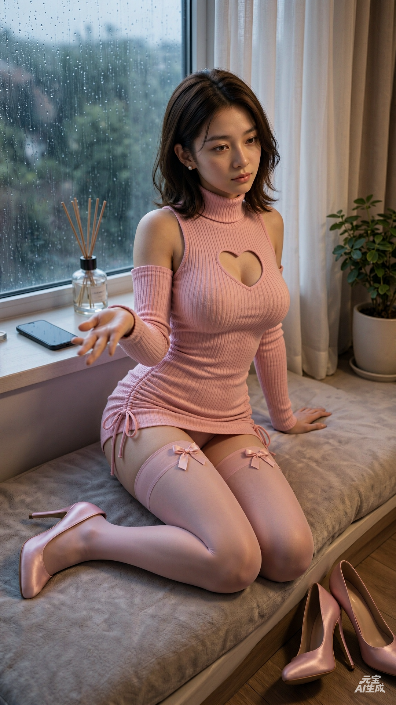
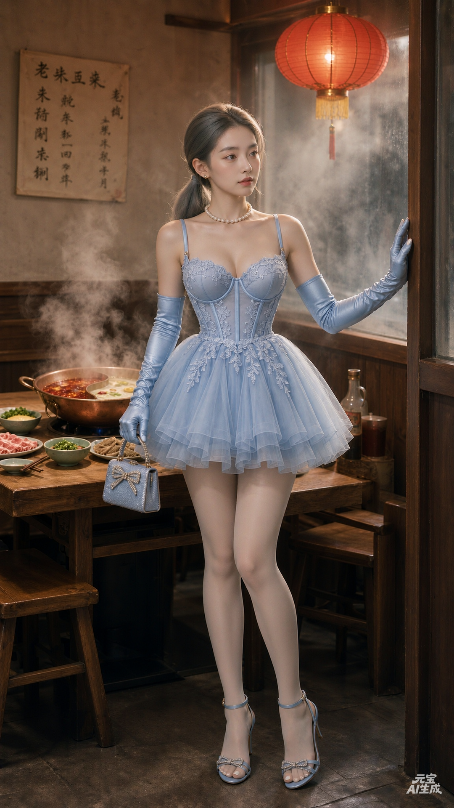
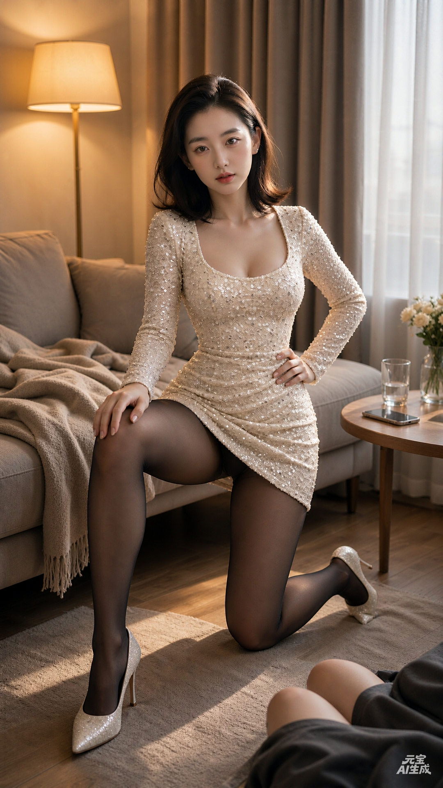
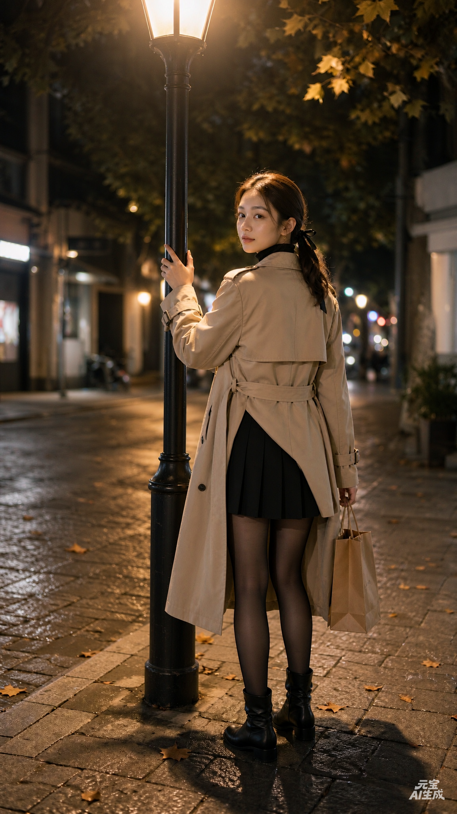
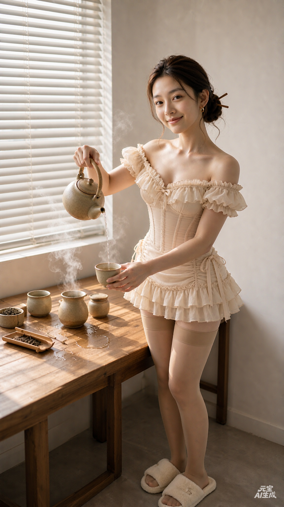
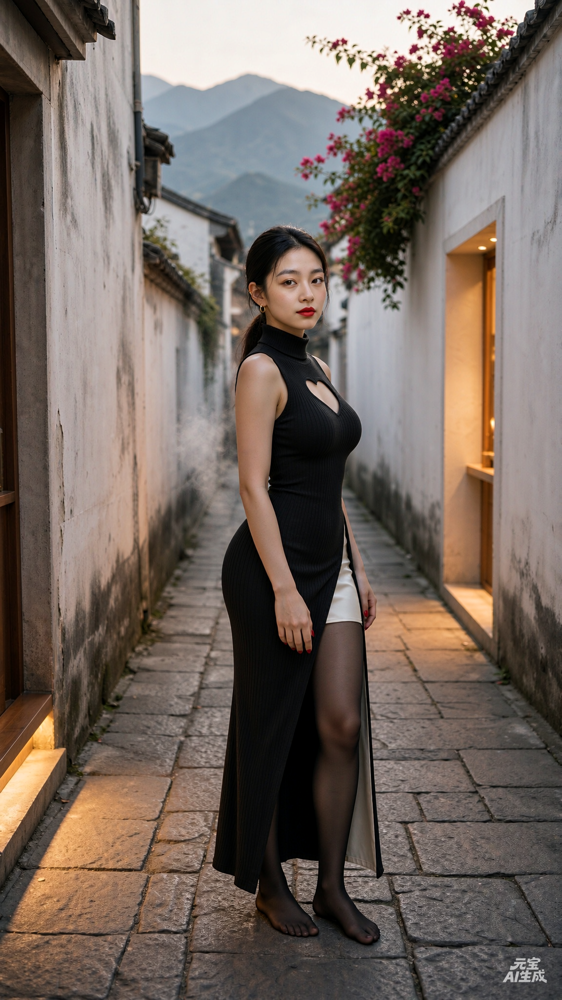
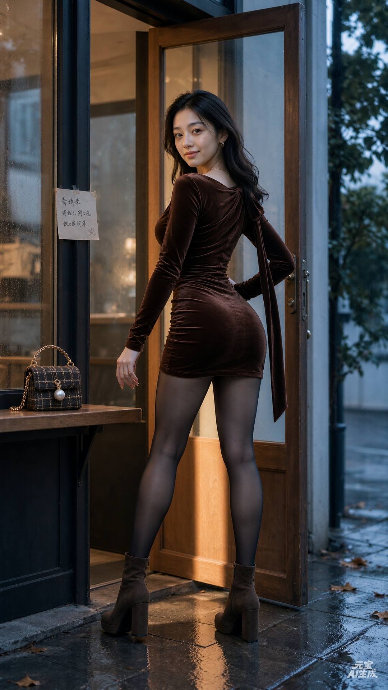
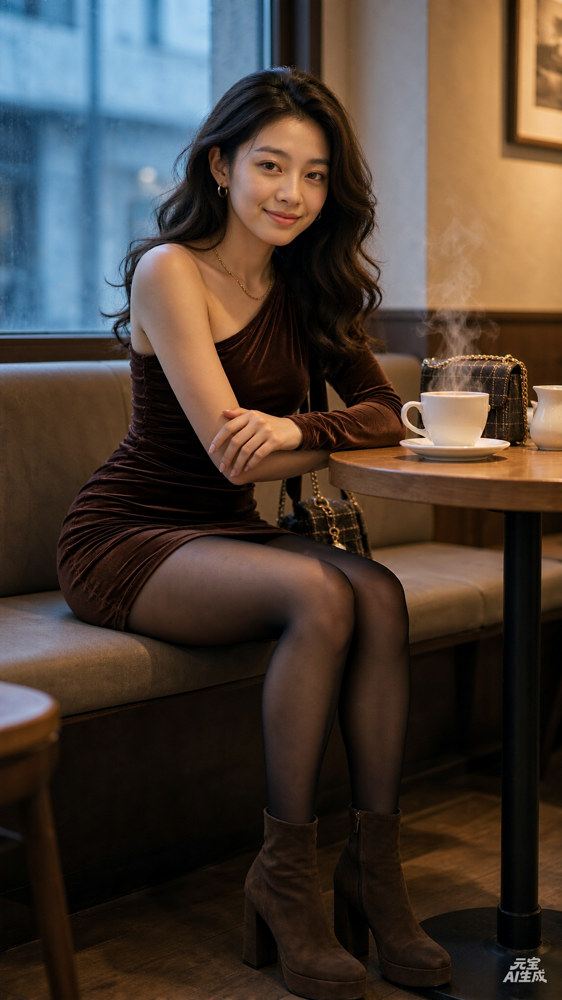

**唐唐 · 终稿图鉴** · 18 轮 72 图 · [🌐 网页画廊](https://zjh1934.github.io/tangtang-archive/) · [按场景](#按场景) · [按发型](#按发型) · [按月份](#按月份) · [台账](ARCHIVE.md) · [主页](README.md)

**R018 · 好烦哦的傍晚雨窗**

`SXY-0001` · 半扎发 · 其它 · 2026-11 · source=yuanbao ｜ [本轮现场](rounds/20261126r_rainy-window-mood/README.md) · [manifest](rounds/20261126r_rainy-window-mood/manifest.json)

**01 正面**　[看原图](https://github.com/zjh1934/tangtang-archive/raw/main/rounds/20261126r_rainy-window-mood/01_front.png) · [01 终稿 prompt](rounds/20261126r_rainy-window-mood/01_front.md)

**02 侧身**　[看原图](https://github.com/zjh1934/tangtang-archive/raw/main/rounds/20261126r_rainy-window-mood/02_side.png) · [02 终稿 prompt](rounds/20261126r_rainy-window-mood/02_side.md)

**03 坐姿**　[看原图](https://github.com/zjh1934/tangtang-archive/raw/main/rounds/20261126r_rainy-window-mood/03_seat.png) · [03 终稿 prompt](rounds/20261126r_rainy-window-mood/03_seat.md)

**04 特写**　[看原图](https://github.com/zjh1934/tangtang-archive/raw/main/rounds/20261126r_rainy-window-mood/04_close.png) · [04 终稿 prompt](rounds/20261126r_rainy-window-mood/04_close.md)

> 别站着呀，我今天烦得很，手机都扣过去了。你先别问，过来陪我数会儿窗上的雨就行。 ／ 你看这道雨痕，我划到一半就不想划了。白天那些破事谁爱管谁管，我今晚只管这扇窗。 ／ 坐近点嘛，脚上这只拖鞋晃半天你都不接话。淋这么久，你倒是说句哄我的呀。 ／ 好啦不烦了，手给你，拉我起来。等雨停陪我把阳台那盆薄荷搬进来，顺路买两个咸蛋黄酥。

---

**R017 · 好的我喝口茶先**

`TEA-0001` · 低挽圆髻＋贴颊手推波纹 · 喝茶 · 窗边 · 傍晚 · 旗袍 · 人设第二跑 · 2026-11 · source=lovers ｜ [本轮现场](rounds/20261126q_lovers-tea-whisper/README.md) · [manifest](rounds/20261126q_lovers-tea-whisper/manifest.json)

**01 正面**　[看原图](https://github.com/zjh1934/tangtang-archive/raw/main/rounds/20261126q_lovers-tea-whisper/01_front.png) · [01 终稿 prompt](rounds/20261126q_lovers-tea-whisper/01_front.md)

**02 侧身**　[看原图](https://github.com/zjh1934/tangtang-archive/raw/main/rounds/20261126q_lovers-tea-whisper/02_side.png) · [02 终稿 prompt](rounds/20261126q_lovers-tea-whisper/02_side.md)

**03 坐姿**　[看原图](https://github.com/zjh1934/tangtang-archive/raw/main/rounds/20261126q_lovers-tea-whisper/03_seat.png) · [03 终稿 prompt](rounds/20261126q_lovers-tea-whisper/03_seat.md)

**04 特写**　[看原图](https://github.com/zjh1934/tangtang-archive/raw/main/rounds/20261126q_lovers-tea-whisper/04_close.png) · [04 终稿 prompt](rounds/20261126q_lovers-tea-whisper/04_close.md)

> 好～茶我给你温着呢，别烫嘴，先抿一口再说话。 ／ 等会儿那家换豆子的，还等着呢，不许又说困。

---

**R016 · 颈膜枪震得舒服的夜里**

`LNG-0020` · 慵懒低盘发 · 卧室 · 2026-11 · source=yuanbao ｜ [本轮现场](rounds/20261126p_neck-massage-night/README.md) · [manifest](rounds/20261126p_neck-massage-night/manifest.json)

**01 正面**　[看原图](https://github.com/zjh1934/tangtang-archive/raw/main/rounds/20261126p_neck-massage-night/01_front.png) · [01 终稿 prompt](rounds/20261126p_neck-massage-night/01_front.md)

**02 侧身**　[看原图](https://github.com/zjh1934/tangtang-archive/raw/main/rounds/20261126p_neck-massage-night/02_side.png) · [02 终稿 prompt](rounds/20261126p_neck-massage-night/02_side.md)

**03 坐姿**　[看原图](https://github.com/zjh1934/tangtang-archive/raw/main/rounds/20261126p_neck-massage-night/03_seat.png) · [03 终稿 prompt](rounds/20261126p_neck-massage-night/03_seat.md)

**04 特写**　[看原图](https://github.com/zjh1934/tangtang-archive/raw/main/rounds/20261126p_neck-massage-night/04_close.png) · [04 终稿 prompt](rounds/20261126p_neck-massage-night/04_close.md)

> 你半躺着别出声呀，这枪一抵上后颈我就整个人软了，偏还留半分劲回头看你一眼，看有没有在偷看。 ／ 坐起来啦？那我可就把肩转过来了。嗯不许学我嘴硬，刚才那声舒服我可没出声，你别乱讲。 ／ 别俯这么近，我后颈全让给你了还不看。就故意把气吐到一半咬住，偏不让你听全这一下。 ／ 停啦，枪搁这儿。舒服归舒服，话头归我起，明早你陪我去挑个软一点的按摩头，敢说不我就点你额头。

---

**R015 · 你会撒娇吗**

`SAJ-0001` · 及肩下两指蓬松波浪卷发 · 撒娇 · 居家 · 傍晚 · 人设首跑 · 2026-11 · source=lovers ｜ [本轮现场](rounds/20261126o_lovers-sajiao-coquette/README.md) · [manifest](rounds/20261126o_lovers-sajiao-coquette/manifest.json)

**01 正面**　[看原图](https://github.com/zjh1934/tangtang-archive/raw/main/rounds/20261126o_lovers-sajiao-coquette/01_front.png) · [01 终稿 prompt](rounds/20261126o_lovers-sajiao-coquette/01_front.md)

**02 侧身**　[看原图](https://github.com/zjh1934/tangtang-archive/raw/main/rounds/20261126o_lovers-sajiao-coquette/02_side.png) · [02 终稿 prompt](rounds/20261126o_lovers-sajiao-coquette/02_side.md)

**03 坐姿**　[看原图](https://github.com/zjh1934/tangtang-archive/raw/main/rounds/20261126o_lovers-sajiao-coquette/03_seat.png) · [03 终稿 prompt](rounds/20261126o_lovers-sajiao-coquette/03_seat.md)

**04 特写**　[看原图](https://github.com/zjh1934/tangtang-archive/raw/main/rounds/20261126o_lovers-sajiao-coquette/04_close.png) · [04 终稿 prompt](rounds/20261126o_lovers-sajiao-coquette/04_close.md)

> 会不会？我歪个头你就知道啦～长手套都举酸了，你倒是先哄我一句呀。 ／ 等会儿那家换豆子的，你陪我去嘛，不许又说困。

---

**R014 · 好刺激哦你猜我在干嘛**

`NIGHT-0001` · 蓬松高丸子头 · 居家 · 看片 · 夜 · 2026-11 · source=lovers ｜ [本轮现场](rounds/20261126n_lovers-guess-movie-night/README.md) · [manifest](rounds/20261126n_lovers-guess-movie-night/manifest.json)

**01 正面**　[看原图](https://github.com/zjh1934/tangtang-archive/raw/main/rounds/20261126n_lovers-guess-movie-night/01_front.png) · [01 终稿 prompt](rounds/20261126n_lovers-guess-movie-night/01_front.md)

**02 侧身**　[看原图](https://github.com/zjh1934/tangtang-archive/raw/main/rounds/20261126n_lovers-guess-movie-night/02_side.png) · [02 终稿 prompt](rounds/20261126n_lovers-guess-movie-night/02_side.md)

**03 坐姿**　[看原图](https://github.com/zjh1934/tangtang-archive/raw/main/rounds/20261126n_lovers-guess-movie-night/03_seat.png) · [03 终稿 prompt](rounds/20261126n_lovers-guess-movie-night/03_seat.md)

**04 特写**　[看原图](https://github.com/zjh1934/tangtang-archive/raw/main/rounds/20261126n_lovers-guess-movie-night/04_close.png) · [04 终稿 prompt](rounds/20261126n_lovers-guess-movie-night/04_close.md)

> 哼，又让我猜～屏幕蓝成这样，你准是又把那部吓人的翻出来了，爆米花归我，别抢。 ／ 等片尾字幕滚完，你可得把毯子还我；明早那家换豆子的，还等着呢。

---

**R013 · 看着大黄和它玩一会儿**

`HOME-0001` · 慵懒低半扎发 · 居家 · 宠物 · 地垫 · 2026-11 · source=lovers ｜ [本轮现场](rounds/20261126m_lovers-dahuang/README.md) · [manifest](rounds/20261126m_lovers-dahuang/manifest.json)

**01 正面**　[看原图](https://github.com/zjh1934/tangtang-archive/raw/main/rounds/20261126m_lovers-dahuang/01_front.png) · [01 终稿 prompt](rounds/20261126m_lovers-dahuang/01_front.md)

**02 侧身**　[看原图](https://github.com/zjh1934/tangtang-archive/raw/main/rounds/20261126m_lovers-dahuang/02_side.png) · [02 终稿 prompt](rounds/20261126m_lovers-dahuang/02_side.md)

**03 坐姿**　[看原图](https://github.com/zjh1934/tangtang-archive/raw/main/rounds/20261126m_lovers-dahuang/03_seat.png) · [03 终稿 prompt](rounds/20261126m_lovers-dahuang/03_seat.md)

**04 特写**　[看原图](https://github.com/zjh1934/tangtang-archive/raw/main/rounds/20261126m_lovers-dahuang/04_close.png) · [04 终稿 prompt](rounds/20261126m_lovers-dahuang/04_close.md)

> 去吧去吧，大黄归我管～它把布偶球叼到我裙摆上了，你慢点，别蹲到天亮。 ／ 回来给我倒杯温水呀；明早那家换豆子的，还等着呢。

---

**R012 · 吃火锅不吃米线啦**

`HOT-0001` · 低侧马尾 · 火锅 · 铜锅 · 约会 · 2026-11 · source=lovers ｜ [本轮现场](rounds/20261126l_lovers-hotpot/README.md) · [manifest](rounds/20261126l_lovers-hotpot/manifest.json)

**01 正面**　[看原图](https://github.com/zjh1934/tangtang-archive/raw/main/rounds/20261126l_lovers-hotpot/01_front.png) · [01 终稿 prompt](rounds/20261126l_lovers-hotpot/01_front.md)

**02 侧身**　[看原图](https://github.com/zjh1934/tangtang-archive/raw/main/rounds/20261126l_lovers-hotpot/02_side.png) · [02 终稿 prompt](rounds/20261126l_lovers-hotpot/02_side.md)

**03 坐姿**　[看原图](https://github.com/zjh1934/tangtang-archive/raw/main/rounds/20261126l_lovers-hotpot/03_seat.png) · [03 终稿 prompt](rounds/20261126l_lovers-hotpot/03_seat.md)

**04 特写**　[看原图](https://github.com/zjh1934/tangtang-archive/raw/main/rounds/20261126l_lovers-hotpot/04_close.png) · [04 终稿 prompt](rounds/20261126l_lovers-hotpot/04_close.md)

> 你说不吃米线啦？那铜锅我可点红汤了，钱包你收好，今天我负责好看就行。 ／ 毛肚七上八下，你别抢我筷子呀；等会儿那家换豆子的，明天再陪我去嘛。

---

**R011 · 凑过来亲亲**

`PTY-0047` · 未标注 · 亲亲 · 2026-11 · source=lovers ｜ [本轮现场](rounds/20261126k_lovers-kiss/README.md) · [manifest](rounds/20261126k_lovers-kiss/manifest.json)

**01 正面**　[看原图](https://github.com/zjh1934/tangtang-archive/raw/main/rounds/20261126k_lovers-kiss/01_front.png) · [01 终稿 prompt](rounds/20261126k_lovers-kiss/01_front.md)

**02 侧身**　[看原图](https://github.com/zjh1934/tangtang-archive/raw/main/rounds/20261126k_lovers-kiss/02_side.png) · [02 终稿 prompt](rounds/20261126k_lovers-kiss/02_side.md)

**03 坐姿**　[看原图](https://github.com/zjh1934/tangtang-archive/raw/main/rounds/20261126k_lovers-kiss/03_seat.png) · [03 终稿 prompt](rounds/20261126k_lovers-kiss/03_seat.md)

**04 特写**　[看原图](https://github.com/zjh1934/tangtang-archive/raw/main/rounds/20261126k_lovers-kiss/04_close.png) · [04 终稿 prompt](rounds/20261126k_lovers-kiss/04_close.md)

> 凑过来啦～亲一下就亲一下，先说好不许蹭花我刚补的口红😘 ／ 等会儿那家新开的你陪我去嘛，我那九张图还压着没修呢，不许又说困。

---

**R010 · 渡轮去对岸看旧灯塔**

`SUM-0069` · 锁骨微卷 · 渡轮 · 2026-11 · source=yuanbao ｜ [本轮现场](rounds/20261126j_ferry-lighthouse/README.md) · [manifest](rounds/20261126j_ferry-lighthouse/manifest.json)

**01 正面**　[看原图](https://github.com/zjh1934/tangtang-archive/raw/main/rounds/20261126j_ferry-lighthouse/01_front.png) · [01 终稿 prompt](rounds/20261126j_ferry-lighthouse/01_front.md)

**02 侧身**　[看原图](https://github.com/zjh1934/tangtang-archive/raw/main/rounds/20261126j_ferry-lighthouse/02_side.png) · [02 终稿 prompt](rounds/20261126j_ferry-lighthouse/02_side.md)

**03 坐姿**　[看原图](https://github.com/zjh1934/tangtang-archive/raw/main/rounds/20261126j_ferry-lighthouse/03_seat.png) · [03 终稿 prompt](rounds/20261126j_ferry-lighthouse/03_seat.md)

**04 特写**　[看原图](https://github.com/zjh1934/tangtang-archive/raw/main/rounds/20261126j_ferry-lighthouse/04_close.png) · [04 终稿 prompt](rounds/20261126j_ferry-lighthouse/04_close.md)

> 船来之前你先别说话呀，让我把这点太阳看完，你坐那头就好，别把我这半边椅子也占啦。 ／ 风这么大，你倒是过来替我按着呀，我这只手可腾不出来，船一晃我就赖你身上了。 ／ 接好，别把票弄湿了，弄湿了你自己去补，我才不陪你排队，石阶滑，你慢点上来。 ／ 爬到灯塔顶看落日，谁先喊累谁请吃冰，我先走啦，你勾着点，别在芦苇里把我跟丢。

---

**R009 · 老街身后那一眼**

`SPR-0186` · 低侧马尾 · 老街 · 2026-11 · source=yuanbao ｜ [本轮现场](rounds/20261126i_evening-street-gaze/README.md) · [manifest](rounds/20261126i_evening-street-gaze/manifest.json)

**01 正面**　[看原图](https://github.com/zjh1934/tangtang-archive/raw/main/rounds/20261126i_evening-street-gaze/01_front.png) · [01 终稿 prompt](rounds/20261126i_evening-street-gaze/01_front.md)

**02 侧身**　[看原图](https://github.com/zjh1934/tangtang-archive/raw/main/rounds/20261126i_evening-street-gaze/02_side.png) · [02 终稿 prompt](rounds/20261126i_evening-street-gaze/02_side.md)

**03 坐姿**　[看原图](https://github.com/zjh1934/tangtang-archive/raw/main/rounds/20261126i_evening-street-gaze/03_seat.png) · [03 终稿 prompt](rounds/20261126i_evening-street-gaze/03_seat.md)

**04 特写**　[看原图](https://github.com/zjh1934/tangtang-archive/raw/main/rounds/20261126i_evening-street-gaze/04_close.png) · [04 终稿 prompt](rounds/20261126i_evening-street-gaze/04_close.md)

> 别走那么近，让人看见你一直盯我，我耳根都热了。你就在后面慢慢走，我不回头，回头就算我输。 ／ 橱窗里那张封套好看吧。等下你陪我进去挑一张，门口装不认识我可不行，我记着呢。 ／ 刚才那眼我看见了，别装。街上人多我不好意思看你，只许你在我后面看，看多久都行。 ／ 看够了没，跟上。路灯都替我数到第三根了，你再不来，我就自己拐进唱片店不等你了。

---

**R008 · 赖床起来泡茶洗头洗脸**

`SPR-0038` · 慵懒低盘发 · 洗漱 · 2026-11 · source=yuanbao ｜ [本轮现场](rounds/20261126h_morning-tea-wash/README.md) · [manifest](rounds/20261126h_morning-tea-wash/manifest.json)

**01 正面**　[看原图](https://github.com/zjh1934/tangtang-archive/raw/main/rounds/20261126h_morning-tea-wash/01_front.png) · [01 终稿 prompt](rounds/20261126h_morning-tea-wash/01_front.md)

**02 侧身**　[看原图](https://github.com/zjh1934/tangtang-archive/raw/main/rounds/20261126h_morning-tea-wash/02_side.png) · [02 终稿 prompt](rounds/20261126h_morning-tea-wash/02_side.md)

**03 坐姿**　[看原图](https://github.com/zjh1934/tangtang-archive/raw/main/rounds/20261126h_morning-tea-wash/03_seat.png) · [03 终稿 prompt](rounds/20261126h_morning-tea-wash/03_seat.md)

**04 特写**　[看原图](https://github.com/zjh1934/tangtang-archive/raw/main/rounds/20261126h_morning-tea-wash/04_close.png) · [04 终稿 prompt](rounds/20261126h_morning-tea-wash/04_close.md)

> WorkBuddy 给你写的我还得审一眼呢。嘴臭先别凑过来，躺好，起来之前先把这屏让我看完，水我烧着呢。 ／ 茶先压一压你那嘴。起不来就再赖两分钟，壶我看着，不催你，杯口那团汽散了再喊你。 ／ 水不凉，别在门口探头。我洗完就轮到你，浅杏那条在台角自己够，脚别踩进来，地垫刚擦过。 ／ 脸洗好了，茶也凉了。你那包烟自己买去，我不送，巷口那家新开的豆浆摊我自己去坐，你别跟。

---

**R007 · 洗好头送你出门**

`SUM-0179` · 半扎发 · 洗漱 · 2026-11 · source=yuanbao ｜ [本轮现场](rounds/20261126g_wash-hair-errand/README.md) · [manifest](rounds/20261126g_wash-hair-errand/manifest.json)

**01 正面**　[看原图](https://github.com/zjh1934/tangtang-archive/raw/main/rounds/20261126g_wash-hair-errand/01_front.png) · [01 终稿 prompt](rounds/20261126g_wash-hair-errand/01_front.md)

**02 侧身**　[看原图](https://github.com/zjh1934/tangtang-archive/raw/main/rounds/20261126g_wash-hair-errand/02_side.png) · [02 终稿 prompt](rounds/20261126g_wash-hair-errand/02_side.md)

**03 坐姿**　[看原图](https://github.com/zjh1934/tangtang-archive/raw/main/rounds/20261126g_wash-hair-errand/03_seat.png) · [03 终稿 prompt](rounds/20261126g_wash-hair-errand/03_seat.md)

**04 特写**　[看原图](https://github.com/zjh1934/tangtang-archive/raw/main/rounds/20261126g_wash-hair-errand/04_close.png) · [04 终稿 prompt](rounds/20261126g_wash-hair-errand/04_close.md)

> 水还热着呢，你低一点嘛，我够不着你额发。别动，泡沫要滑进领子啦，我替你挡着。 ／ 毛巾烘得暖暖的，转过来。你刚缓过来我不敢用力，就轻轻按两下，剩下那点水我自己收。 ／ 镜子全起雾了，我拿梳子把这边理一理。你别偷看我别夹子，歪了就歪了，反正只给你看。 ／ 外套拿着，门口风凉。买你的去吧，早回，我把拖鞋摆在你那侧，回来先坐一下再说话。

---

**R006 · 一闻到大肠杆菌就不停咳嗽**

`SPR-0014` · 蓬松披肩大波浪 · 窗边 · 2026-11 · source=yuanbao ｜ [本轮现场](rounds/20261126f_fresh-window-care/README.md) · [manifest](rounds/20261126f_fresh-window-care/manifest.json)

**01 正面**　[看原图](https://github.com/zjh1934/tangtang-archive/raw/main/rounds/20261126f_fresh-window-care/01_front.png) · [01 终稿 prompt](rounds/20261126f_fresh-window-care/01_front.md)

**02 侧身**　[看原图](https://github.com/zjh1934/tangtang-archive/raw/main/rounds/20261126f_fresh-window-care/02_side.png) · [02 终稿 prompt](rounds/20261126f_fresh-window-care/02_side.md)

**03 坐姿**　[看原图](https://github.com/zjh1934/tangtang-archive/raw/main/rounds/20261126f_fresh-window-care/03_seat.png) · [03 终稿 prompt](rounds/20261126f_fresh-window-care/03_seat.md)

**04 特写**　[看原图](https://github.com/zjh1934/tangtang-archive/raw/main/rounds/20261126f_fresh-window-care/04_close.png) · [04 终稿 prompt](rounds/20261126f_fresh-window-care/04_close.md)

> 咳成这样还硬撑着不吭声，窗我替你推开了，风进来那股闷气就散啦，你只管靠着别动。 ／ 枕套刚换的，晒了一上午太阳味。你别抢着起来，抱着闻闻就好，今晚这一整屋都归我收拾。 ／ 垫高一点你咳着才顺。别皱眉啦，我手慢是我自己要慢，谁让你一咳我这边就跟着乱。 ／ 手帕折了四层，按着别说话。窗合上了，茶花也不动，我就这么守到你自己睡着为止。

---

**R005 · 好累啊我**

`SPR-0006` · 慵懒低盘发 · 沙发 · 2026-11 · source=yuanbao ｜ [本轮现场](rounds/20261126e_tired-sofa-evening/README.md) · [manifest](rounds/20261126e_tired-sofa-evening/manifest.json)

**01 正面**　[看原图](https://github.com/zjh1934/tangtang-archive/raw/main/rounds/20261126e_tired-sofa-evening/01_front.png) · [01 终稿 prompt](rounds/20261126e_tired-sofa-evening/01_front.md)

**02 侧身**　[看原图](https://github.com/zjh1934/tangtang-archive/raw/main/rounds/20261126e_tired-sofa-evening/02_side.png) · [02 终稿 prompt](rounds/20261126e_tired-sofa-evening/02_side.md)

**03 坐姿**　[看原图](https://github.com/zjh1934/tangtang-archive/raw/main/rounds/20261126e_tired-sofa-evening/03_seat.png) · [03 终稿 prompt](rounds/20261126e_tired-sofa-evening/03_seat.md)

**04 特写**　[看原图](https://github.com/zjh1934/tangtang-archive/raw/main/rounds/20261126e_tired-sofa-evening/04_close.png) · [04 终稿 prompt](rounds/20261126e_tired-sofa-evening/04_close.md)

> 累就别硬撑啦，过来。沙发我占了一半，另一半给你留着，今晚的话我先替你收着，你连点头的力气都省了。 ／ 毯子刚晒过，带一点太阳味。你就闭眼躺着，我不吵你，坐这儿把今天那些麻烦事都挡在门外头。 ／ 温水放这儿了，不烫。你连手指都懒得抬我就举着，等缓过来陪我把窗台那盆绿萝挪个位置，这可是我今天的事。 ／ 枕好啦别乱动。我数你呼吸，数着数着我也困了，今晚轮到我守着，你只管睡，明早谁先醒谁去关灯。

---

**R004 · 吃过饭去哪里**

`SXY-0027` · 低侧马尾 · 咖啡 · 耳环 · 2026-11 · source=yuanbao ｜ [本轮现场](rounds/20261126d_coffee-and-earrings/README.md) · [manifest](rounds/20261126d_coffee-and-earrings/manifest.json)

**01 正面**　[看原图](https://github.com/zjh1934/tangtang-archive/raw/main/rounds/20261126d_coffee-and-earrings/01_front.png) · [01 终稿 prompt](rounds/20261126d_coffee-and-earrings/01_front.md)

**02 侧身**　[看原图](https://github.com/zjh1934/tangtang-archive/raw/main/rounds/20261126d_coffee-and-earrings/02_side.png) · [02 终稿 prompt](rounds/20261126d_coffee-and-earrings/02_side.md)

**03 坐姿**　[看原图](https://github.com/zjh1934/tangtang-archive/raw/main/rounds/20261126d_coffee-and-earrings/03_seat.png) · [03 终稿 prompt](rounds/20261126d_coffee-and-earrings/03_seat.md)

**04 特写**　[看原图](https://github.com/zjh1934/tangtang-archive/raw/main/rounds/20261126d_coffee-and-earrings/04_close.png) · [04 终稿 prompt](rounds/20261126d_coffee-and-earrings/04_close.md)

> 吃好啦就别坐着发呆，手给我。先去那家换了豆子的店，扣了两天的豆子今天还你，路上不许问第三遍。 ／ 走快些呀，巷口那面墙我等你好久了。你数我几步都行，就是别把我今早自己挑的正红看漏了。 ／ 到啦，闻见没，深烘的新豆子。我替你扣到今天才拿出来，这杯你请，谁让你前天只惦记探店。 ／ 凑近点看，这粒小珍珠贴我耳垂好不好看。说错我就去够莓紫那对，反正付账的是你，吹头发那回还欠着呢。

---

**R003 · 我要起来咯**

`SPR-0063` · 锁骨微卷 · 卧室 · 2026-11 · source=yuanbao ｜ [本轮现场](rounds/20261126c_morning-rise/README.md) · [manifest](rounds/20261126c_morning-rise/manifest.json)

**01 正面**　[看原图](https://github.com/zjh1934/tangtang-archive/raw/main/rounds/20261126c_morning-rise/01_front.png) · [01 终稿 prompt](rounds/20261126c_morning-rise/01_front.md)

**02 侧身**　[看原图](https://github.com/zjh1934/tangtang-archive/raw/main/rounds/20261126c_morning-rise/02_side.png) · [02 终稿 prompt](rounds/20261126c_morning-rise/02_side.md)

**03 坐姿**　[看原图](https://github.com/zjh1934/tangtang-archive/raw/main/rounds/20261126c_morning-rise/03_seat.png) · [03 终稿 prompt](rounds/20261126c_morning-rise/03_seat.md)

**04 特写**　[看原图](https://github.com/zjh1934/tangtang-archive/raw/main/rounds/20261126c_morning-rise/04_close.png) · [04 终稿 prompt](rounds/20261126c_morning-rise/04_close.md)

> 我早醒半刻啦，一直没叫你。你翻个身我都数着，脚尖勾你被角那下，愣是没舍得把你吵起来。 ／ 你终于舍得动啦，我还以为要我掀被子。坐好先别急着下床，昨夜分错那支的账，吹头发时慢慢算。 ／ 我要起来咯这句我替你先说啦，赢你半招。窗帘缝那道光照进来，我伸个懒腰，你站门边看着就好。 ／ 凑近点呀，先别眨眼。今天涂哪支你来说，说错我就去够莓紫那支；不过吹头发那回，你欠我的还没销。

---

**R002 · 三支口红试色那晚**

`AUT-0080` · 半扎发 · 口红 · 2026-11 · source=yuanbao ｜ [本轮现场](rounds/20261126b_lipstick-tryon/README.md) · [manifest](rounds/20261126b_lipstick-tryon/manifest.json)

**01 正面**　[看原图](https://github.com/zjh1934/tangtang-archive/raw/main/rounds/20261126b_lipstick-tryon/01_front.png) · [01 终稿 prompt](rounds/20261126b_lipstick-tryon/01_front.md)

**02 侧身**　[看原图](https://github.com/zjh1934/tangtang-archive/raw/main/rounds/20261126b_lipstick-tryon/02_side.png) · [02 终稿 prompt](rounds/20261126b_lipstick-tryon/02_side.md)

**03 坐姿**　[看原图](https://github.com/zjh1934/tangtang-archive/raw/main/rounds/20261126b_lipstick-tryon/03_seat.png) · [03 终稿 prompt](rounds/20261126b_lipstick-tryon/03_seat.md)

**04 特写**　[看原图](https://github.com/zjh1934/tangtang-archive/raw/main/rounds/20261126b_lipstick-tryon/04_close.png) · [04 终稿 prompt](rounds/20261126b_lipstick-tryon/04_close.md)

> 豆子先扣下啦，今晚哪儿都不去。三支新口红我挨个在手背上排开，你坐好，只准看不准猜。 ／ 本来想画你手背上，怕你乱动，先在我自己手上排给你看。豆沙、正红、莓紫，点错一支罚你给我吹头发。 ／ 镜子里我自己先判过了，正红最衬今晚这身酒红。你非要挑莓紫也行，那我可就当你是故意逗我啦。 ／ 凑近点，别眨眼。挑中哪支，明天就涂哪支给你看；分错的那次先记着，吹头发的时候我慢慢跟你算。

---

**R001 · 换豆子那天早上**

`AUT-0007` · 蓬松披肩大波浪 · 咖啡 · 2026-11 · source=yuanbao ｜ [本轮现场](rounds/20261126_coffee-beans/README.md) · [manifest](rounds/20261126_coffee-beans/manifest.json)

**01 正面**　[看原图](https://github.com/zjh1934/tangtang-archive/raw/main/rounds/20261126_coffee-beans/01_front.png) · [01 终稿 prompt](rounds/20261126_coffee-beans/01_front.md)

**02 侧身**　[看原图](https://github.com/zjh1934/tangtang-archive/raw/main/rounds/20261126_coffee-beans/02_side.png) · [02 终稿 prompt](rounds/20261126_coffee-beans/02_side.md)

**03 坐姿**　[看原图](https://github.com/zjh1934/tangtang-archive/raw/main/rounds/20261126_coffee-beans/03_seat.png) · [03 终稿 prompt](rounds/20261126_coffee-beans/03_seat.md)

**04 特写**　[看原图](https://github.com/zjh1934/tangtang-archive/raw/main/rounds/20261126_coffee-beans/04_close.png) · [04 终稿 prompt](rounds/20261126_coffee-beans/04_close.md)

> 什么黄豆呀，是咖啡豆，那家昨夜刚换的豆子。你隔条街站着看我干嘛，过来呀，门我给你推着呢。 ／ 走快些呀，湿石板滑，当心脚下。今天这身丝绒是我特意挑的，你倒好，一路只顾着看我后脑勺。 ／ 坐好啦，杯子上这圈气我先替你看着。刚才那句豆浆我可记着呢，等会儿这杯新豆子，你第一个尝。 ／ 凑过来，这句只讲给你听：明早还陪我来，豆子换哪种都行，反正我想坐的，是你对面这个位子。

---

**按场景**

- **居家**（3 轮）：[R015 你会撒娇吗](#r015) · [R014 好刺激哦你猜我在干嘛](#r014) · [R013 看着大黄和它玩一会儿](#r013)

- **傍晚**（2 轮）：[R017 好的我喝口茶先](#r017) · [R015 你会撒娇吗](#r015)

- **卧室**（2 轮）：[R016 颈膜枪震得舒服的夜里](#r016) · [R003 我要起来咯](#r003)

- **咖啡**（2 轮）：[R004 吃过饭去哪里](#r004) · [R001 换豆子那天早上](#r001)

- **洗漱**（2 轮）：[R008 赖床起来泡茶洗头洗脸](#r008) · [R007 洗好头送你出门](#r007)

- **窗边**（2 轮）：[R017 好的我喝口茶先](#r017) · [R006 一闻到大肠杆菌就不停咳嗽](#r006)

- **亲亲**（1 轮）：[R011 凑过来亲亲](#r011)

- **人设第二跑**（1 轮）：[R017 好的我喝口茶先](#r017)

- **人设首跑**（1 轮）：[R015 你会撒娇吗](#r015)

- **其它**（1 轮）：[R018 好烦哦的傍晚雨窗](#r018)

- **口红**（1 轮）：[R002 三支口红试色那晚](#r002)

- **喝茶**（1 轮）：[R017 好的我喝口茶先](#r017)

- **地垫**（1 轮）：[R013 看着大黄和它玩一会儿](#r013)

- **夜**（1 轮）：[R014 好刺激哦你猜我在干嘛](#r014)

- **宠物**（1 轮）：[R013 看着大黄和它玩一会儿](#r013)

- **撒娇**（1 轮）：[R015 你会撒娇吗](#r015)

- **旗袍**（1 轮）：[R017 好的我喝口茶先](#r017)

- **沙发**（1 轮）：[R005 好累啊我](#r005)

- **渡轮**（1 轮）：[R010 渡轮去对岸看旧灯塔](#r010)

- **火锅**（1 轮）：[R012 吃火锅不吃米线啦](#r012)

- **看片**（1 轮）：[R014 好刺激哦你猜我在干嘛](#r014)

- **约会**（1 轮）：[R012 吃火锅不吃米线啦](#r012)

- **老街**（1 轮）：[R009 老街身后那一眼](#r009)

- **耳环**（1 轮）：[R004 吃过饭去哪里](#r004)

- **铜锅**（1 轮）：[R012 吃火锅不吃米线啦](#r012)

**按发型**

- **低侧马尾**（3 轮）：[R012 吃火锅不吃米线啦](#r012) · [R009 老街身后那一眼](#r009) · [R004 吃过饭去哪里](#r004)

- **半扎发**（3 轮）：[R018 好烦哦的傍晚雨窗](#r018) · [R007 洗好头送你出门](#r007) · [R002 三支口红试色那晚](#r002)

- **慵懒低盘发**（3 轮）：[R016 颈膜枪震得舒服的夜里](#r016) · [R008 赖床起来泡茶洗头洗脸](#r008) · [R005 好累啊我](#r005)

- **蓬松披肩大波浪**（2 轮）：[R006 一闻到大肠杆菌就不停咳嗽](#r006) · [R001 换豆子那天早上](#r001)

- **锁骨微卷**（2 轮）：[R010 渡轮去对岸看旧灯塔](#r010) · [R003 我要起来咯](#r003)

- **低挽圆髻＋贴颊手推波纹**（1 轮）：[R017 好的我喝口茶先](#r017)

- **及肩下两指蓬松波浪卷发**（1 轮）：[R015 你会撒娇吗](#r015)

- **慵懒低半扎发**（1 轮）：[R013 看着大黄和它玩一会儿](#r013)

- **未标注**（1 轮）：[R011 凑过来亲亲](#r011)

- **蓬松高丸子头**（1 轮）：[R014 好刺激哦你猜我在干嘛](#r014)

**按月份**

- **2026-11**（18 轮）：[R018 好烦哦的傍晚雨窗](#r018) · [R017 好的我喝口茶先](#r017) · [R016 颈膜枪震得舒服的夜里](#r016) · [R015 你会撒娇吗](#r015) · [R014 好刺激哦你猜我在干嘛](#r014) · [R013 看着大黄和它玩一会儿](#r013) · [R012 吃火锅不吃米线啦](#r012) · [R011 凑过来亲亲](#r011) · [R010 渡轮去对岸看旧灯塔](#r010) · [R009 老街身后那一眼](#r009) · [R008 赖床起来泡茶洗头洗脸](#r008) · [R007 洗好头送你出门](#r007) · [R006 一闻到大肠杆菌就不停咳嗽](#r006) · [R005 好累啊我](#r005) · [R004 吃过饭去哪里](#r004) · [R003 我要起来咯](#r003) · [R002 三支口红试色那晚](#r002) · [R001 换豆子那天早上](#r001)

---
