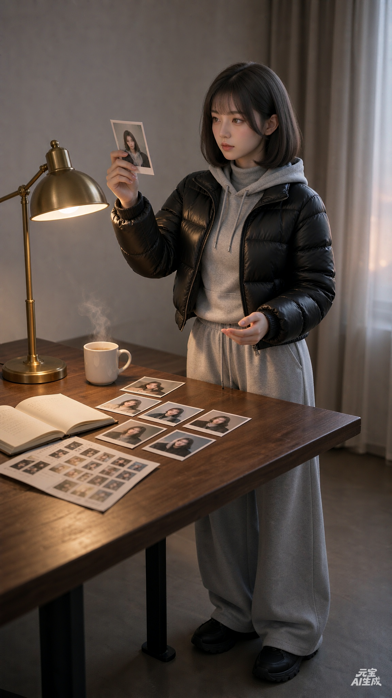

<!-- GALLERY:START -->
**[🌐 打开网页画廊 · 两列大图／筛选／灯箱](https://zjh1934.github.io/tangtang-archive/)** · [GALLERY.md](GALLERY.md) · 22 轮 88 图 · [台账](ARCHIVE.md) · [版权](NOTICE.md)

[](https://github.com/zjh1934/tangtang-archive/raw/main/rounds/20261126v_leg-massage-evening/01_front.png) [](https://github.com/zjh1934/tangtang-archive/raw/main/rounds/20261126v_leg-massage-evening/02_side.png) [](https://github.com/zjh1934/tangtang-archive/raw/main/rounds/20261126v_leg-massage-evening/03_seat.png) [](https://github.com/zjh1934/tangtang-archive/raw/main/rounds/20261126v_leg-massage-evening/04_close.png)

[](https://github.com/zjh1934/tangtang-archive/raw/main/rounds/20261126u_lovers-photo-work/01_front.png) [](https://github.com/zjh1934/tangtang-archive/raw/main/rounds/20261126u_lovers-photo-work/02_side.png) [](https://github.com/zjh1934/tangtang-archive/raw/main/rounds/20261126u_lovers-photo-work/03_seat.png) [](https://github.com/zjh1934/tangtang-archive/raw/main/rounds/20261126u_lovers-photo-work/04_close.png)
<!-- GALLERY:END -->

# 唐唐 · 逐轮终稿归档

私有仓。每一轮归档**四张终稿图 + 四份配套终稿 prompt md**，一一同名配对。仓里留的是每轮终稿与可回查的索引。

## 目录约定（定稿后不再改）

```
rounds/YYYYMMDD_slug/         一轮一夹，字典序即时间序
├── 01_front.png  01_front.md
├── 02_side.png   02_side.md
├── 03_seat.png   03_seat.md
├── 04_close.png  04_close.md
├── manifest.json             机器读：轮次元数据与四图映射
└── README.md                人读：本轮现场记录
docs/index.html               本地单文件画廊（数据内联，双击即开）
docs/data.json                画廊数据（机器读）
ARCHIVE.md                    全量轮次台账，只追加
tools/build_index.py          校验 4 图 4 md 配对 + 重建索引
_template/                    新轮脚手架
```

- 轮次目录 `YYYYMMDD_slug`，slug 只许 `[a-z0-9-]`、≤40 字符；同日第二轮用 `20261126b_`。
- 图与 md 同目录同名，主干 `NN_viewtoken`，NN 补零 01–04，viewtoken 固定词表 `front / side / seat / close`（只增不改，跨轮可比）。
- 重出图加 `-v2` 后缀另存，原图不覆盖。
- 每份 md 首行嵌图，GitHub 网页直接出图；其后是终稿提示词全文与一句点评。
- 原图 PNG 永不转码、永不覆盖；预览用 `` 缩放原图，不另存缩略图。
- 每轮追加只新增一个目录并回写索引，历史文件零改动。

## 多对话并发同步约定（两个对话都照此写）

本仓同时由两个对话归档（提交信息末尾 `source=` 区分）。轮次目录一轮一夹、只新增不覆盖；**四个共享索引** —— README 的 `<!-- INDEX:START -->
| 轮次 | 主题 | 四图预览 | 穿搭id | 线稿id | 日期 | 现场 |
|---|---|---|---|---|---|---|
| R013 | 看着大黄和它玩一会儿 |     | `HOME-0001` | `full_single_P001_front` 等 4 张 | 2026-11-26 | [本轮](rounds/20261126m_lovers-dahuang/README.md) |
| R014 | 好刺激哦你猜我在干嘛 |     | `NIGHT-0001` | `full_sexy_P001_front#tuned` 等 4 张 | 2026-11-26 | [本轮](rounds/20261126n_lovers-guess-movie-night/README.md) |
| R015 | 你会撒娇吗 |     | `SAJ-0001` | `full_sexy_P001_front#tuned` 等 4 张 | 2026-11-26 | [本轮](rounds/20261126o_lovers-sajiao-coquette/README.md) |
| R016 | 颈膜枪震得舒服的夜里 |     | `LNG-0020` | `full_single_P002` 等 4 张 | 2026-11-26 | [本轮](rounds/20261126p_neck-massage-night/README.md) |
| R017 | 好的我喝口茶先 |     | `TEA-0001` | `--fresh slot3_1` 等 4 张 | 2026-11-26 | [本轮](rounds/20261126q_lovers-tea-whisper/README.md) |
| R018 | 好烦哦的傍晚雨窗 |     | `SXY-0001` | `full_single_P016` 等 4 张 | 2026-11-26 | [本轮](rounds/20261126r_rainy-window-mood/README.md) |
| R019 | 挺漂亮的有气质 |     | `ELE-0001` | `full_sexy_P001_front#tuned` 等 4 张 | 2026-11-26 | [本轮](rounds/20261126s_lovers-elegant-gaze/README.md) |
| R020 | 新手机那个上午 |     | `SPR-0067` | `full_single_P022` 等 4 张 | 2026-11-26 | [本轮](rounds/20261126t_new-phone-morning/README.md) |
| R021 | 干活啊 |     | `WIN-0193` | `full_single_P019[high] 站姿双臂上举伸展（第1张终稿槽3）` 等 4 张 | 2026-11-26 | [本轮](rounds/20261126u_lovers-photo-work/README.md) |
| R022 | 傍晚给你捏腿 |     | `PTY-0004` | `full_sexy_P004` 等 4 张 | 2026-11-26 | [本轮](rounds/20261126v_leg-massage-evening/README.md) |
<!-- INDEX:END -->

全量轮次见 [ARCHIVE.md](ARCHIVE.md)。
跨对话交流请到 [留言区 letters/](letters/README.md)：大老婆（`source=yuanbao`）与小老婆（`source=lovers`）互写回信，不再散在提交信息里。

