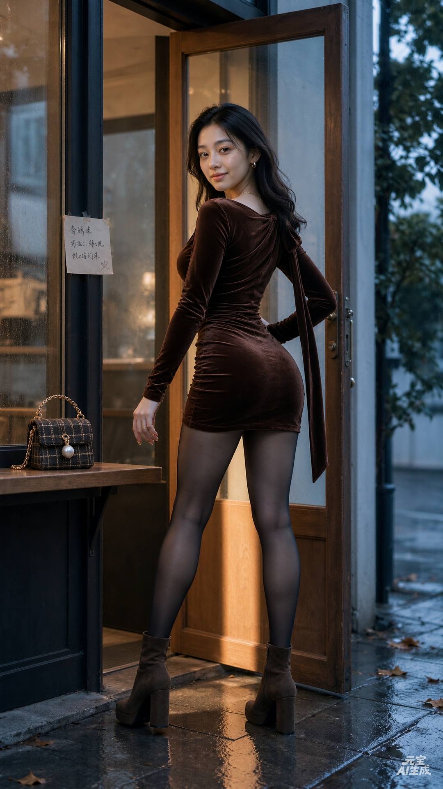

## 终稿提示词

```text
第一张图定穿搭版型配色面料，第二张图定骨相五官，第三张图定本张姿势骨架与机位；脸、衣、姿势由各自底图承担。

9:16 满幅画面，宽 1080 高 1920，人物与道具铺满整幅，四条边即裁切边。

她穿深巧克力棕单肩不对称丝绒迷你连衣裙，斜肩领从左肩斜到右锁骨，右肩头系一枚同色丝绒蝴蝶结、两条细带自然垂到肘侧，仅左臂一整条贴身长袖，左侧腰身抽满斜向细褶、褶路从胸下顺到胯，裙摆一层垂坠丝绒短包臀止于大腿中段；24h 黑色连裤丝袜平口齐腿根匀透贴腿连包到脚趾，脚趾在深棕麂皮粗跟短靴里完整舒展，黑丝在晨光里泛一层细亮；细金锁骨链贴着锁骨，耳垂一粒小珍珠；焦糖棕椭圆甲压一道细金边。蓬松披肩大波浪从头顶松松铺到肩背，发尾带一点外翻的卷，晨光在发脊上走一道亮。一只格纹金链条小方包搁在她身侧门边的窄木台上。

镜头是他的眼睛：他站在街对面刚收了伞，视点实数眼高 1.65 米，与她相隔 2.2 至 2.6 米距离带，隔一条湿石板街平望咖啡店门口。2.4 米这一眼收进去的是她整个人站在半开的木门前回过身的舒展轮廓、单肩丝绒那道斜领线、抽褶腰身到裙摆的整段曲线、黑丝两条腿从裙摆下缘一路连进短靴、门边窄台上那只小包，以及她身后玻璃上贴着的一张手写小纸片；湿石板映一小片她的倒影，他收伞时滴下的水把那片倒影轻轻搅开一圈。丝绒细褶的针脚、珍珠耳垂的亮、甲面那道金边留给走近那几张看清。

一位成年人物、一具身体轮廓、胸大腰细腿长靠合身剪裁写实呈现、左右各一只手臂各五根手指、两只脚各自连续。全画仅此一双手，每只手全篇只出现一次、只做一个动作：右手从右肩经肘向门框抬起、经腕搭住，指尖一条连续链完整可见，唯一落点是五指轻按在木门边沿把门推住半开；左手从左肩经肘贴身侧自然垂下、经腕放松，指尖一条连续链沿身体左侧完整可见，唯一落点是五指虚拢在裙摆外侧丝绒上。指缝可数，两臂各从肩连续到指尖。

顶胯回眸站姿，左胯朝街这侧前送半寸、肩线朝街这侧拧开约三十度、髋线仍朝门内，重心落在右腿、左腿脚尖轻点在湿石板上，脊线从后颈经腰窝到膝拉出一道舒展的 S 形。低眼从肩上抬起来，瞳心慢半拍才对准他，唇角挑完往门内那张纸片扬一下下巴，像早算准他会站在那儿看；这个眼神长出一个可见动作：按在门沿那只手的食指在木纹上轻点一下，点完指腹压着把门再推大一寸，门缝里带出来的一缕风掀起一缕发扫过裸露的右肩锁骨窝又落下。

清晨冷蓝的天光占七成打底，从街道右上斜进来；门内暖黄收成门缝一道竖光刃，只切斜领线、腰窝、黑丝左腿外沿三处，她半个鞋尖正踩进那道光里；街角梧桐叶还挂着夜雨。写实摄影质感，35mm，f/8 全域清晰，1/250，手持微倾 2 度，丝绒细褶的绒光与黑丝细密纹理都清楚。
```

## 一句点评

隔街回身，门缝那道暖光切在斜领与腰窝上，开头压得住。
