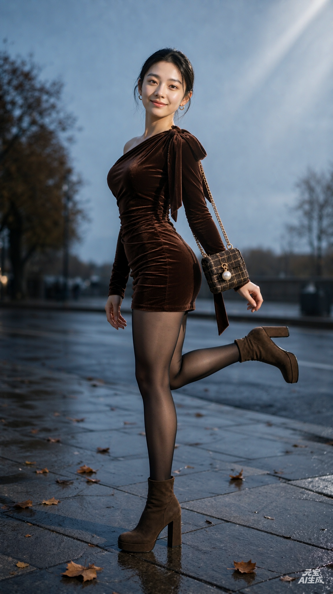

## 终稿提示词

```text
第一张图定穿搭版型配色面料，第二张图定骨相五官，第三张图定本张姿势骨架与机位；脸、衣、姿势由各自底图承担。

9:16 满幅画面，宽 1080 高 1920，人物与道具铺满整幅，四条边即裁切边。

她穿深巧克力棕单肩不对称丝绒迷你连衣裙，斜肩领从左肩斜到右锁骨，右肩头系一枚同色丝绒蝴蝶结、两条细带自然垂到肘侧，仅左臂一整条贴身长袖，左侧腰身抽满斜向细褶、褶路从胸下顺到胯，裙摆一层垂坠丝绒短包臀止于大腿中段；24h 黑色连裤丝袜平口齐腿根匀透贴腿连包到脚趾，两只脚都穿深棕麂皮粗跟短靴、脚趾在靴里完整舒展，后抬那只脚的脚背在靴里绷直，黑丝在晨光里泛一层细亮；细金锁骨链贴着锁骨，耳垂一粒小珍珠；焦糖棕椭圆甲压一道细金边。蓬松披肩大波浪从头顶松松铺到肩背，发尾带一点外翻的卷，晨光在发脊上走一道亮。一只格纹金链条小方包挂在她右腕上随动作轻轻荡开。

镜头是他的眼睛：他跟在后面半步，视点实数眼高 1.55 米，与她相隔 1.2 至 1.5 米距离带，从她左后侧略仰看她往前走又回过头。这一眼看得见她身体完全侧对镜头、右肩朝镜头这侧、左肩朝行进方向，只把脸转回来正对他；单肩丝绒斜领线被走动带出的细褶、抽褶腰身随肩髋错开的一小片暗、黑丝从腿根到后抬那只脚的短靴连成一道不断线的长斜、大波浪发尾在回眸时甩出的一道弧、右腕那只小包荡开的金链都在；画面下缘压到她支撑脚前掌碾过湿石板的一道湿痕、脚跟离地，与一小片落叶同框。

一位成年人物、一具身体轮廓、胸大腰细腿长靠合身剪裁写实呈现、左右各一只手臂各五根手指、两只脚各自连续。全画仅此一双手，每只手全篇只出现一次、只做一个动作：右手从右肩经肘向后扬起、腕外翻、经腕放松，指尖一条连续链沿画面右侧完整可见，唯一落点是五指虚拢着格纹小包的金链把包带在腕上；左手从左肩经肘贴身前向下、经腕轻收，指尖一条连续链沿身体前侧完整可见，唯一落点是五指轻拂过自己裙摆外侧的丝绒褶。指缝可数，两臂各从肩连续到指尖。

侧身往前走，胯与脚朝行进方向，肩与脸朝他这侧拧回约三十度，左腿支撑、前掌碾住湿石板、脚跟离地，右腿向身后斜下方抬起约三十五度、膝压低、脚背在短靴里绷到顶，腰窝顺势下压一寸，脊线从后颈经腰窝到后抬的膝拉出一道舒展的 S 形。下巴再压低、眼珠先转过来，肩和脸晚半拍跟上，右眼高光偏上偏内、左眼一道细月牙柔反光，挑高那边唇角等视线对上他才慢慢提起，笑里带一句责备，像早算准他会加快脚步；这个眼神长出一个可见动作：右腕金链被甩成一道扁椭圆、让腕骨刹住，链尾搭上右胯丝绒褶停住，包面翻一次亮角，肩头两条丝绒飘带随走动收拢贴身；靠镜头那缕发尾被回头带起，掠过挑高的唇角再落到斜领线上，拂裙摆的左手五指位置不动。

清晨冷蓝的天光从街道右上斜进来，勾出斜领线、后抬小腿外沿与发尾的亮边，黑丝沿胫骨走一道不断线的细亮，沿街橱窗的暖光压暗一档、湿石板与落叶压成柔软的冷灰；街角梧桐叶还挂着夜雨。写实摄影质感，50mm，1/250，手持微倾 2 度，丝绒细褶的绒光、黑丝细密纹理、两只短靴的麂皮与甲面金边都清楚。
```

## 一句点评

侧身走又回头，两只短靴齐了，黑丝长斜撑住；重出后从摆拍改成抓拍。
