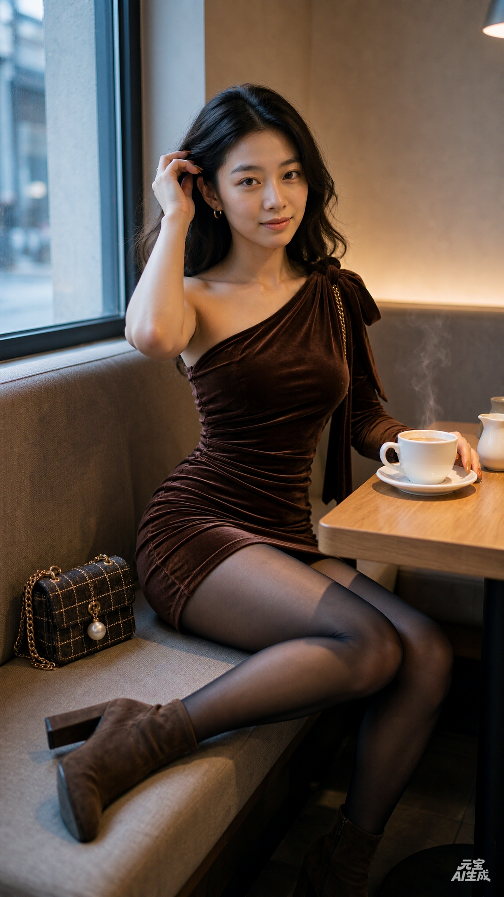

## 终稿提示词

```text
第一张图定穿搭版型配色面料，第二张图定骨相五官，第三张图定本张姿势骨架与机位；脸、衣、姿势由各自底图承担。

9:16 满幅画面，宽 1080 高 1920，人物与道具铺满整幅，四条边即裁切边。

她穿深巧克力棕单肩不对称丝绒迷你连衣裙，斜肩领从左肩斜到右锁骨，右肩头系一枚同色丝绒蝴蝶结、两条细带自然垂到肘侧，仅左臂一整条贴身长袖，左侧腰身抽满斜向细褶、褶路从胸下顺到胯，裙摆一层垂坠丝绒短包臀止于大腿中段；24h 黑色连裤丝袜平口齐腿根匀透贴腿连包到脚趾，脚趾在深棕麂皮粗跟短靴里完整舒展，黑丝在窗光里泛一层细亮；细金锁骨链贴着锁骨，耳垂一粒小珍珠；焦糖棕椭圆甲压一道细金边。蓬松披肩大波浪从头顶松松铺到肩背，发尾带一点外翻的卷，窗光在发脊上走一道亮。一只格纹金链条小方包搁在卡座她身侧的软垫上，桌上一只白瓷杯与一只小奶罐。

镜头是他的眼睛：他刚在她对面坐下，视点实数眼高 1.1 米，与她相隔 0.8 至 1.0 米距离带，隔着一张小圆桌略俯看她靠在软垫里侧坐的样子。这一眼看得见她整个人斜倚在卡座软垫上的舒展轮廓、单肩丝绒那道斜领线、抽褶腰身被坐姿压出的软褶、黑丝两条腿一屈一伸从裙摆下缘连进短靴、软垫上那只小包、白瓷杯口一小圈热气，以及她抬手把一缕大波浪别到耳后时整条手臂的线；丝绒细褶的绒光、珍珠耳垂的亮、甲面那道金边在这一眼都清楚。

一位成年人物、一具身体轮廓、胸大腰细腿长靠合身剪裁写实呈现、左右各一只手臂各五根手指、两只脚各自连续。全画仅此一双手，每只手全篇只出现一次、只做一个动作：右手从右肩经肘向上弯到耳侧、肘外开留一线腋下空、经腕放松，指尖一条连续链完整可见，唯一落点是五指拢住耳后那一缕大波浪把发别到耳后、指尖在耳垂珍珠上多停半拍；左手从左肩经肘贴身侧向桌面伸、经腕搭下，指尖一条连续链沿身体左侧完整可见，唯一落点是五指轻搭在小圆桌沿白瓷杯旁。指缝可数，两臂各从肩连续到指尖。

侧坐在卡座软垫里，一腿屈起脚尖点在座面、一腿斜伸到桌下脚背微绷，胯随侧坐朝他这侧微顶、屈起那侧膝尖正对他，肩背靠着软垫、上身略朝他这侧转，脊线从后颈经腰窝到屈起的膝拉出一道松下来的 S 形。视线比他落座早半秒到，先盯杯口那一圈气，再沿杯沿一线抬眼，抬到最后眼尾挑一毫米，右眼高光偏上偏内、左眼一道细月牙柔反光，唇角往她右侧歪出浅窝就不收、下巴压低一线，像已经审完他那句豆浆；这个眼神长出一个可见动作：别到耳后那只手的指尖在珍珠上停完那半拍才落下，搭在桌沿的左手五指位置不动。

窗外冷蓝晨光从左斜进来，店内暖黄顶灯从她右后铺出来，只勾斜领线、抽褶腰窝、黑丝小腿外沿三处，白瓷杯口那圈热气刚升到下颌高、在冷蓝里成一缕清晰暖白，杯壁带一层细水痕；桌面木纹与软垫绒面压成柔软的暖灰。写实摄影质感，50mm，1/250，手持微倾 2 度，丝绒细褶的绒光、黑丝细密纹理与发丝层次都清楚。
```

## 一句点评

卡座侧坐别发，杯口热气刚升到下颌，四张里最对他说话的一格。
