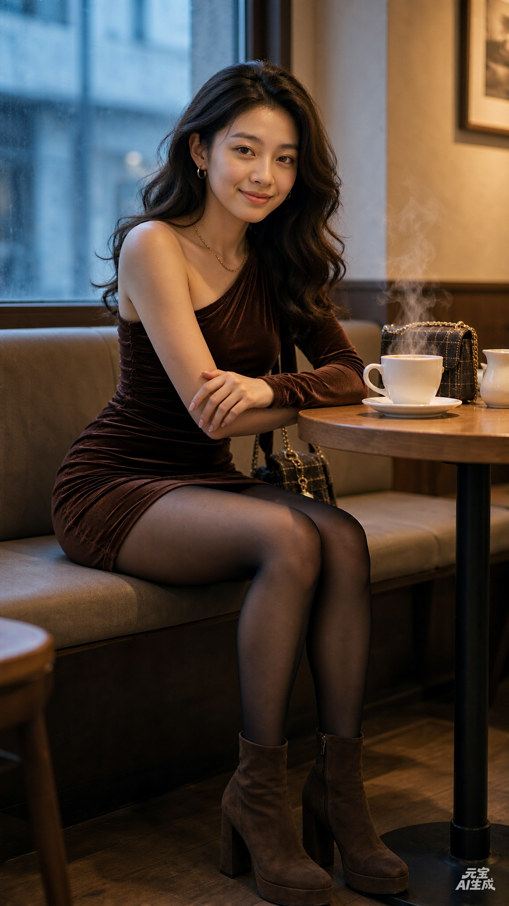

## 终稿提示词

```text
第一张图定穿搭版型配色面料，第二张图定骨相五官，第三张图定本张姿势骨架与机位；脸、衣、姿势由各自底图承担。

9:16 满幅画面，宽 1080 高 1920，人物与道具铺满整幅，四条边即裁切边。

她穿深巧克力棕单肩不对称丝绒迷你连衣裙，斜肩领从左肩斜到右锁骨，右肩头系一枚同色丝绒蝴蝶结、两条细带分开垂着、长的一条过肘、随俯身先晃到桌面上方，仅左臂一整条贴身长袖，左侧腰身抽满斜向细褶、褶路从胸下顺到胯，裙摆一层垂坠丝绒短包臀止于大腿中段；24h 黑色连裤丝袜平口齐腿根匀透贴腿连包到脚趾，脚趾在深棕麂皮粗跟短靴里完整舒展，黑丝在窗光里泛一层细亮；细金锁骨链贴着锁骨，耳垂一粒小珍珠；焦糖棕椭圆甲压一道细金边。蓬松披肩大波浪从头顶松松铺到肩背，发尾带一点外翻的卷，窗光在发脊上走一道亮。一只格纹金链条小方包搁在画面一角软垫上，桌上一只白瓷杯与一只小奶罐，白瓷杯往左让开半个身位。

镜头是他的眼睛：他坐在原位没动，视点实数眼高 1.05 米、略仰一点，与她相隔 0.35 至 0.5 米距离带，她髋仍留在卡座软垫上、只让胸以上朝小圆桌这侧折下来凑近，他这一眼正对着她逼近的脸与肩。0.4 米这一眼看得见她斜领线在俯身时压出的一小片丝绒暗褶、右肩那枚蝴蝶结两条飘带分开晃到桌面上方的一截、细金锁骨链随前倾滑到锁骨窝里、耳垂那粒珍珠的亮、大波浪发梢擦过桌沿，以及她撑在桌沿那只手的甲面金边；画面下缘只留裙摆和一小截腿，大半画幅让给她凑近的上半身。

一位成年人物、一具身体轮廓、胸大腰细腿长靠合身剪裁写实呈现、左右各一只手臂各五根手指、两只脚各自连续。全画仅此一双手，每只手全篇只出现一次、只做一个动作：右手从右肩经肘向桌沿撑下、肘微屈、掌根压实、经腕压平，指尖一条连续链沿画面右侧完整可见，唯一落点是五指按实在小圆桌木沿上把折下来的上身撑住；左手从左肩经肘抬到身前、经腕放松，指尖一条连续链沿身体前侧完整可见，唯一落点是五指虚拢轻扶在自己左前臂中段，把这句话拢住。指缝可数，两臂各从肩连续到指尖。

髋稳稳留在软垫上，只让胸以上朝他这侧折下来，肩线压低、右肩比左肩再往前送一点、头随肩微偏成说话的角度，像怕隔壁桌听见，下巴往撑桌那侧再压半寸、眼珠先不抬，等视线落稳了才从眉骨下顶上来正对他，脊线从后颈经肩背到撑桌的手拉出一道朝他柔弯的斜线，腰窝轻陷，像正说到那个字。右眼高光偏上偏内、左眼一道细月牙柔反光，唇角挑完后下唇轻含一瞬、眼没躲；这个眼神长出一个可见动作：虚拢在左前臂中段那只手的指尖轻轻收一下，撑桌的右手五指位置不动。

窗外冷蓝晨光从左斜进来，店内暖黄顶灯从她右后铺出来，只勾颧骨、斜领线、锁骨窝里那截细金链三处；白瓷杯口一缕看得见的热气竖着升起，正从她挑起的唇角与他视线之间穿过、在他视线高度散开半透明一层，桌面木纹与发丝压成柔软的暖灰。写实摄影质感，50mm，1/250，机位稳住不动，丝绒细褶的绒光、甲面金边与珍珠耳垂都清楚。
```

## 一句点评

俯身凑近只讲给他听，热气挡在两人中间收尾；重出后骨架换成柔弯侧撑。
