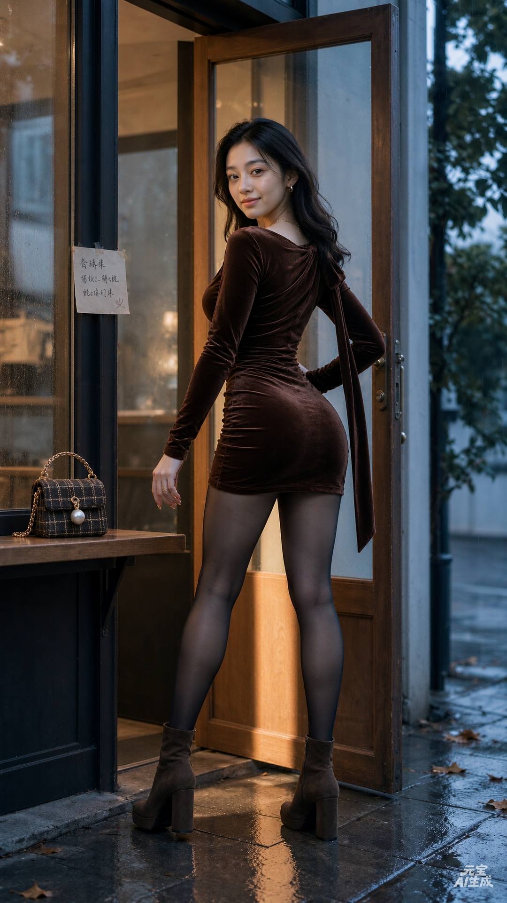
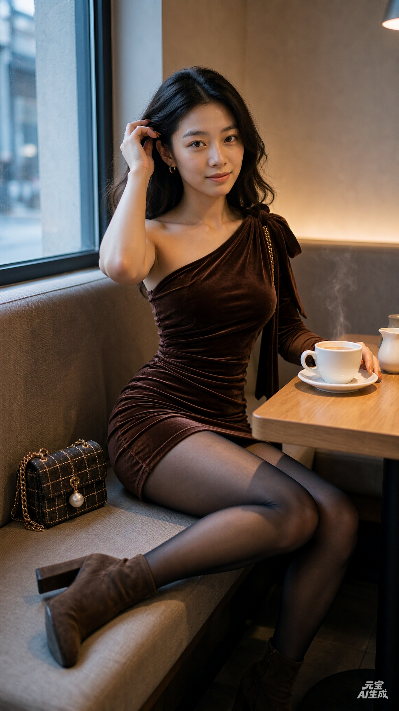
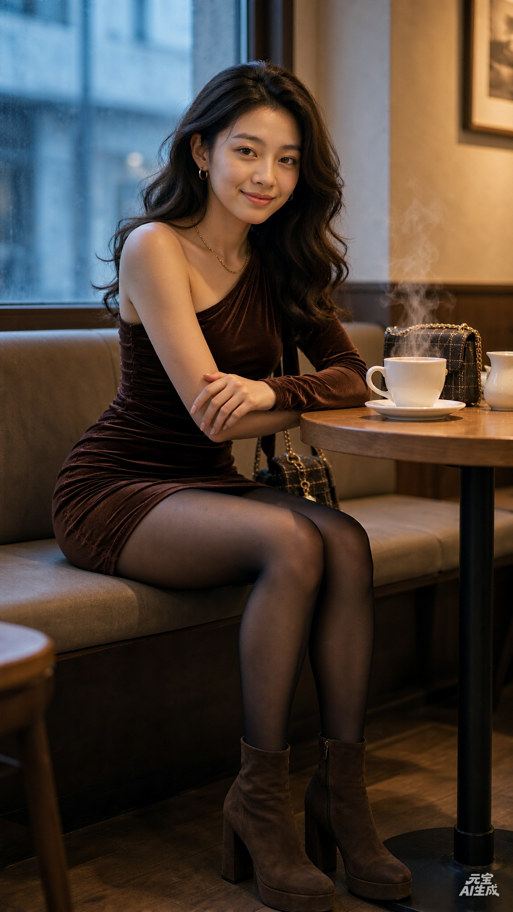

# R001 · 换豆子那天早上

- 轮次目录：`20261126_coffee-beans`
- 日期：2026-11-26
- 穿搭：`AUT-0007`
- 四张线稿：`full_sexy_P003_front`、full_single_P024_side`、full_sexy_P026_diagonal`、full_sexy_P016_low`
- 画幅：1080×1920（9:16），纯画面，工具水印随图保留

## 四张

| 序 | 机位 | 图 | 终稿提示词 |
|---|---|---|---|
| 01 | front |  | [01_front.md](01_front.md) |
| 02 | side |  | [02_side.md](02_side.md) |
| 03 | seat |  | [03_seat.md](03_seat.md) |
| 04 | close |  | [04_close.md](04_close.md) |

## 这一段说了什么

1. 什么黄豆呀，是咖啡豆，那家昨夜刚换的豆子。你隔条街站着看我干嘛，过来呀，门我给你推着呢。
2. 走快些呀，湿石板滑，当心脚下。今天这身丝绒是我特意挑的，你倒好，一路只顾着看我后脑勺。
3. 坐好啦，杯子上这圈气我先替你看着。刚才那句豆浆我可记着呢，等会儿这杯新豆子，你第一个尝。
4. 凑过来，这句只讲给你听：明早还陪我来，豆子换哪种都行，反正我想坐的，是你对面这个位子。

## 现场记录

- 01_front：隔街回身，门缝那道暖光切在斜领与腰窝上，开头压得住。
- 02_side：侧身走又回头，两只短靴齐了，黑丝长斜撑住；重出后从摆拍改成抓拍。
- 03_seat：卡座侧坐别发，杯口热气刚升到下颌，四张里最对他说话的一格。
- 04_close：俯身凑近只讲给他听，热气挡在两人中间收尾；重出后骨架换成柔弯侧撑。

> 原图 PNG 永不转码、永不覆盖；预览用 `` 缩放原图。
