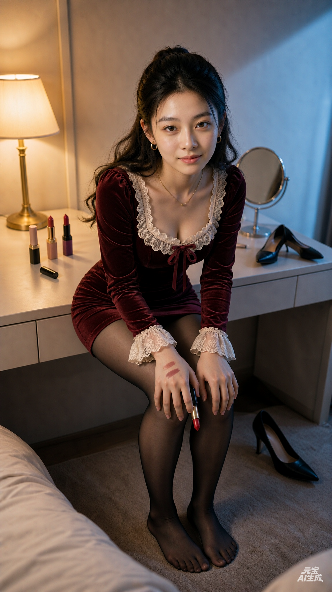

## 终稿提示词

```text
第一张图定穿搭版型配色面料，第二张图定骨相五官，第三张图定本张姿势骨架与机位；脸、衣、姿势由各自底图承担。

9:16 满幅画面，宽 1080 高 1920，人物与道具铺满整幅，四条边即裁切边。

她穿深酒红丝绒方领长袖包臀迷你连衣裙，米白蕾丝花边沿方领走一圈、领口正中一枚同色丝绒小蝴蝶结垂两条细带，泡泡肩、两条贴身长袖、两只袖口各一圈米白蕾丝喇叭边，胸下收腰压出横向细褶，裙摆一层垂坠丝绒短包臀止于大腿中段；24h 黑色连裤丝袜平口齐腿根匀透贴腿连包到脚趾，两只脚是黑丝包住的赤足、脚趾圆润完整露出来；酒红椭圆甲压一道细金边，耳垂一粒小珍珠，细金锁骨链贴着锁骨窝；半扎发：上半束起在头顶松松挽一个小髻、下半大波浪披到锁骨与肩背，后颈露出来，几缕碎发贴着颈侧。梳妆台上一盏暖黄台灯、一面小圆镜、三支口红并排立着——豆沙裸粉、正红、莓紫，正红那支旋开膏体朝上；一只脱下的黑色高跟鞋随手扣在台面、鞋尖朝床；她右手背上并排三道短试色痕，豆沙、正红、莓紫各一道。

镜头是他的眼睛：他坐在床沿刚把外套搭到膝上，视点实数眼高 1.15 米，与她相隔 1.8 至 2.1 米距离带，隔半间卧室平望梳妆台前。这一眼看得见她整个人从台前转过来、上身朝他前倾双手按在自己两膝上的舒展轮廓、方领那圈米白蕾丝在暖灯下的一线亮、收腰细褶到包臀裙摆的整段曲线、黑丝两条腿从裙摆下缘连到赤足的脚趾、台面上三支口红与旋开的那支膏体、扣在台面那只鞋尖朝床的高跟鞋、小圆镜里映出的一小片她的肩；右手背三道试色痕在这一眼已经能认出颜色，甲面金边与珍珠耳垂的亮留给走近那几张看清。最亮只给右手背三道痕与正红膏头，冷蓝把她身后半幅裙摆压暗一档。

一位成年人物、一具身体轮廓、胸大腰细腿长靠合身剪裁写实呈现、左右各一只手臂各五根手指、两只脚各自连续。全画仅此一双手，每只手全篇只出现一次、只做一个动作：右手从右肩经肘向台面一侧垂下、经腕轻收，指尖一条连续链沿身体右侧完整可见，唯一落点是五指虚拢捏着那支旋开膏体的正红口红、手背朝他、三道试色痕清楚；左手从左肩经肘向下按、经腕压平，指尖一条连续链沿身体左侧完整可见，唯一落点是五指按实在自己左膝上把前倾的上身撑住。指缝可数，两臂各从肩连续到指尖。

站姿前倾回身，前倾比自然扶膝再深一寸，两脚踩在绒毯上、重心落在右腿，肩线朝他这侧转开、髋线仍朝梳妆台，脊线从后颈经腰窝到膝拉出一道舒展的 S 形。下巴压着不动、眼珠先翻上来找到他，找到了下巴才一点点抬，瞳心在他脸上停半拍才亮起来，唇角往右边歪出一点浅窝、晚半拍再慢慢松，像刚把「只会探店」这句记进小本子；这个眼神长出一个可见动作：捏着口红那只手的拇指在管身轻转一下、把膏体旋出一小截就停住，膏头朝他点一下像点名，后颈一缕碎发往肩前滑半寸，按在膝上的左手五指位置不动。

暖黄台灯从她左前铺出来，只勾方领蕾丝、收腰细褶、黑丝小腿外沿三处；窗边冷蓝夜光从画面右上斜进来压住半间卧室，绒毯与木台面收成柔软的暖灰。写实摄影质感，35mm，1/250，手持微倾 2 度，丝绒绒光、蕾丝孔隙与黑丝细密纹理都清楚。
```

## 一句点评

隔半间房前倾回身，右手背三道色痕与旋开的正红膏头吃到最亮
