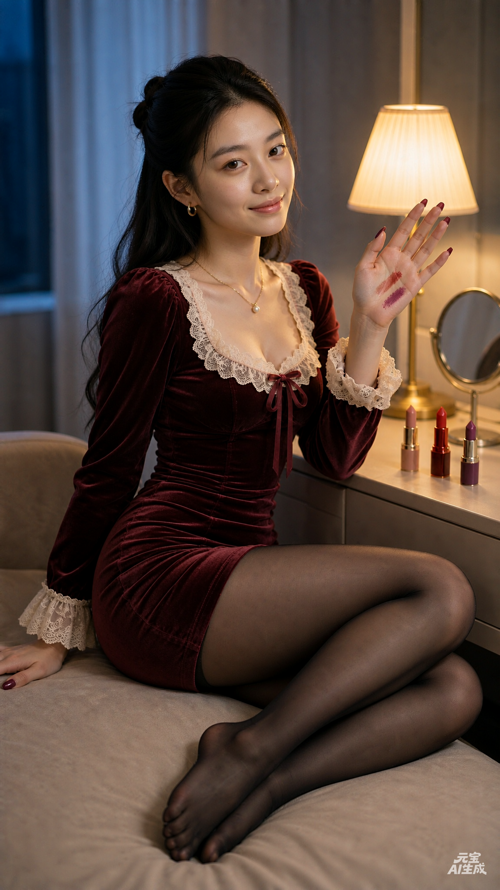

## 终稿提示词

```text
第一张图定穿搭版型配色面料，第二张图定骨相五官，第三张图定本张姿势骨架与机位；脸、衣、姿势由各自底图承担。

9:16 满幅画面，宽 1080 高 1920，人物与道具铺满整幅，四条边即裁切边。

她穿深酒红丝绒方领长袖包臀迷你连衣裙，米白蕾丝花边沿方领走一圈、领口正中一枚同色丝绒小蝴蝶结垂两条细带，泡泡肩、两条贴身长袖、两只袖口各一圈米白蕾丝喇叭边，胸下收腰压出横向细褶，裙摆一层垂坠丝绒短包臀止于大腿中段；24h 黑色连裤丝袜平口齐腿根匀透贴腿连包到脚趾，两只脚是黑丝包住的赤足、脚趾圆润完整露出来；酒红椭圆甲压一道细金边，耳垂一粒小珍珠，细金锁骨链贴着锁骨窝；半扎发：上半束起在头顶松松挽一个小髻、下半大波浪披到锁骨与肩背，后颈露出来，几缕碎发贴着颈侧。梳妆台上一盏暖黄台灯、一面小圆镜、三支口红并排立着——豆沙裸粉、正红、莓紫，正红那支旋开膏体朝上；她右手背上并排三道短试色痕，豆沙、正红、莓紫各一道。

镜头是他的眼睛：他侧过身靠着床头，视点实数眼高 1.05 米，与她相隔 1.0 至 1.3 米距离带，从她左侧略平看她侧坐在床沿、两条腿斜向画面右侧。这一眼看得见她整个人侧坐的舒展轮廓、方领那圈米白蕾丝与领口小蝴蝶结、收腰细褶被坐姿压出的软褶、黑丝两条腿一叠一伸从裙摆下缘连到赤足脚趾、她举到耳侧略高过眉的右手背与上面三道试色痕、身后台面上三支口红，以及她撑在软垫上的那只手；丝绒绒光、蕾丝袖口、甲面金边在这一眼都清楚。三道痕定格在刚转过三分之二那一瞬：莓紫吃主光带一道细高光、正红转过光成哑深红、豆沙没进阴影只余一线暖边。

一位成年人物、一具身体轮廓、胸大腰细腿长靠合身剪裁写实呈现、左右各一只手臂各五根手指、两只脚各自连续。全画仅此一双手，每只手全篇只出现一次、只做一个动作：右手从右肩经肘向上举到耳侧略高过眉、腕外翻让手背正对镜头、经腕放松，指尖一条连续链沿画面右侧完整可见，唯一落点是五指舒展把手背三道试色痕像递签单一样朝他胸口往前送两厘米、指尖朝他胸口；左手从左肩经肘向身侧软垫撑下、经腕压平，指尖一条连续链沿身体左侧完整可见，唯一落点是五指按实在床沿丝绒软垫上把侧坐的上身撑住。指缝可数，两臂各从肩连续到指尖。

侧坐在床沿，两条腿斜向画面右侧、上腿叠在下腿上、脚背微绷、赤足脚趾在黑丝里圆润舒展，肩往后沉、胯往他这侧顶半寸、后腰离床沿一拳，斜腿线与高举手背拉成一个长三角，脊线从后颈经腰窝到斜伸的膝拉出一道舒展的 S 形。低眼从举起的手背后头抬起来看他，右眼高光偏上偏内、左眼一道细月牙柔反光，眼皮压低一线，唇角只挑一侧、下唇含住一毫没笑开，像在等他伸手点哪一道；这个眼神长出一个可见动作：举起那只手的手腕慢慢转到三分之二停住，让三道色痕在台灯光里依次亮一遍，撑在软垫上的左手唯食指指尖在绒面上轻点一下、像替他数三道，五指位置不动。

暖黄台灯从她右后铺出来，只勾举起的右手背、方领蕾丝、黑丝小腿外沿三处，莓紫那道膏体在光里泛一层细湿亮；窗边冷蓝夜光从画面左上斜进来压住床头，软垫与绒毯收成柔软的暖灰。写实摄影质感，50mm，1/250，手持微倾 2 度，丝绒绒光、蕾丝孔隙、手背上三道膏体光泽都清楚。
```

## 一句点评

侧坐床沿把手背递到他眼前，三道色痕刚转过三分之二那一瞬
