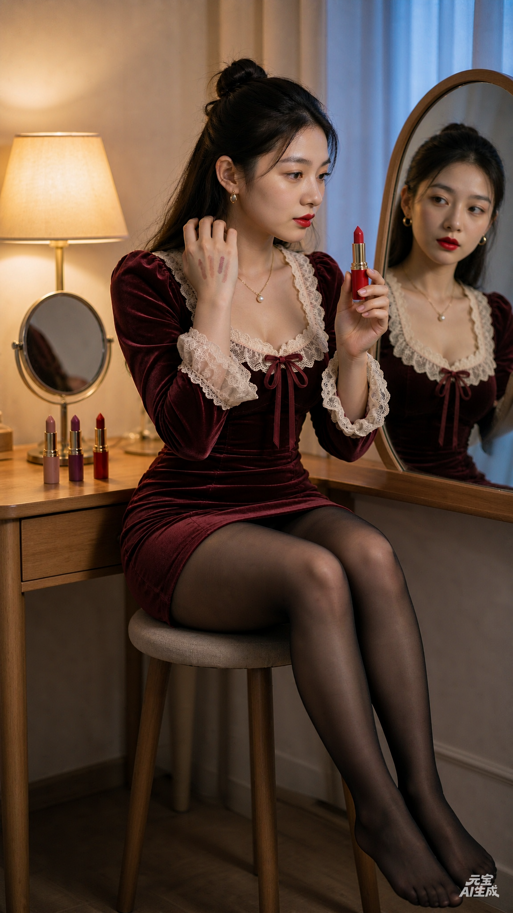

## 终稿提示词

```text
第一张图定穿搭版型配色面料，第二张图定骨相五官，第三张图定本张姿势骨架与机位；脸、衣、姿势由各自底图承担。

9:16 满幅画面，宽 1080 高 1920，人物与道具铺满整幅，四条边即裁切边。

她穿深酒红丝绒方领长袖包臀迷你连衣裙，米白蕾丝花边沿方领走一圈、领口正中一枚同色丝绒小蝴蝶结垂两条细带，泡泡肩、两条贴身长袖、两只袖口各一圈米白蕾丝喇叭边，胸下收腰压出横向细褶，裙摆一层垂坠丝绒短包臀止于大腿中段；24h 黑色连裤丝袜平口齐腿根匀透贴腿连包到脚趾，两只脚是黑丝包住的赤足、脚趾圆润完整露出来；酒红椭圆甲压一道细金边，耳垂一粒小珍珠，细金锁骨链贴着锁骨窝；半扎发：上半束起在头顶松松挽一个小髻、下半大波浪披到锁骨与肩背，后颈露出来，几缕碎发贴着颈侧。梳妆台上一盏暖黄台灯、一面小圆镜、三支口红并排立着——豆沙裸粉与莓紫两支盖着盖、正红那支旋开膏体朝上；镜中那半张唇已经带上正红色；她右手背上并排三道短试色痕，豆沙、正红、莓紫各一道。

镜头是他的眼睛：他走到她右肩后 0.7 至 0.9 米站定，视点实数眼高 1.4 米、俯下去看，画面里只给她后颈、右肩背与半边侧脸轮廓，正脸全交给台面那面小圆镜。这一眼先吃米白蕾丝沿后颈走到右肩那一道亮、半扎发小髻与后颈几缕碎发、右肩背随上体扭转拉出的一道斜线，再落到小圆镜：镜里她半张带正红的唇、领口蝴蝶结、镜面边沿多映进一点他自己的肩影；台面上两支盖着盖的口红与旋开的那支膏体、她捏着口红那只手的手背三道试色痕都在；一腿屈起脚尖点在绒毯上、一腿收回，黑丝从裙摆下缘连到赤足脚趾的斜线从画面左下穿出去。

一位成年人物、一具身体轮廓、胸大腰细腿长靠合身剪裁写实呈现、左右各一只手臂各五根手指、两只脚各自连续。全画仅此一双手，每只手全篇只出现一次、只做一个动作：右手从右肩经肘向前抬到小圆镜前、经腕轻转，指尖一条连续链沿画面右侧完整可见，唯一落点是五指虚拢捏着那支旋开膏体的正红口红、膏体朝镜面、手背三道试色痕朝他，膏体尖由腕带着朝镜里他的眼睛虚点一下；左手从左肩经肘向上弯到颈侧、肘往下沉、腕内扣、米白喇叭袖口堆在肘弯下，指尖一条连续链沿身体左侧完整可见，唯一落点是食中二指把耳前那缕碎发往耳后压半寸、压完顺颈侧往下滑一寸停住、颈侧压出一小道浅凹。指缝可数，两臂各从肩连续到指尖。

坐在台前小圆凳上，一腿屈起、一腿收回，肩线朝镜面偏 15 度、后颈与左耳廓完整朝他，上体朝镜面扭转，脊线从后颈经腰窝到屈起的膝拉出一道松下来的 S 形。低眼先被镜里他的肩影顿住半秒、睫毛压一下，再沿镜沿一线抬起来找他，右眼高光偏上偏内、左眼一道细月牙柔反光，唇角往右边歪出浅窝就不收、下巴压低一线，像已经替他把三支都判过了；这个眼神长出一个可见动作：捏着口红那只手的拇指在管身轻转一下、把膏体又旋出一小截，停在颈侧的左手五指位置不动。

暖黄台灯从镜面左前铺出来，只勾后颈蕾丝、停在颈侧的四个指节、屈起那侧小腿外沿三处，小圆镜把那一圈暖光反到她下颌；窗边冷蓝夜光从画面右上斜进来压住台面其余部分，木纹与绒毯收成柔软的暖灰。写实摄影质感，50mm，1/250，手持微倾 2 度，丝绒绒光、蕾丝孔隙、镜里那半张带正红的唇都清楚。
```

## 一句点评

侧后俯看重出，一腿屈一腿收，正脸交给镜里那半张带正红的唇
