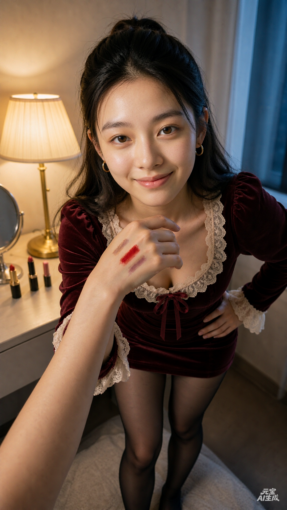

## 终稿提示词

```text
第一张图定穿搭版型配色面料，第二张图定骨相五官，第三张图定本张姿势骨架与机位；脸、衣、姿势由各自底图承担。

9:16 满幅画面，宽 1080 高 1920，人物与道具铺满整幅，四条边即裁切边。

她穿深酒红丝绒方领长袖包臀迷你连衣裙，米白蕾丝沿方领走一圈、领口一枚同色丝绒小蝴蝶结，泡泡肩、两条贴身长袖、袖口各一圈米白蕾丝喇叭边，胸下收腰细褶、裙摆一层垂坠丝绒短包臀止于大腿中段；24h 黑色连裤丝袜平口齐腿根匀透贴腿连包到脚趾，两只脚是黑丝包住的赤足、脚趾圆润完整露出来；酒红椭圆甲压一道细金边，耳垂一粒小珍珠；半扎发，上半束起在头顶松松挽一个小髻、下半大波浪披到锁骨与肩背，后颈露出来。梳妆台上一盏暖黄台灯、一面小圆镜、三支口红并排立着，正红那支旋开膏体朝上；她右手背上三道短试色痕：正红最宽最长、压在手背最高棱上，豆沙与莓紫往小指侧依次收短。

镜头是他的眼睛：他走到她面前刚站定，视点实数眼高 1.0 米、略仰一点，与她相隔 0.35 至 0.5 米距离带，她从台前小圆凳上朝他前倾凑过来、仰起脸迎他。这一眼大半画幅让给她凑近的脸与举到锁骨前的手背：方领那圈米白蕾丝在前倾里压出一小片暗、领口小蝴蝶结两条细带垂下来一截、耳垂那粒珍珠的亮、半扎发几缕碎发擦过颈侧，以及右手举到锁骨前那片手背上三道试色痕——正红吃台灯主光泛一层细湿亮、豆沙与莓紫在小指侧各余一线暖边；裙摆与黑丝腿收在画面下缘软毯那一小片里。

一位成年人物、一具身体轮廓、胸大腰细腿长靠合身剪裁写实呈现、左右各一只手臂各五根手指、两只脚各自连续。全画仅此一双手，每只手全篇只出现一次、只做一个动作：右手从右肩经肘抬到锁骨前、腕外翻让手背正对镜头、经腕放松，指尖一条连续链沿画面右侧完整可见，唯一落点是五指舒展把三道试色痕举到他眼前；左手从左肩经肘向身侧弯回、经腕轻收，指尖一条连续链沿身体左侧完整可见，唯一落点是五指轻扶在自己左侧腰窝上把前倾的上身稳住。两臂一高一低错开、互不遮挡，指缝可数，两臂各从肩连续到指尖。

上身朝他这侧前倾、后颈露出来、下巴略抬，脊线从后颈经肩背到扶腰的手拉出一道柔弯的斜线，腰窝轻陷，重心稳稳落在小圆凳上。低眼从眉骨下抬起来正对他，右眼高光偏上偏内、左眼一道细月牙柔反光，唇角挑完往抿住的方向收一点像忍笑、眼没躲，像正等他伸手点哪一道；这个眼神长出一个可见动作：举着手背那只手腕轻轻转三分之二停住，让三道色痕在台灯光里依次亮一遍，扶在腰窝的左手五指位置不动。

暖黄台灯从她左前铺出来，只勾颧骨、方领蕾丝、举起的右手背三处，正红那道膏体在近景里泛一层细湿亮；窗边冷蓝夜光从画面右上斜进来压住背景，台面木纹与发丝收成柔软的暖灰。写实摄影质感，50mm，1/250，机位稳住不动，丝绒绒光、蕾丝孔隙与珍珠耳垂都清楚。
```

## 一句点评

凑近递手背收尾，正红最宽最长，左手扶腰窝，四张同一盏灯
