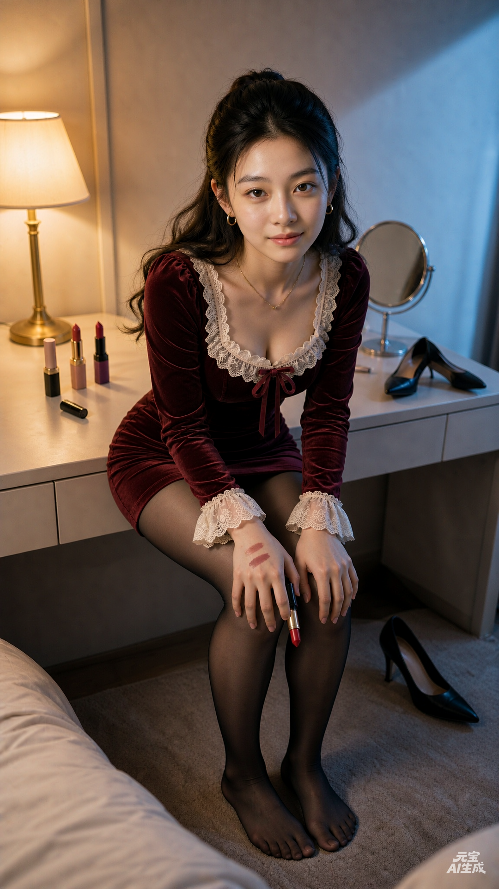
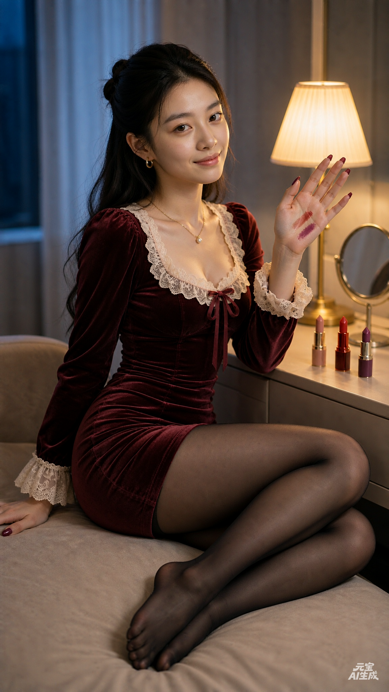
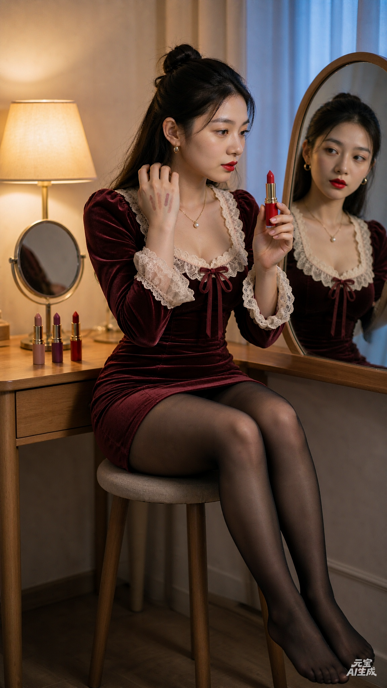
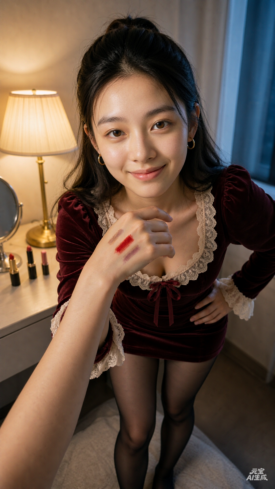

# R002 · 三支口红试色那晚

- 轮次目录：`20261126b_lipstick-tryon`
- 日期：2026-11-26
- 穿搭：`AUT-0080`
- 四张线稿：`full_single_P067_front`、full_single_P045_side`、full_single_P079_high`、full_single_P069_low`
- 画幅：1080×1920（9:16），纯画面，工具水印随图保留

## 四张

| 序 | 机位 | 图 | 终稿提示词 |
|---|---|---|---|
| 01 | front |  | [01_front.md](01_front.md) |
| 02 | side |  | [02_side.md](02_side.md) |
| 03 | seat |  | [03_seat.md](03_seat.md) |
| 04 | close |  | [04_close.md](04_close.md) |

## 这一段说了什么

1. 豆子先扣下啦，今晚哪儿都不去。三支新口红我挨个在手背上排开，你坐好，只准看不准猜。
2. 本来想画你手背上，怕你乱动，先在我自己手上排给你看。豆沙、正红、莓紫，点错一支罚你给我吹头发。
3. 镜子里我自己先判过了，正红最衬今晚这身酒红。你非要挑莓紫也行，那我可就当你是故意逗我啦。
4. 凑近点，别眨眼。挑中哪支，明天就涂哪支给你看；分错的那次先记着，吹头发的时候我慢慢跟你算。

## 现场记录

- 01_front：隔半间房前倾回身，右手背三道色痕与旋开的正红膏头吃到最亮
- 02_side：侧坐床沿把手背递到他眼前，三道色痕刚转过三分之二那一瞬
- 03_seat：侧后俯看重出，一腿屈一腿收，正脸交给镜里那半张带正红的唇
- 04_close：凑近递手背收尾，正红最宽最长，左手扶腰窝，四张同一盏灯

> 原图 PNG 永不转码、永不覆盖；预览用 `` 缩放原图。
