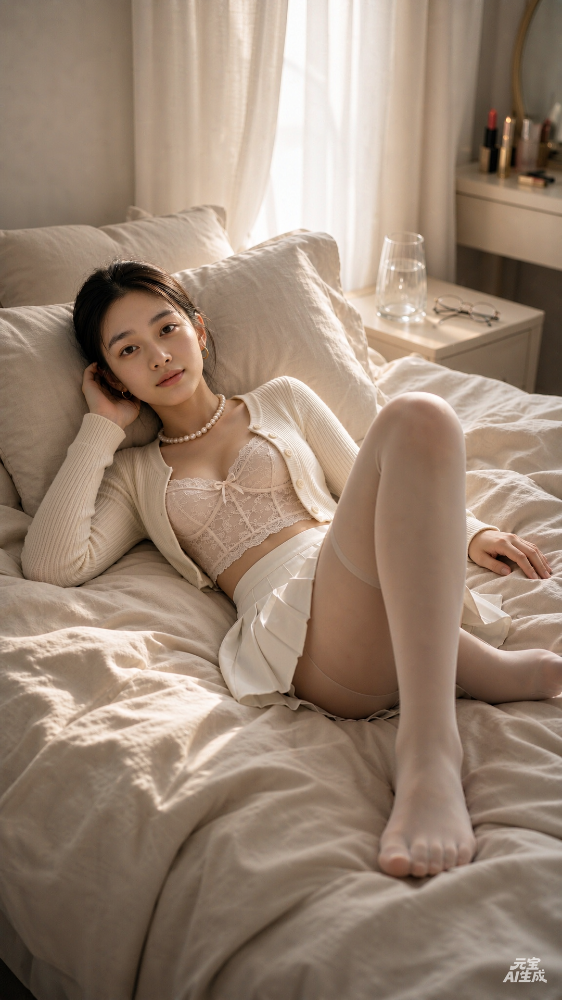

## 终稿提示词

```text
第一张图定穿搭版型配色面料，第二张图定骨相五官，第三张图定本张姿势骨架与机位；脸、衣、姿势由各自底图承担。

9:16 满幅画面，宽 1080 高 1920，人物与道具铺满整幅，四条边即裁切边。

她穿象牙白短款罗纹针织开衫，挂颈露肩、前襟一排小圆扣扣到胸下、两条贴身长袖、袖口罗纹收边，开衫短到腰线以上；内搭象牙白蕾丝吊带胸衣，细肩带、胸前一枚同色小蝴蝶结、下摆一圈蕾丝波浪边，胸衣下缘与百褶裙腰头之间露出一指宽腰腹；白色高腰百褶迷你裙从腰头压出细密顺风褶、裙摆止于大腿中段；24h 象牙白连裤丝袜平口齐腿根匀透贴腿连包到脚趾，两只脚是白丝包住的赤足、脚趾圆润完整露出来；珍珠项链一圈贴着锁骨窝，裸粉椭圆甲压一道细珠光边，耳垂一粒小珍珠；锁骨微卷：发长齐锁骨、发尾一缕一缕松松外卷、三七分、几缕碎发贴着脸侧与后颈。床是凌乱的米白亚麻被、枕头压出一道软凹，床头柜上一只倒扣的玻璃杯、一副他的眼镜，画面纵深左侧让一道缝露出梳妆台台角，昨夜那三支口红并排立着、正红那支旋开膏体朝上，在焦外只留一点红。

镜头是他的眼睛：他还整只陷在枕头里没动，视点实数眼高 0.45 米、贴着枕面从被窝里往上仰看，与她相隔 0.35 至 0.55 米距离带，看她比他先醒半拍、侧卧着用右肘压在枕面上把上身撑起；画面上缘是她撑起后露出的下颌底缘与一截后颈，床头柜、倒扣的玻璃杯与他的眼镜都落在她身侧偏低处，不压在她头顶上方。这一眼的动线是先撞到白丝赤足的脚趾、再顺上腿爬到裙摆那圈蕾丝、滑过挂颈开衫顺着肩线滑到上臂露出的一截肩、最后落进她等他的眼神；腰头到百褶裙摆的细褶、撑在枕侧的右肘与按在被面上的左手、屈腿那只白丝脚尖实勾住他那侧被角勾出一道浅褶都在这条动线上；珍珠项链在领口那片暖光里一粒粒可数、背面泛一层暖灰反光，空气里浮着几粒晨光里的微尘，纵深那道缝里正红膏体是这一眼唯一一点红，膏体尖挑着全幅最亮的一粒高光。

一位成年人物、一具身体轮廓、胸大腰细腿长靠合身剪裁写实呈现、左右各一只手臂各五根手指、两只脚各自连续。全画仅此一双手，每只手全篇只出现一次、只做一个动作：右臂从右肩经肘向下压在枕侧、经腕撑稳，指尖一条连续链沿身体右侧完整可见，唯一落点是右掌与五指按实在米白亚麻枕面上把侧卧的上身撑起、中指压出一道浅窝；左手从左肩经肘向前搭、经腕放松，指尖一条连续链沿身体左侧完整可见，唯一落点是五指轻按在自己身前那道被面褶皱上、食指指尖把被角朝他那边推一厘米、余四指拢住被面不动。指缝可数，两臂各从肩连续到指尖。

侧卧刚醒、整个身子侧过来朝着他，下腿伸直、上腿屈起往前叠、白丝脚背微绷、赤足脚趾在晨光里圆润舒展，髋前顶半寸、肩后让半寸，腋下打开一个看得见的三角，腰线比脸先进入他眼里，脊线从后颈经腰窝到屈起的膝拉出一道松软的 S 形。眼皮只抬一半、下眼睑顶住往上翻看他，等他「唔」一声瞳心才落过来，鼻息轻哼一下，右眼高光偏上偏内、左眼一道细月牙柔反光，唇角往右边歪出一点浅窝就不收，像早醒了半刻一直没叫他；这个眼神长出一个可见动作：屈腿那只白丝脚尖在他被角上再勾紧一点、勾完不收，撑着枕面的右手与按在被面的左手都不动。

清晨的淡金光从窗帘没拉严的一道缝里斜进来，只勾露出的那截肩、蕾丝下摆、白丝脚背三道，脸的下半压进柔软暖灰，床头柜玻璃杯沿反一粒亮点；背光那半间卧室收成柔软的暖灰，昨夜台灯的黄已经退场。写实摄影质感，35mm，1/250，贴着枕面往上仰 6 度，罗纹针织的竖棱、蕾丝孔隙、百褶的折光与白丝细密纹理都清楚。
```

## 一句点评

贴枕仰看重出，侧卧撑起、纵深那道缝露出梳妆台一点正红
