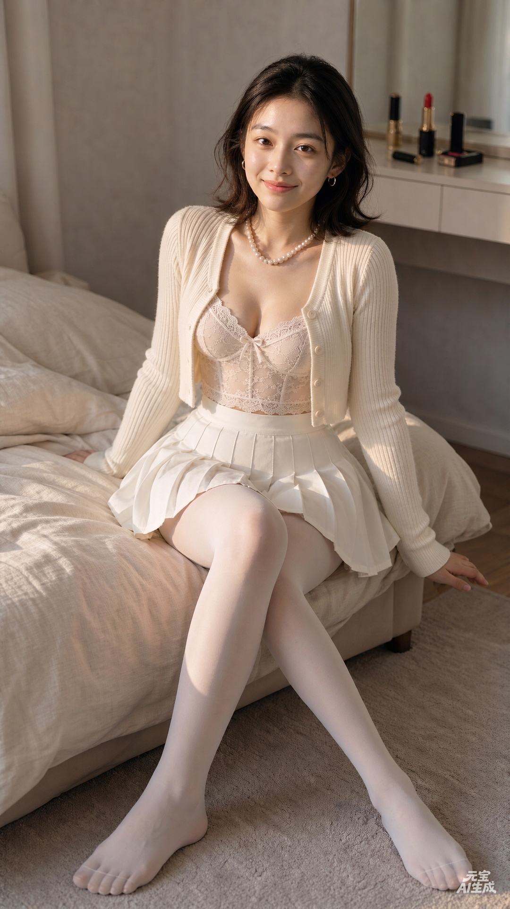

## 终稿提示词

```text
返工复核锚（STD-001.2 B5-T）：丝袜从腿根到脚尖同色连续，脚踝、脚背无横向分界、无袜口、无趾根收边；脚趾由与腿部同色的袜面完整包住，五趾轮廓在袜面里各自分明，露趾鞋与凉鞋前口里袜面一直连到趾尖并与鞋口平顺衔接；四张同一层腿部覆盖、同一双鞋。本张已按此逐字复核并重出。

第一张图定穿搭版型配色面料，第二张图定骨相五官，第三张图定本张姿势骨架与机位；脸、衣、姿势由各自底图承担。

9:16 满幅画面，宽 1080 高 1920，人物与道具铺满整幅，四条边即裁切边。

她穿象牙白短款罗纹针织开衫，挂颈露肩、前襟一排小圆扣扣到胸下、两条贴身长袖、袖口罗纹收边，开衫短到腰线以上；内搭象牙白蕾丝吊带胸衣，细肩带、胸前一枚同色小蝴蝶结、下摆一圈蕾丝波浪边，胸衣下缘与百褶裙腰头之间露出一指宽腰腹；白色高腰百褶迷你裙从腰头压出细密顺风褶、裙摆止于大腿中段；24h 象牙白连裤丝袜平口齐腿根匀透贴腿连包到脚趾，两只脚是白丝包住的赤足、脚趾圆润完整露出来；珍珠项链一圈贴着锁骨窝，裸粉椭圆甲压一道细珠光边，耳垂一粒小珍珠；锁骨微卷：发长齐锁骨、发尾一缕一缕松松外卷、三七分、几缕碎发贴着脸侧与后颈。米白亚麻被堆在床尾，床边一块浅灰短绒地毯，梳妆台在画面深处，昨夜那三支口红并排立着、正红那支旋开膏体朝上留在台面。

镜头是他的眼睛：他撑着枕头刚坐起半个身子，视点实数眼高 0.95 米，与她相隔 0.8 至 1.1 米距离带，从她左前方略平看她已经坐到床沿、单膝立起、两只手往身后撑在床面上；画面下缘带进他自己撑枕那只手的一截前臂和亚麻枕角做虚前景，这一眼真是他的眼睛。这一眼看得见她整个人坐定的舒展轮廓、挂颈开衫随挺背滑到肩头露出的两截肩、蕾丝胸衣下摆那圈波浪边、腰头到百褶裙摆被坐姿压开的细褶、白丝两条腿一屈一伸从裙摆下缘连到赤足脚趾、立起那侧膝头顶出的一小片裙摆暗、身后两只撑住床面的手，以及床尾堆起的米白亚麻被；珍珠项链与耳垂那粒小珍珠在晨光里各亮一点，远处台面上正红那支膏体是这一眼唯一一点红。

一位成年人物、一具身体轮廓、胸大腰细腿长靠合身剪裁写实呈现、左右各一只手臂各五根手指、两只脚各自连续。全画仅此一双手，每只手全篇只出现一次、只做一个动作：右臂从右肩经肘向身后斜撑、经腕压平，指尖一条连续链沿身体右侧完整可见，唯一落点是右掌与五指按实在身后的米白亚麻床面上、掌根压出一道褶把上身撑住；左手从左肩经肘向身后另一侧斜撑、经腕放松，指尖一条连续链沿身体左侧完整可见，唯一落点是五指虚按在同一片床面上、指尖微翘像随时要拍他一下，与右手一起把肩线稳稳送开。指缝可数，两臂各从肩连续到指尖。

坐在床沿，一腿屈起脚掌踩在床沿、一腿伸下去脚尖点在浅灰短绒地毯上、脚踝往外侧微翻、白丝在绒尖压出一个浅窝，白丝赤足脚趾圆润舒展，肩线往后送开、两侧肩胛往中间夹一下、锁骨窝陷出两个浅影、胸骨轻轻提起来，脊线从后颈经腰窝到立起的膝拉出一道挺而不僵的 S 形。低眼从他自己坐起的动作上抬过来正对他，右眼高光偏上偏内、左眼一道细月牙柔反光，眉梢挑住不落、下颌往立起那侧偏半寸再开口，唇角往右边歪出一点浅窝，像在说「你终于舍得动啦」；这个眼神长出一个可见动作：点在地毯那只脚的脚趾先不动，等他撑直手臂那一秒才轻收一下放开，唇角跟着多歪一分，身后两只手的五指位置不动。

清晨的淡金光从窗帘缝里斜进来，只勾露出的两截肩、蕾丝下摆、立起那侧白丝小腿外沿三处，地毯绒尖起一层细亮；背光那半间卧室收成柔软的暖灰。写实摄影质感，50mm，1/250，手持微倾 2 度，罗纹针织的竖棱、蕾丝孔隙、百褶的折光与白丝细密纹理都清楚。
```

## 一句点评

他刚坐起半个身子，她单膝立起双手后撑
