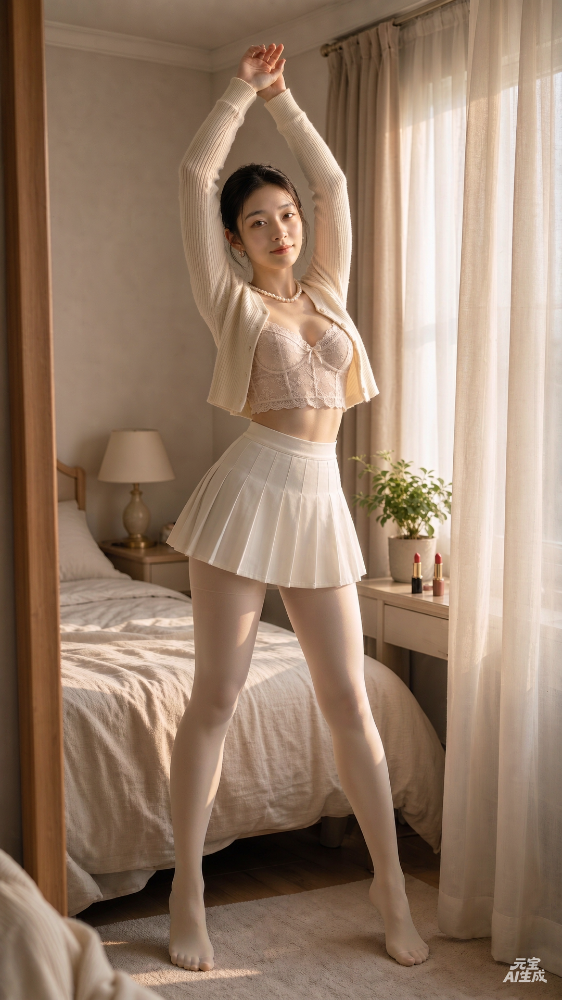

## 终稿提示词

```text
返工复核锚（STD-001.2 B5-T）：丝袜从腿根到脚尖同色连续，脚踝、脚背无横向分界、无袜口、无趾根收边；脚趾由与腿部同色的袜面完整包住，五趾轮廓在袜面里各自分明，露趾鞋与凉鞋前口里袜面一直连到趾尖并与鞋口平顺衔接；四张同一层腿部覆盖、同一双鞋。本张已按此逐字复核并重出。

第一张图定穿搭版型配色面料，第二张图定骨相五官，第三张图定本张姿势骨架与机位；脸、衣、姿势由各自底图承担。

9:16 满幅画面，宽 1080 高 1920，人物与道具铺满整幅，四条边即裁切边。

她穿象牙白短款罗纹针织开衫，挂颈露肩、前襟一排小圆扣扣到胸下、两条贴身长袖、袖口罗纹收边，开衫短到腰线以上；内搭象牙白蕾丝吊带胸衣，细肩带、胸前一枚同色小蝴蝶结、下摆一圈蕾丝波浪边，胸衣下缘与百褶裙腰头之间露出一指宽腰腹；白色高腰百褶迷你裙从腰头压出细密顺风褶、裙摆止于大腿中段；24h 象牙白连裤丝袜平口齐腿根匀透贴腿连包到脚趾，两只脚是白丝包住的赤足、脚趾圆润完整露出来；珍珠项链一圈贴着锁骨窝，裸粉椭圆甲压一道细珠光边，耳垂一粒小珍珠；锁骨微卷：发长齐锁骨、发尾一缕一缕松松外卷、三七分、几缕碎发贴着脸侧与后颈。窗边一条没拉严的米白纱帘、窗台一小盆绿叶，床尾堆着亚麻被，梳妆台在画面侧后，昨夜那三支口红并排立着、正红那支旋开膏体朝上留在台面。

镜头是他的眼睛：他披着外套站到卧室门边刚要开口，视点实数眼高 1.45 米，与她相隔 1.4 至 1.7 米距离带，从她斜前侧略平看她已经光着脚站到窗前、两条手臂往上举着伸懒腰、腰身朝他这侧拧回来。这一眼三口气走完：先撞见举高交叠的那同一双手与手上那道淡金边、落到挂颈开衫被举臂带高露出的一指宽腰腹、最后收到她压着看他的眼，远处台面上正红那支膏体替视线收尾；百褶裙摆被转身拧出的一道斜褶、白丝两条腿从裙摆下缘连到赤足脚趾、窗纱缝里漏进来的那道淡金光、画面左缘一道虚门框与他袖口入画的一截都在；珍珠项链随仰头滑到锁骨窝里，那点红是这一眼唯一的高饱和。

一位成年人物、一具身体轮廓、胸大腰细腿长靠合身剪裁写实呈现、左右各一只手臂各五根手指、两只脚各自连续。全画仅此一双手，每只手全篇只出现一次、只做一个动作：右臂从右肩经肘向上举过头顶、经腕轻翻，指尖一条连续链沿身体右侧完整可见，唯一落点是右手五指与举上来的左手在头顶轻轻交叠、掌心朝窗；左臂从左肩经肘向上举过头顶、经腕放松，指尖一条连续链沿身体左侧完整可见，唯一落点是左手五指与右手交叠成同一个伸展的顶点。指缝可数，两臂各从肩连续到指尖。

站直伸懒腰，两脚前后错开半步踩在地毯上、重心压在前脚掌、后脚尖点地外送半寸，肩压窗、髋朝他这侧顶约 30 度，脊线从后颈经腰窝拉到抬起的后脚尖、腰侧拧出一道浅凹，下巴随举臂轻轻抬起来。眼从自己举起的指缝里落下来、从手臂外侧压着他看，右眼高光偏上偏内、左眼一道细月牙柔反光，眉梢松着随两手再送高两厘米挑一下、唇角往右边歪出一点浅窝就不收，像把「我要起来咯」这句抢在他前头先说了、还赢了半招；这个眼神长出一个可见动作：交叠的那同一双手往窗光里再送高两厘米、白丝脚趾在绒毯上抓一下才落回，肩胛收出两道浅窝。

清晨的淡金光从窗纱那道缝里斜进来，只勾举起的那双手背、露出的那指宽腰腹、白丝小腿外沿三处，纱帘上落着她一道软影；背光那半间卧室收成柔软的暖灰。写实摄影质感，50mm，1/250，手持微倾 2 度，罗纹针织的竖棱、蕾丝孔隙、百褶的折光与白丝细密纹理都清楚。
```

## 一句点评

站到窗前举臂伸懒腰，头顶只有一双手交叠
