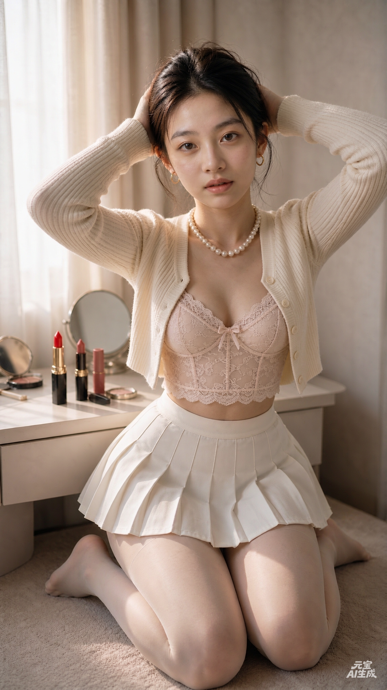

## 终稿提示词

```text
返工复核锚（STD-001.2 B5-T）：丝袜从腿根到脚尖同色连续，脚踝、脚背无横向分界、无袜口、无趾根收边；脚趾由与腿部同色的袜面完整包住，五趾轮廓在袜面里各自分明，露趾鞋与凉鞋前口里袜面一直连到趾尖并与鞋口平顺衔接；四张同一层腿部覆盖、同一双鞋。本张已按此逐字复核并重出。

第一张图定穿搭版型配色面料，第二张图定骨相五官，第三张图定本张姿势骨架与机位；脸、衣、姿势由各自底图承担。

9:16 满幅画面，宽 1080 高 1920，人物与道具铺满整幅，四条边即裁切边。

她穿象牙白短款罗纹针织开衫，挂颈露肩、前襟一排小圆扣扣到胸下、两条贴身长袖、袖口上推到肩下露满两截肩头、罗纹收边，开衫短到腰线以上；内搭象牙白蕾丝吊带胸衣，细肩带、胸前一枚同色小蝴蝶结、下摆一圈蕾丝波浪边，胸衣下缘与百褶裙腰头之间露出一指宽腰腹；白色高腰百褶迷你裙从腰头压出细密顺风褶、裙摆止于大腿中段；24h 象牙白连裤丝袜平口齐腿根匀透贴腿连包到脚趾，两只脚是白丝包住的赤足、脚趾圆润完整露出来；珍珠项链一圈贴着锁骨窝，裸粉椭圆甲压一道细珠光边，耳垂一粒小珍珠；锁骨微卷：发长齐锁骨、发尾一缕一缕松松外卷、三七分、几缕碎发贴着脸侧与后颈。梳妆台就在她身侧，昨夜那三支口红并排立着——正红那支旋开膏体朝上、往他这边挪两厘米正对着她下巴偏出去的方向，豆沙裸粉与莓紫两支退到小圆镜边虚掉，台面小圆镜映着窗光，床尾堆着亚麻被。

镜头是他的眼睛：他走到她面前俯下身，视点实数眼高 0.95 米、俯 8 至 10 度，与她相隔 0.3 至 0.45 米距离带，她跪坐在床沿边、正坐挺胸、两只手绕到后脑把锁骨微卷的发拢起来、手已经在那儿停了两秒才仰脸迎他，下巴再抬一点把颈线拉满。这一眼大半画幅让给她凑近的脸、后脑交叠的指节与领口那圈珍珠：挂颈开衫随挺背露满两截肩、蕾丝胸衣胸前那枚小蝴蝶结、下摆一圈蕾丝波浪边、细金般的晨光沿锁骨窝走一线、耳垂那粒小珍珠、几缕碎发擦过颈侧，以及她身后台面上旋开膏体的正红那支口红——四张里这一眼离那点红最近；画面下缘只留并膝白丝反光一线、脚尖阴影压住画框最底，脸、后脑指节、正红连成一条斜线。

一位成年人物、一具身体轮廓、胸大腰细腿长靠合身剪裁写实呈现、左右各一只手臂各五根手指、两只脚各自连续。全画仅此一双手，每只手全篇只出现一次、只做一个动作：右臂从右肩经肘向上绕到后脑、经腕轻收，指尖一条连续链沿身体右侧完整可见，唯一落点是右手五指拢在自己后脑右半侧那束发上、把发尾往上托半寸；左臂从左肩经肘向上绕到后脑、经腕放松，指尖一条连续链沿身体左侧完整可见，唯一落点是左手五指拢在后脑左半侧、小指与无名指两指压住右手腕背、把发尾拎起半寸露出一小段后颈，与右手一起把松开的碎发收成一个松松的小髻，腋下与颈侧同时打开一瞬。指缝可数，两臂各从肩连续到指尖。

跪坐在床沿边、臀压住脚跟，两膝并起微开压在浅灰短绒地毯上、白丝脚背贴着地毯、脚趾朝后舒展、裙褶在膝上摊成一小扇，肩线往后送开、胸骨轻轻提起来，脊线从后颈经腰窝到并起的膝拉出一道柔弯的斜线，重心稳稳落在床沿。低眼从眉骨下抬起来正对他，右眼高光偏上偏内、左眼一道细月牙柔反光，唇角挑住不抿、下唇极轻往前送一下再收回，像数着秒等他先开口、说错就伸手去够那支莓紫，眼没躲；这个眼神长出一个可见动作：后脑那两只手把发托到最后半寸故意没放开，下巴朝台面正红那支轻轻偏半寸时鼻尖微皱一下、像自己先赢了半招。

清晨的淡金光从窗纱那道缝里斜进来，只勾颧骨、露满的两截肩、后脑交叠的指节三处，后脑指节补一粒淡金高光与颧骨、肩头连成三点，第四道细光束正好落在台面那支旋开的正红膏尖上、红得发湿、与他视线同高；背光那半间卧室收成柔软的暖灰。写实摄影质感，50mm，1/250，机位稳住不动，罗纹针织的竖棱、蕾丝孔隙、珍珠的柔光与白丝细密纹理都清楚。
```

## 一句点评

俯身收尾重出，露满两截肩、正红膏尖与他视线同高
