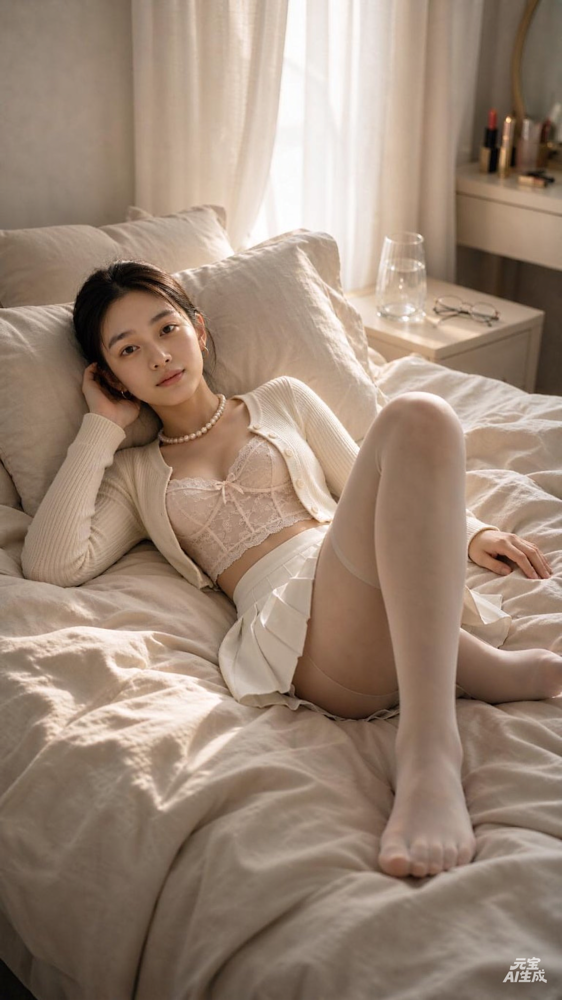
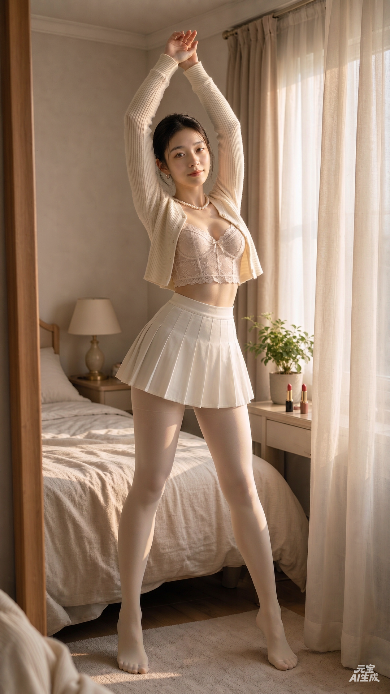
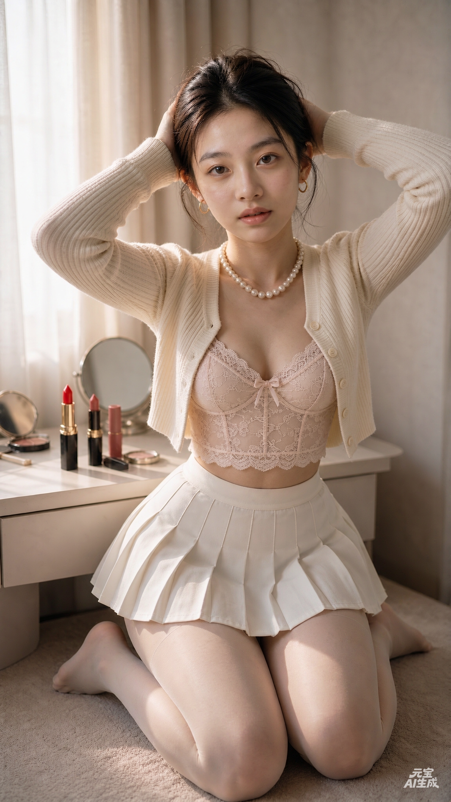

# R003 · 我要起来咯

- 轮次目录：`20261126c_morning-rise`
- 日期：2026-11-26
- 穿搭：`SPR-0063`
- 四张线稿：`full_sexy_P046_low`、full_sexy_P028_diagonal`、full_sexy_P011_diagonal`、full_sexy_P017_high`
- 画幅：1080×1920（9:16），纯画面，工具水印随图保留

## 四张

| 序 | 机位 | 图 | 终稿提示词 |
|---|---|---|---|
| 01 | front |  | [01_front.md](01_front.md) |
| 02 | side |  | [02_side.md](02_side.md) |
| 03 | seat |  | [03_seat.md](03_seat.md) |
| 04 | close |  | [04_close.md](04_close.md) |

## 这一段说了什么

1. 我早醒半刻啦，一直没叫你。你翻个身我都数着，脚尖勾你被角那下，愣是没舍得把你吵起来。
2. 你终于舍得动啦，我还以为要我掀被子。坐好先别急着下床，昨夜分错那支的账，吹头发时慢慢算。
3. 我要起来咯这句我替你先说啦，赢你半招。窗帘缝那道光照进来，我伸个懒腰，你站门边看着就好。
4. 凑近点呀，先别眨眼。今天涂哪支你来说，说错我就去够莓紫那支；不过吹头发那回，你欠我的还没销。

## 现场记录

- 01_front：贴枕仰看重出，侧卧撑起、纵深那道缝露出梳妆台一点正红
- 02_side：他刚坐起半个身子，她单膝立起双手后撑
- 03_seat：站到窗前举臂伸懒腰，头顶只有一双手交叠
- 04_close：俯身收尾重出，露满两截肩、正红膏尖与他视线同高

> 原图 PNG 永不转码、永不覆盖；预览用 `` 缩放原图。
- 返工：2026-11-26 按 STD-001.2 / letters/0024 回扫补派单 A 与 0015／0018 退回单，本轮 4 张同名 PNG 与同名 md 一起覆盖重出，逐字核 B5-T 脚趾袜面连续；用户当面授权覆盖、旧图不留仓。
