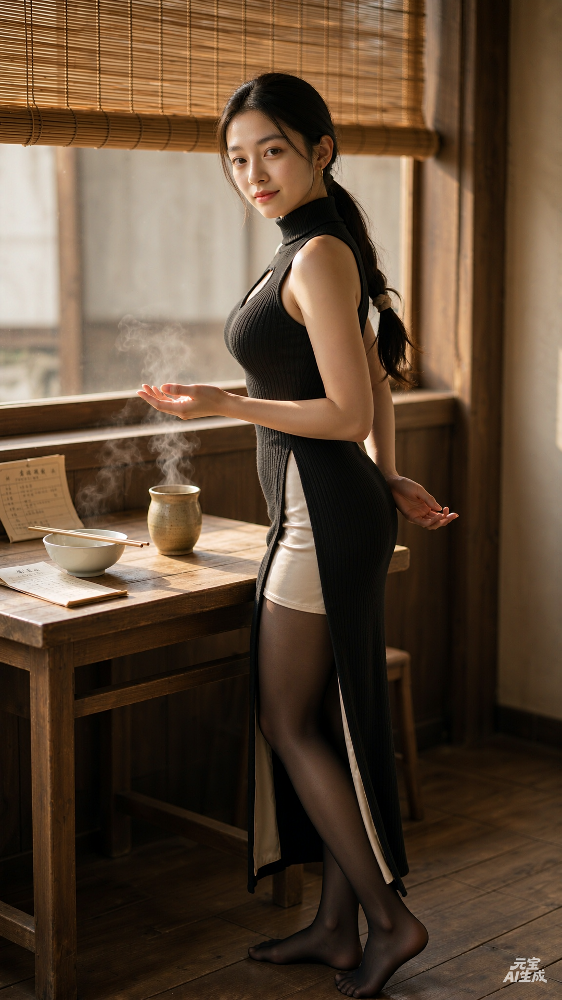

## 终稿提示词

```text
第一张图定穿搭版型配色面料，第二张图定骨相五官，第三张图定本张姿势骨架与机位；脸、衣、姿势由各自底图承担。

9:16 满幅画面，宽 1080 高 1920，人物与道具铺满整幅，四条边即裁切边。

她穿黑色高领无袖贴身罗纹针织长裙，高领立起贴着颈侧、领口下方一枚心形镂空露出锁骨下一小片肌肤，无袖、两条裸臂、罗纹竖棱从胸下顺着腰窝一路收到臀线，裙长到脚踝，右侧高开衩从大腿中段一直开到裙摆、开衩上缘露出一指宽象牙白缎面衬裙边，左侧裙摆自然垂下；24h 黑色连裤丝袜平口齐腿根匀透贴腿连包到脚趾，两只脚是黑丝包住的赤足、脚趾圆润完整露出来；正红唇，正红椭圆甲压一道细金边，耳垂空着只别一粒细小淡金耳骨夹；低侧马尾：头发低低扎在左侧颈后、发尾松松垂过锁骨、几缕碎发贴着脸侧与后颈。小饭馆的木桌刚收了碗，一只白瓷碗里横搭着竹筷、筷尖沾着一粒米，一只粗陶茶杯还冒一点热气，桌角一张折起的账单，门口竹帘卷起半幅，午后光从帘缝里斜进来。

镜头是他的眼睛：他还坐在木桌边没动，视点实数眼高 1.0 米、仰 5 度，与她相隔 0.7 至 0.9 米距离带，从椅子上看她已经放下筷子起身、侧过身回眸、一只手背到身后朝他摊开掌心；视线上沿压住她挑起的那道眉，她下巴线切在画面上三分之一。这一眼看得见她整个人从桌边站起的舒展轮廓、高领到心形镂空那一小片肌肤、罗纹竖棱顺着腰窝收到臀线的整段曲线、起身时前腿自然顶开的右侧高开衩里黑丝一整条腿从大腿中段连到赤足脚趾、另一条腿在垂下的裙摆里只露出黑丝脚背、背到身后的那只摊开的手，以及桌上横搭竹筷的白瓷碗、冒热气的粗陶茶杯与折起的账单；那缕热气斜着飘进帘光里，正红唇是这一眼最亮的一点红。

一位成年人物、一具身体轮廓、胸大腰细腿长靠合身剪裁写实呈现、左右各一只手臂各五根手指、两只脚各自连续。全画仅此一双手，每只手全篇只出现一次、只做一个动作：右臂从右肩经肘向身后弯、经腕外翻，指尖一条连续链沿身体右侧完整可见，唯一落点是右手五指舒展朝他摊开掌心、掌心朝上停在椅背高度等他把手放上来、中指尖轻轻勾一下像钩他的手；左臂从左肩经肘向上弯到肩后、经腕轻收，指尖一条连续链沿身体左侧完整可见，唯一落点是左手虚捏住低侧马尾的发尾绕半圈停住，不碰裙不碰桌。指缝可数，两臂各从肩连续到指尖。

站姿侧身回眸，两脚前后错开半步踩在木地板上、重心落在后脚，肩先转、头晚一拍才跟过来，低侧马尾的发尾扫过他这侧锁骨才停眼，肩线朝桌、髋线朝他这侧转开，脊线从后颈经腰窝到前脚拉出一道舒展的 S 形。眼从肩上落下来正对他，眼皮不急着眨、视线在他脸上多压半拍才把浅窝收成笑，右眼高光偏上偏内、左眼一道细月牙柔反光，眉梢先挑一下才松，正红唇角往右边歪出一点浅窝就不收，像已经把「去哪儿」替他想好了还偏要他先问；这个眼神长出一个可见动作：背在身后那只摊开的手的五指再轻勾一下、勾完仍摊着，捏着发尾的左手五指位置不动。

午后的淡金斜光从竹帘缝里进来，只勾颧骨、心形镂空那片肌肤、开衩边那截黑丝小腿外沿三处，粗陶茶杯口一缕细白热气；背光那半间小饭馆收成柔软的暖灰，木纹与竹帘的缝都清楚。写实摄影质感，50mm，1/250，坐姿仰 5 度，罗纹竖棱、缎面衬裙边的柔光、黑丝细密纹理与正红唇都清楚。
```

## 一句点评

饭桌边起身回身摊开掌心，碗里横搭竹筷、粗陶茶杯冒热气
