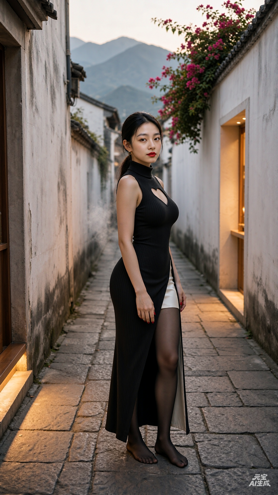

## 终稿提示词

```text
第一张图定穿搭版型配色面料，第二张图定骨相五官，第三张图定本张姿势骨架与机位；脸、衣、姿势由各自底图承担。

9:16 满幅画面，宽 1080 高 1920，人物与道具铺满整幅，四条边即裁切边。

她穿黑色高领无袖贴身罗纹针织长裙，高领立起贴着颈侧、领口下方一枚心形镂空露出锁骨下一小片肌肤，无袖、两条裸臂、罗纹竖棱从胸下顺着腰窝一路收到臀线，裙长到脚踝，右侧高开衩从大腿中段一直开到裙摆、开衩上缘露出一指宽象牙白缎面衬裙边，左侧裙摆自然垂下；24h 黑色连裤丝袜平口齐腿根匀透贴腿连包到脚趾，两只脚是黑丝包住的赤足、脚趾圆润完整露出来；正红唇，正红椭圆甲压一道细金边，耳垂空着只别一粒细小淡金耳骨夹；低侧马尾：头发低低扎在左侧颈后、发尾松松垂过锁骨、几缕碎发贴着脸侧与后颈。老巷的青石板路从画面左下往深处斜着收过去、斑驳白墙沿石板一路退远、墙头一蓬三角梅，午后斜阳把墙影切在石板缝里，巷子尽头露出苍山一线青蓝；右侧白墙在拐角让出一道窄缝，缝里透出一点咖啡店暖黄光，木招牌只斜切进画面一个亮边与两枚钉痕，店本身还在这一眼看不见的地方；画边左下切一条饭馆门槛的暖黄光，她肩后一缕极淡热气。

镜头是他的眼睛：他跟在后面刚走出饭馆门，视点实数眼高 1.5 米、略俯 3 度，与她相隔 1.6 至 2.0 米距离带，隔半条巷子从斜侧三分面望她走在前半步、在巷口站定、身体仍朝巷子深处、只把脸和肩回过来看他。正红唇先刺进他眼里、再落回她歪着的嘴角；这一眼沿青石板的斜线先走到她前脚黑丝脚尖、再顺开衩里那条腿往上、最后收进她压下来的眼：她整个人斜侧站定的舒展轮廓、高领到心形镂空那一小片肌肤、罗纹竖棱顺着腰窝收到臀线的整段曲线、右胯朝他这侧顶出去把开衩撑成一个三角口、黑丝一整条腿从大腿中段连到赤足脚趾、另一条腿在垂下的裙摆里只露出黑丝脚背，以及扣在开衩上缘的那只手与捏着马尾梢往肩前带的另一只手；她身后退远的白墙、墙头三角梅、苍山一线与拐角那道透暖光的窄缝都在。

一位成年人物、一具身体轮廓、胸大腰细腿长靠合身剪裁写实呈现、左右各一只手臂各五根手指、两只脚各自连续。全画仅此一双手，每只手全篇只出现一次、只做一个动作：右臂从右肩经肘向下弯到胯侧、经腕压平，指尖一条连续链沿身体右侧完整可见，唯一落点是右手五指扣进开衩上缘往髋外侧带开两寸、让黑丝整条外沿连胯线一起亮给他；左臂从左肩经肘向上弯到肩前、经腕轻收，指尖一条连续链沿身体左侧完整可见，唯一落点是左手虚捏住低侧马尾的发梢、把发尾往肩前带半寸停住，破开两手的对称。指缝可数，两臂各从肩连续到指尖。

斜侧三分面站定，身体朝巷子深处、脸和肩回过来看他，前脚黑丝脚尖朝他点地、脚跟离石板半寸，后脚收回到前脚后半步、脚尖朝前、膝微屈顶住前膝，重心稳稳落在前脚；右胯朝他这侧顶出一掌、肩线朝巷口留半拍差，脊线从后颈经腰窝到后脚拉出一道拧开的 S 形。眼压向画面下缘、先落在他跟上来的脚上停一拍才抬起来，下巴微收、眼珠上翻正对他，下唇往里咬一毫米再松开歪出浅窝，右眼高光偏上偏内、左眼一道细月牙柔反光，眉梢挑住不落，正红唇角往右边歪出一点浅窝，像在数他还要几步才跟得上；这个眼神长出一个可见动作：扣在开衩上缘那只手的食指指尖往石板路深处轻点一下、点完仍扣着，捏着马尾梢的左手五指位置不动。

午后的淡金斜光从巷口左上方铺下来，只勾颧骨、心形镂空那片肌肤、开衩边那截黑丝小腿外沿三处，三角梅的花瓣在白墙上落一层软影，肩后那缕极淡热气被斜阳照出一线亮；背光那半条巷子收成柔软的青灰，石板缝与墙皮的纹路都清楚。写实摄影质感，35mm，1/250，斜侧略俯 3 度，罗纹竖棱、缎面衬裙边的柔光、黑丝细密纹理与正红唇都清楚。
```

## 一句点评

巷口重出，斜侧三分面只回脸和肩，青石板往深处收、拐角透一点店里的暖光
