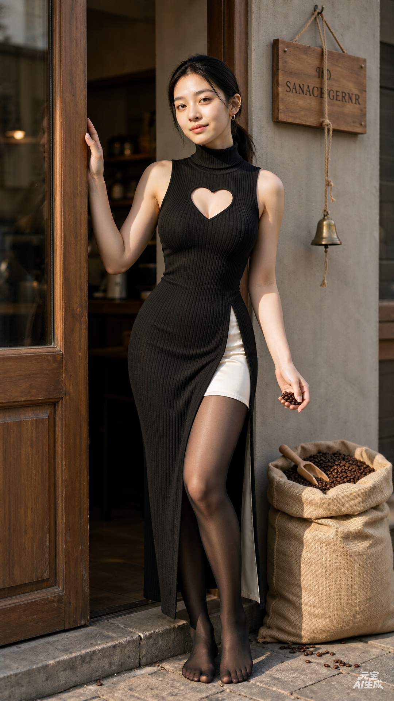

## 终稿提示词

```text
第一张图定穿搭版型配色面料，第二张图定骨相五官，第三张图定本张姿势骨架与机位；脸、衣、姿势由各自底图承担。

9:16 满幅画面，宽 1080 高 1920，人物与道具铺满整幅，四条边即裁切边。

她穿黑色高领无袖贴身罗纹针织长裙，高领立起贴着颈侧、领口下方一枚心形镂空露出锁骨下一小片肌肤，无袖、两条裸臂、罗纹竖棱从胸下顺着腰窝一路收到臀线，裙长到脚踝，右侧高开衩从大腿中段一直开到裙摆、开衩上缘露出一指宽象牙白缎面衬裙边，左侧裙摆自然垂下；24h 黑色连裤丝袜平口齐腿根匀透贴腿连包到脚趾，两只脚是黑丝包住的赤足、脚趾圆润完整露出来；正红唇，正红椭圆甲压一道细金边，耳垂空着只别一粒细小淡金耳骨夹；低侧马尾：头发低低扎在左侧颈后、发尾松松垂过锁骨、几缕碎发贴着脸侧与后颈。那家换了新豆子的咖啡店：旧木门框，门头一块小木牌只留木纹与两枚钉痕、木牌下沿垂一小截麻绳与一枚小铜铃，门内一条暖黄光带，窗台一盆绿叶压在画面右上只留一角，门边靠着一只装咖啡豆的粗麻袋，一把小木勺斜插在袋口、勺窝里几粒深烘豆亮一度，豆子都好好盛在袋里，门槛石与青石板干干净净，玻璃窗上映着一线巷子的青灰。

镜头是他的眼睛：他走到店门边刚站定，视点实数眼高 1.35 米，与她相隔 0.7 至 0.9 米距离带，从她右侧略平看她已经先到门口、一手扶着木门框、髋朝他这侧顶出一掌、侧身把开衩撑成一个三角口回头等他，肩比髋慢半拍才转过来，像已倚了两分钟才听见他脚步。这一眼先撞胯线再撞眼睛：她整个人倚在门框边的舒展轮廓、高领到心形镂空那一小片肌肤、罗纹竖棱顺着腰窝收到臀线的整段曲线、被顶开的三角口里黑丝一整条腿从大腿中段连到赤足脚趾、开衩开口与门内暖光带连成一条斜线亮到门槛石、另一条腿在垂下的裙摆里只露出黑丝脚背、扶在门框上的那只手与垂到袋口捻豆的另一只手，以及木纹钉痕、垂着的小铜铃与勺窝里那几粒豆；店里的座位、吧台与后面的人都在这一眼看不见的门内深处。

一位成年人物、一具身体轮廓、胸大腰细腿长靠合身剪裁写实呈现、左右各一只手臂各五根手指、两只脚各自连续。全画仅此一双手，每只手全篇只出现一次、只做一个动作：右臂从右肩经肘向前上方抬到门框、经腕压平，指尖一条连续链沿身体右侧完整可见，唯一落点是右手五指按实在旧木门框齐肩高处、指节微微泛白把侧顶胯的上身稳稳撑住；左臂从左肩经肘向身侧垂到麻袋口、腕有袋沿做支点、经腕放松，指尖一条连续链沿身体左侧完整可见，唯一落点是左手食指与拇指捻着两粒深褐咖啡豆、往画面下缘他手心的方向送半寸又缩回袋口、指尖始终碰着豆。指缝可数，两臂各从肩连续到指尖。

站姿倚框侧顶胯，两脚前后错开踩在门槛石上、前腿膝微外开把开衩撑成三角口、重心落在后脚，前脚脚尖朝他轻点一下门槛石，髋朝他这侧顶出一掌、肩线朝门内留半拍差，脊线从后颈经腰窝到前脚拉出一道舒展的 S 形。眼从门内那片暖光里收回来正对他、瞳心稳稳落在镜头中央，右眼高光偏上偏内、左眼一道细月牙柔反光，眉梢先挑一下才慢慢松，正红唇角往右边歪出一点浅窝就不收，下巴朝扶门那只手的反方向抬半寸、眼没躲，像在说「豆子我可替你扣到今天了」；这个眼神长出一个可见动作：捻豆那两指往他手心虚送半寸又缩回，扶在门框的右手五指位置不动。

午后淡金斜光从巷口斜进来，只勾颧骨、心形镂空那片肌肤、开衩上缘那一指宽象牙白缎边、开衩边那截黑丝小腿外沿四处，门内暖黄光带在她右肩后铺出一层柔边；背光的木门框与青灰巷墙收成柔软的暖灰，木纹、麻袋粗纤维与黑丝细密纹理都清楚。写实摄影质感，50mm，1/250，手持微倾 2 度，罗纹竖棱、缎面衬裙边的柔光与正红唇都清楚。
```

## 一句点评

店门口重出到第三版，瞳心正对镜头、左手捻两粒深烘豆往他手心虚送，木牌下小铜铃
