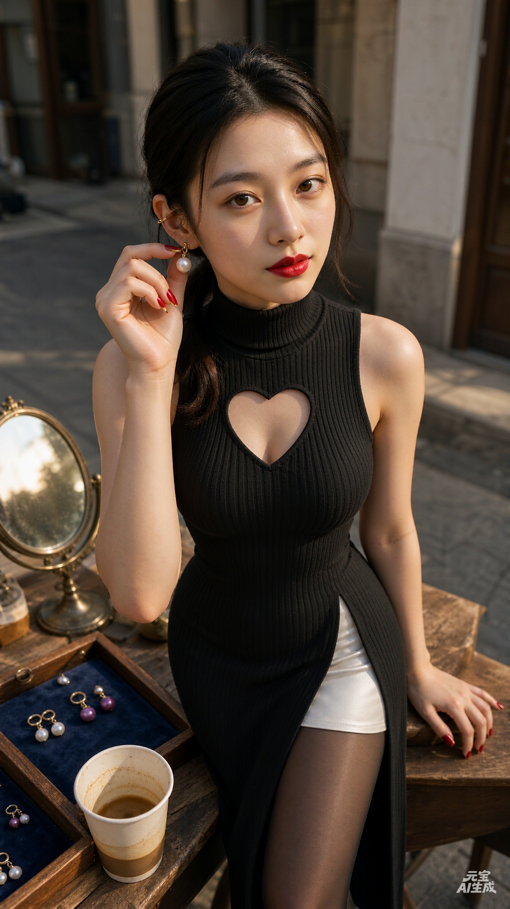

## 终稿提示词

```text
第一张图定穿搭版型配色面料，第二张图定骨相五官，第三张图定本张姿势骨架与机位；脸、衣、姿势由各自底图承担。

9:16 满幅画面，宽 1080 高 1920，人物与道具铺满整幅，四条边即裁切边。

她穿黑色高领无袖贴身罗纹针织长裙，高领立起贴着颈侧、领口下方一枚心形镂空露出锁骨下一小片肌肤，无袖、两条裸臂、罗纹竖棱从胸下顺着腰窝一路收到臀线，裙长到脚踝，右侧高开衩从大腿中段一直开到裙摆、开衩上缘露出一指宽象牙白缎面衬裙边，左侧裙摆自然垂下；24h 黑色连裤丝袜平口齐腿根匀透贴腿连包到脚趾，两只脚是黑丝包住的赤足、脚趾圆润完整露出来；正红唇，正红椭圆甲压一道细金边，耳垂空着只别一粒细小淡金耳骨夹；低侧马尾：头发低低扎在左侧颈后、发尾松松垂过锁骨、几缕碎发贴着脸侧与后颈。巷口银饰小摊：一只旧木托盘铺着深蓝绒布，托盘里并排几对耳环——一粒小珍珠、一枚细金圈、一对莓紫小坠，摊沿一只小圆镜只映着午后暖光与她下颌线、不映手部，旁边纸杯里剩小半杯刚喝完的咖啡，杯底一圈深褐痕。

镜头是他的眼睛：他俯身凑到摊前，视点实数眼高 1.0 米、俯 8 度，与她相隔 0.3 至 0.45 米距离带，她侧身朝他转过来、一手把那只小珍珠耳环举到自己空着的耳垂边比给他看；焦点只锁住她耳垂和捏耳环的那两指，细金圈与小珍珠在柔焦里化开、莓紫小坠留一点可辨的紫，纸杯与脚下暗部若隐若现。0.4 米这一眼大半画幅让给她凑近的脸、举到耳垂边的指尖与领口那片心形镂空：高领贴着颈侧、心形镂空露出的那一小片肌肤、正红唇、低侧马尾几缕碎发被带离颈侧皮肤一毫米、耳垂空着只一粒淡金耳骨夹的亮、捏着耳环那两指的指腹与正红甲面金边，以及托盘里那对莓紫小坠和纸杯底那圈咖啡痕；裙摆开衩与黑丝赤足收在画面下缘青石板那一小片里。

一位成年人物、一具身体轮廓、胸大腰细腿长靠合身剪裁写实呈现、左右各一只手臂各五根手指、两只脚各自连续。全画仅此一双手，每只手全篇只出现一次、只做一个动作：右臂从右肩经肘向上弯到耳侧、经腕轻转，指尖一条连续链沿身体右侧完整可见，唯一落点是右手食指与拇指两指捏着那粒小珍珠耳环、把珍珠轻轻顶在空着的右耳垂上顶出一点浅凹比给他看，其余三指自然收拢；左臂从左肩经肘向下扶到摊沿、经腕压平，指尖一条连续链沿身体左侧完整可见，唯一落点是左手五指按实在旧木托盘近身侧的边框上、食指把托盘往他那边推一厘米、杯里咖啡面晃出一道细弧。指缝可数，两臂各从肩连续到指尖。

侧身朝他这侧微微前倾、肩线松开、后颈露出来，脊线从后颈经肩背到扶在摊沿的手拉出一道柔弯的斜线，腰窝轻陷，重心稳稳落在青石板上。抬眼先钉他一拍、瞳仁再移下半寸扫过托盘里那对莓紫小坠才回到他脸上，右眼高光偏上偏内、左眼一道细月牙柔反光，唇角只单边再挑高一毫米、下唇极轻往前送一下再收回，像数着秒等他先开口说好看、说错就去够那对莓紫小坠，眼没躲；这个眼神长出一个可见动作：捏着耳环那两指把小珍珠往耳垂上再顶紧一点、下巴朝捏耳环那侧偏三度、贴完停住，扶在摊沿的左手五指位置不动。

午后淡金斜光从摊侧斜进来，只勾颧骨、心形镂空那片肌肤、捏着耳环的两指指节三处，小珍珠在光里泛一点细湿亮，小圆镜把那圈暖光反到她下颌；背光的深蓝绒布与青灰巷墙收成柔软的暖灰，罗纹竖棱、珍珠的柔光、黑丝细密纹理与正红唇都清楚。写实摄影质感，50mm，1/250，机位稳住不动。
```

## 一句点评

银饰摊前收尾，小珍珠耳环顶在空着的右耳垂上，莓紫小坠虚在托盘里
