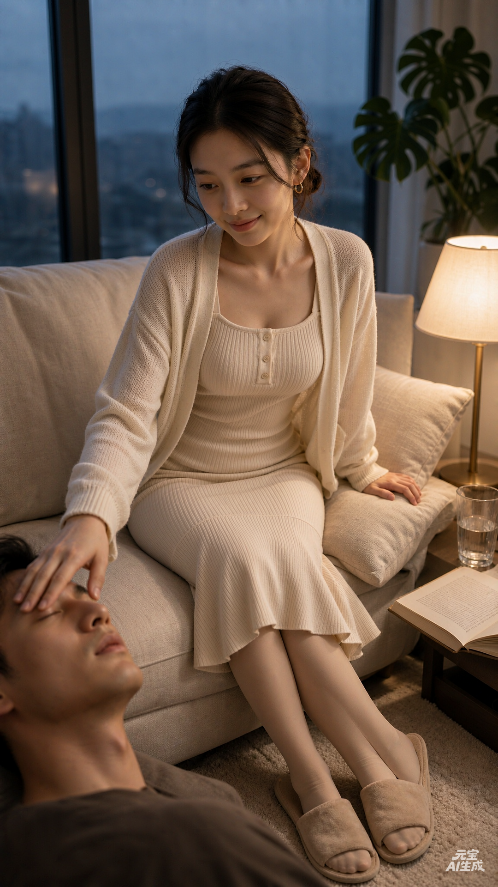

## 终稿提示词

```text
第一张图定穿搭版型配色面料，第二张图定骨相五官与本轮慵懒低盘发，第三张图定本张姿势骨架与机位；脸、衣、发型、姿势由各自底图承担。

9:16 满幅画面，宽 1080 高 1920，人物与道具铺满整幅，四条边即裁切边。

她穿米白罗纹针织贴身连衣裙，方领、短袖、前襟三颗小圆扣扣到胸下，罗纹竖棱从胸下顺着腰窝一路收到臀线，鱼尾裙摆散到小腿中段；肩上披一件同色薄透米白针织开衫，长袖、袖口罗纹收边、开襟敞着、两条空袖自然垂在身侧；24h 米白连裤丝袜平口齐腿根匀透贴腿连包到脚趾，两只脚上各穿一只燕麦色软底绒拖，一字带露趾、丝袜脚背连进拖鞋口、脚趾在拖鞋里被米白丝袜完整包着，四张同一双；耳垂一粒细小淡金耳圈，裸色椭圆甲压一道细珠光边；慵懒低盘发：深棕头发松松往后拢、在后颈偏低处挽成一个不规则松散低髻，髻上几缕发丝自然抽出，两缕碎发垂在耳后与颈侧、发尾微卷，后颈露出一小段，后颈那缕发丝往肩前偏一点擦过方领边。米白亚麻沙发压出两道软凹、一只燕麦色针织靠垫、矮几上一只空玻璃杯与一本翻开的书，短绒地毯铺到沙发脚边，画幅右上角两片虚化的绿萝叶，落地灯罩里一圈暖黄，窗外是傍晚转夜的蓝灰。

镜头是他的眼睛：他刚把自己整个陷进沙发里，视点实数眼高 0.75 米，与她相隔 0.4 至 0.6 米距离带，从靠垫这一侧贴着枕面往上仰看她侧坐在沙发沿、俯下身来把指尖按到他太阳穴上。画面左下角只入画他自己的下颌线与喉结一小片暗部、沉在柔软暖灰里，眉眼鼻都留在画外；后颈与低髻一齐往前垂，他先看见下垂的下颌线与低髻弧线，再看见她的眼睛。这一眼大半画幅让给她俯近的脸与肩：方领到三颗小圆扣那一段、罗纹竖棱顺腰窝收下去的整段曲线、薄透开衫一条空袖垂到他肩侧、低盘发髻抽出的一缕发丝擦过她自己颈侧、耳垂那粒淡金耳圈，以及她按在他太阳穴上的两指与撑在靠垫上的另一只手；沙发扶手、矮几上那只空玻璃杯与翻开的书都在，远处厨房门与走廊这一眼看不见。她裙摆下的两只软底绒拖落在短绒地毯上，斜放那只鞋跟微微离地、脚尖轻点地毯，丝袜脚背连进拖鞋口，鱼尾裙摆把两只鞋都好好让出来。

一位成年人物、一具身体轮廓、胸大腰细腿长靠合身剪裁写实呈现、左右各一只手臂各五根手指、两只脚各自连续、两只燕麦色软底绒拖都好好穿在脚上。全画仅此一双手，每只手全篇只出现一次、只做一个动作：右臂从右肩经肘向前下弯、经腕放松，指尖一条连续链沿身体右侧完整可见，唯一落点是右手食指与中指两指指腹沿着这条链往前送一指宽、实实压在他左太阳穴那道凹陷上慢慢打小圈、指腹边上皮肤带一丝极浅推痕，其余三指自然收拢；左臂从左肩经肘向下撑、经腕压平，指尖一条连续链沿身体左侧完整可见，唯一落点是左手五指按进他身侧那只燕麦色针织靠垫、压出一个浅窝把俯下去的上身稳稳撑住，无名指与小指微微蜷着。指缝可数，两臂各从肩连续到指尖。

侧坐在沙发沿，一腿屈起收在身下、一腿斜放下来让软底绒拖轻踩在短绒地毯上，肩线朝他压下来、髋线留在沙发沿，脊线从后颈经腰窝到屈起的膝拉出一道柔弯的斜线，重心稳稳落在沙发沿。低眼从眉骨下落下来正对他，右眼高光偏上偏内、左眼一道细月牙柔反光，眉梢松着、唇角往右边弯出一点浅浅的弧就不收，说完没出声，鼻息轻落在他额角碎发上、自己没再开口，像早把他那句「好累」听进去了、还顺手把话都替他收着；这个眼神长出一个可见动作：按在太阳穴上那两指多停半拍才慢慢再挪一小圈，撑在靠垫上的左手五指位置不动。

傍晚的蓝灰窗光从她身后斜进来，落地灯那圈暖黄只勾她颧骨、方领下那片锁骨、按在他太阳穴上的两指指节三处，方领边缘那道罗纹阴影留在柔和暗部、指尖最亮，绿萝两片虚叶在墙上落一道软影；背光那半间客厅收成柔软的暖灰，罗纹竖棱、薄透开衫的孔隙、绒拖的短绒与米白丝袜细密纹理都清楚。写实摄影质感，50mm，1/250，陷在沙发里仰 4 度，机位稳住不动。
```

## 一句点评

第1张终审重出：两指按实太阳穴、他只留下颌喉结暗部
