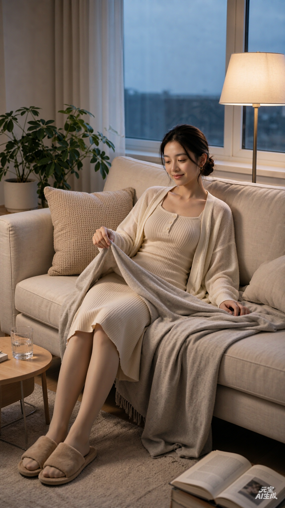

## 终稿提示词

```text
第一张图定穿搭版型配色面料，第二张图定骨相五官与本轮慵懒低盘发，第三张图定本张姿势骨架与机位；脸、衣、发型、姿势由各自底图承担。

9:16 满幅画面，宽 1080 高 1920，人物与道具铺满整幅，四条边即裁切边。

她穿米白罗纹针织贴身连衣裙，方领、短袖、前襟三颗小圆扣扣到胸下，罗纹竖棱从胸下顺着腰窝一路收到臀线，鱼尾裙摆散到小腿中段；肩上披一件同色薄透米白针织开衫，长袖、袖口罗纹收边、开襟敞着、两条空袖自然垂在身侧、靠近镜头那条空袖的袖口搭在自己膝外侧；24h 米白连裤丝袜平口齐腿根匀透贴腿连包到脚趾，两只脚上各穿一只燕麦色软底绒拖，一字带露趾、丝袜脚背连进拖鞋口、脚趾在拖鞋里被米白丝袜完整包着，前景那只绒拖的一字带被伸腿带歪一点，四张同一双；耳垂一粒细小淡金耳圈，裸色椭圆甲压一道细珠光边；慵懒低盘发：深棕头发松松往后拢、在后颈偏低处挽成一个不规则松散低髻，髻上几缕发丝自然抽出，两缕碎发垂在耳后与颈侧、发尾微卷，后颈露出一小段，低髻靠在靠垫上压出一道浅浅的压痕。米白亚麻沙发、一只燕麦色针织靠垫叠在另一头、一条晒过太阳的浅灰薄毯团在沙发扶手上、矮几上一只空玻璃杯与一本翻开的书，短绒地毯铺到沙发脚边，窗台一盆绿萝，落地灯罩里一圈暖黄，窗外是傍晚转夜的蓝灰。

镜头是他的眼睛：他半靠着靠垫缓过来一点，视点实数眼高 0.9 米，与她相隔 0.6 至 0.9 米距离带，略仰看她斜倚在沙发另一头、两条腿舒舒展展伸到他身侧、把那条浅灰薄毯拉过来盖到他胸口；薄毯上缘齐他胸口、露出他搭在毯外松着的一只手。这一眼看得见她整个人斜倚的舒展轮廓、方领到三颗小圆扣那一段、罗纹竖棱顺腰窝收下去的整段曲线、薄透开衫随斜倚滑到肩头露出的一截上臂、低盘发髻压在靠垫上的那道压痕、耳垂那粒淡金耳圈、捏着薄毯边的那只手与撑在沙发面上的另一只手，以及从她裙摆下缘连到两只软底绒拖的米白丝袜两条腿；浅灰薄毯正铺开盖到他胸口，矮几上那只空玻璃杯与翻开的书都在，远处厨房门与走廊这一眼看不见。

一位成年人物、一具身体轮廓、胸大腰细腿长靠合身剪裁写实呈现、左右各一只手臂各五根手指、两只脚各自连续、两只燕麦色软底绒拖都好好穿在脚上。全画仅此一双手，每只手全篇只出现一次、只做一个动作：右臂从右肩经肘向他胸口方向伸、经腕轻转，指尖一条连续链沿身体右侧完整可见，唯一落点是右手五指捏住浅灰薄毯的一角、极慢地把毯子往他胸口抻到一半停住、拇指腹压在毯绒上不动；左臂从左肩经肘向下撑、经腕压平，指尖一条连续链沿身体左侧完整可见，唯一落点是左手五指按实在自己身侧的米白亚麻沙发面上、把斜倚的上身稳稳撑住，食指指节泛一点浅粉。指缝可数，两臂各从肩连续到指尖。

斜倚在沙发另一头，两腿并着斜前伸、脚上两只软底绒拖轻搭在短绒地毯上，肩线往后送开靠住靠垫、髋线朝他这侧松松转一点，脊线从后颈经腰窝到伸直的脚踝拉出一道舒展的 S 形，重心稳稳落在沙发与靠垫之间。眼睑垂一点、视线先盯着毯边停一拍才抬起来正对他，右眼高光偏上偏内、左眼一道细月牙柔反光，眉梢松着、唇角只提一两毫米又压回去、往右边弯出一点浅浅的弧，像在说「别动，盖好就行」；这个眼神长出一个可见动作：捏着毯角那只手的拇指腹在毯绒上再轻压一下、压完仍停着，撑在沙发面上的左手五指位置不动。

傍晚的蓝灰窗光从她身后斜进来，落地灯那圈暖黄只勾她颧骨、方领下那片锁骨、捏着毯角那只手的指节三处，掀毯扬起的细绒絮在光里浮成一小片灰金、盖他胸口那道毯边比其余亮半档、绿萝叶影轻轻晃一下；背光那半间客厅收成柔软的暖灰，罗纹竖棱、薄透开衫的孔隙、绒拖的短绒与米白丝袜细密纹理都清楚。写实摄影质感，50mm，1/250，半靠略仰 3 度，机位稳住像怕一动他就睡着了。
```

## 一句点评

第2张：斜倚抻毯停住、后景绒拖在暗部可辨
