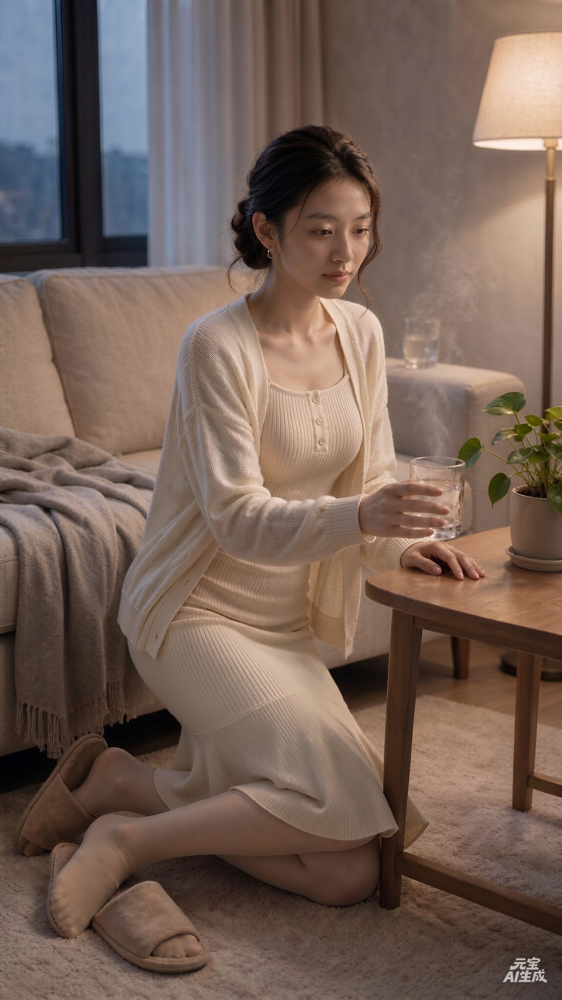

## 终稿提示词

```text
返工复核锚（STD-001.2 B5-T）：丝袜从腿根到脚尖同色连续，脚踝、脚背无横向分界、无袜口、无趾根收边；脚趾由与腿部同色的袜面完整包住，五趾轮廓在袜面里各自分明，露趾鞋与凉鞋前口里袜面一直连到趾尖并与鞋口平顺衔接；四张同一层腿部覆盖、同一双鞋。本张已按此逐字复核并重出。

第一张图定穿搭版型配色面料，第二张图定骨相五官与本轮慵懒低盘发，第三张图定本张姿势骨架与机位；脸、衣、发型、姿势由各自底图承担。

9:16 满幅画面，宽 1080 高 1920，人物与道具铺满整幅，四条边即裁切边。

她穿米白罗纹针织贴身连衣裙，方领、短袖、前襟三颗小圆扣扣到胸下，罗纹竖棱从胸下顺着腰窝一路收到臀线，鱼尾裙摆散到小腿中段；肩上披一件同色薄透米白针织开衫，长袖、袖口罗纹收边、开襟敞着、两条空袖自然垂到矮几边；24h 米白连裤丝袜平口齐腿根匀透贴腿连包到脚趾，两只脚上各穿一只燕麦色软底绒拖，一字带露趾、丝袜脚背连进拖鞋口、脚趾在拖鞋里被米白丝袜完整包着，两只绒拖都压进短绒地毯、后那只露小半截鞋跟，四张同一双；耳垂一粒细小淡金耳圈，裸色椭圆甲压一道细珠光边；慵懒低盘发：深棕头发松松往后拢、在后颈偏低处挽成一个不规则松散低髻，髻上几缕发丝自然抽出，两缕碎发垂在耳后与颈侧、发尾微卷，后颈露出一小段。米白亚麻沙发、浅灰薄毯盖在他身上、矮几上一本翻开的书与一只虚在远景里的空玻璃杯，短绒地毯铺到沙发脚边，矮几另一角摆着一小盆绿萝，落地灯罩里一圈暖黄，窗外是傍晚转夜的蓝灰。

镜头是他的眼睛：他撑着坐起来一点、下巴微收，视点实数眼高 1.0 米、略俯 3 度，与她相隔 0.8 至 1.1 米距离带，余光先落杯口再落她脸，看她半跪在沙发前的短绒地毯上、把一杯温水递到他手边。这一眼看得见她整个人从沙发沿前倾下来的舒展轮廓、方领到三颗小圆扣那一段、罗纹竖棱顺腰窝收下去的整段曲线、薄透开衫两条空袖随前倾垂到矮几边、低盘发髻抽出的一缕发丝垂在颈侧、耳垂那粒淡金耳圈、握着玻璃杯的那只手与撑在矮几沿的另一只手，以及她裙摆下两只软底绒拖轻压在短绒地毯上、米白丝袜脚背连进拖鞋口；玻璃杯里温水不烫、杯口一缕细白汽从她下颌前一寸擦过去散成小雾，是画面里唯一在动的东西，矮几上翻开的书、远景那只空玻璃杯与那小盆绿萝都在，远处厨房门与走廊这一眼看不见。

一位成年人物、一具身体轮廓、胸大腰细腿长靠合身剪裁写实呈现、左右各一只手臂各五根手指、两只脚各自连续、两只燕麦色软底绒拖都好好穿在脚上。全画仅此一双手，每只手全篇只出现一次、只做一个动作：右臂从右肩经肘向前伸到矮几上方、经腕稳住，指尖一条连续链沿身体右侧完整可见，唯一落点是右手五指拢住那只玻璃杯的杯身、把温水稳稳递到他指尖前一拳停住、送完腕不收回；左臂从左肩经肘向前下撑、经腕压平，指尖一条连续链沿身体左侧完整可见，唯一落点是左手五指按实在矮几的木沿上、把半跪前倾的上身稳稳撑住。指缝可数，两臂各从肩连续到指尖。

半跪在短绒地毯上，一膝压住地毯绒、另一膝微立、随递杯往前蹭小半寸把绒面压出浅窝，脚上两只软底绒拖的鞋尖轻轻抵着地毯，小腹自然松一寸、肩胛轻轻合拢，肩线朝他送过去、髋线留在跪起的膝上，脊线从后颈经腰窝到跪起的膝拉出一道柔弯的斜线。眼从杯口那缕白汽上抬起来正对他，右眼高光偏上偏内、左眼一道细月牙柔反光，眉梢松着先弯一下才抬、抿一下下唇再放开、唇角往右边弯出一点浅浅的弧就不收，像把「你连手指都懒得动我就喂你」说得很轻、可没打算让，你不接她就这么举着；这个眼神长出一个可见动作：握着杯身那只手的五指把杯子再往他手边送近半寸、送完停在他指尖前一拳，撑在矮几沿的左手五指位置不动。

傍晚的蓝灰窗光从她身后斜进来，落地灯那圈暖黄只勾她颧骨、方领下那片锁骨、握着杯身那只手的指节三处，玻璃杯沿反一粒亮点、杯口那缕细白汽擦过她下颌散成小雾，远景那只空玻璃杯虚在暗部里；背光那半间客厅收成柔软的暖灰，罗纹竖棱、薄透开衫的孔隙、绒拖的短绒与米白丝袜细密纹理都清楚。写实摄影质感，50mm，1/250，坐起略俯 3 度，机位稳住不动。
```

## 一句点评

第3张：半跪递温水、杯口白汽擦过下颌，审图研究员如实说没看成由主agent自己看图收口
