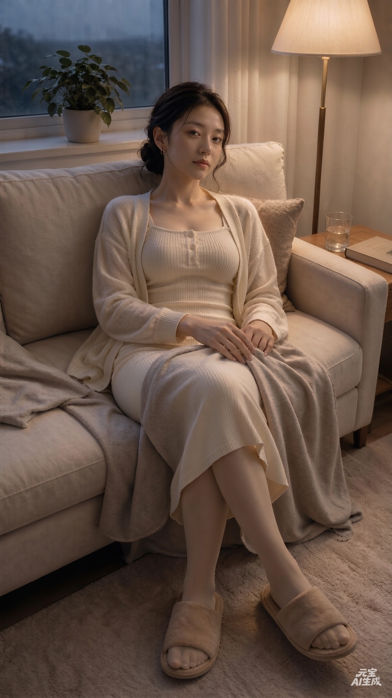

## 终稿提示词

```text
返工复核锚（STD-001.2 B5-T）：丝袜从腿根到脚尖同色连续，脚踝、脚背无横向分界、无袜口、无趾根收边；脚趾由与腿部同色的袜面完整包住，五趾轮廓在袜面里各自分明，露趾鞋与凉鞋前口里袜面一直连到趾尖并与鞋口平顺衔接；四张同一层腿部覆盖、同一双鞋。本张已按此逐字复核并重出。

第一张图定穿搭版型配色面料，第二张图定骨相五官与本轮慵懒低盘发，第三张图定本张姿势骨架与机位；脸、衣、发型、姿势由各自底图承担。

9:16 满幅画面，宽 1080 高 1920，人物与道具铺满整幅，四条边即裁切边。

她穿米白罗纹针织贴身连衣裙，方领、短袖、前襟三颗小圆扣扣到胸下，罗纹竖棱从胸下顺着腰窝一路收到臀线，鱼尾裙摆散到小腿中段；肩上披一件同色薄透米白针织开衫，长袖、袖口罗纹收边、开襟敞着、两条空袖自然垂在身侧；24h 米白连裤丝袜平口齐腿根匀透贴腿连包到脚趾，两只脚上各穿一只燕麦色软底绒拖，一字带露趾、丝袜脚背连进拖鞋口、脚趾在拖鞋里被米白丝袜完整包着，两只绒拖一前一后歪搭在短绒地毯上、鞋头斜进地毯让毯角盖住半个鞋面、右脚那只鞋口被毯角蹭松一点，四张同一双；耳垂一粒细小淡金耳圈，裸色椭圆甲压一道细珠光边；慵懒低盘发：深棕头发松松往后拢、在后颈偏低处挽成一个不规则松散低髻，髻上几缕发丝自然抽出，两缕碎发垂在耳后与颈侧、发尾微卷，后颈露出一小段。米白亚麻沙发、浅灰薄毯盖到他胸口、一只燕麦色针织靠垫垫在他头下、矮几上一只空玻璃杯与一本合上的书，短绒地毯铺到沙发脚边，窗台一盆绿萝，落地灯罩里一圈暖黄已经调暗，窗外是入夜的蓝灰。

镜头是他的眼睛：他躺下来把头枕在她膝上，视点实数眼高 0.55 米、贴着靠垫真仰 8 度往上看，与她相隔 0.25 至 0.4 米距离带；镜头就是他的眼睛，他自己完全在画外，全画只有她一位成年人物、一具身体轮廓。画面下缘是她膝头裙弧与浅灰薄毯边糊成的一片软框，她的下颌线成为画面最高的一条线，低盘发髻从这条线往上坠在后颈、露出一截脖子。这一眼大半画幅让给她俯下来的脸与领口那一段：方领到三颗小圆扣、罗纹竖棱顺着她俯身收下去的曲线、薄透开衫一条空袖垂到画面下缘软框边、耳垂那粒淡金耳圈、按在毯角上的两指指腹与裸色甲面珠光边；膝上那片米白罗纹裙面、浅灰薄毯的边、矮几上合上的书都在，远处厨房门、走廊与整扇窗都在这一眼看不见的上方。

一位成年人物、一具身体轮廓、胸大腰细腿长靠合身剪裁写实呈现、左右各一只手臂各五根手指、两只脚各自连续、两只燕麦色软底绒拖都好好穿在脚上。全画仅此一双手，每只手全篇只出现一次、只做一个动作：右臂从右肩经肘向下弯到膝前、经腕轻转，指尖一条连续链沿身体右侧完整可见，唯一落点是右手食指与中指两指指腹轻轻按在自己膝上那片浅灰薄毯的毯角上、把毯角往他那边掖实一点、按完停住不撤，其余三指自然收拢；左臂从左肩经肘向下搭、经腕放松，指尖一条连续链沿身体左侧完整可见，唯一落点是左手五指虚按在自己并起的膝上、把俯下去的上身稳稳撑住，小指微微翘起。指缝可数，两臂各从肩连续到指尖。

坐在沙发上、一膝微立让他枕得稳、另一腿舒舒展展斜放下来并回收两寸，脚上两只软底绒拖轻搭在短绒地毯上，肩线朝他低下来、髋线留在沙发面上，脊线从后颈经腰窝到微立的膝拉出一道柔弯的斜线，重心稳稳落在沙发里；她随他枕住的重量把肩又落下去半寸、像轻轻吐出一口气。眼睑再压一分、像没聚焦、眨得极慢，视线顺着俯下来的角度落向镜头，拢完那下视线才跟着他的呼吸沉下去，右眼高光偏上偏内、左眼一道细月牙柔反光，眉梢松着、唇角右边只起一丝弧、抿住没合严，像数着他的呼吸、数到自己也不说话了；这个眼神长出一个可见动作：按在毯角上那两指极轻地再掖一下才停住、贴着不撤，搭在膝上的左手五指位置不动。

入夜的蓝灰窗光只剩一线，调暗的落地灯那圈暖黄只勾她髻底那一截后颈、按在毯角上的两指指节、方领下那片锁骨三处，让人第一眼先看见手再看见眼，低髻髻顶留在柔和暗部、耳垂那粒淡金耳圈反一点细亮；背光那半间客厅收成柔软的暖灰，罗纹竖棱、薄透开衫的孔隙、绒拖的短绒与米白丝袜细密纹理都清楚。写实摄影质感，50mm，1/250，贴着靠垫仰 8 度，机位稳住不动。
```

## 一句点评

第4张连出三版：终稿回到纯他的眼睛、她一人入画、右手两指掖毯角，那段话未改故音频不重提
