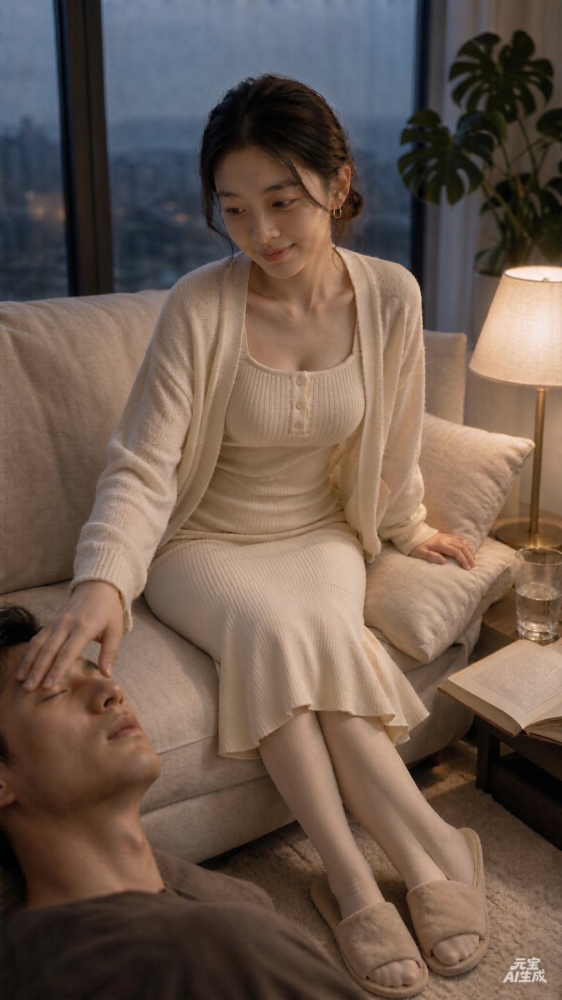
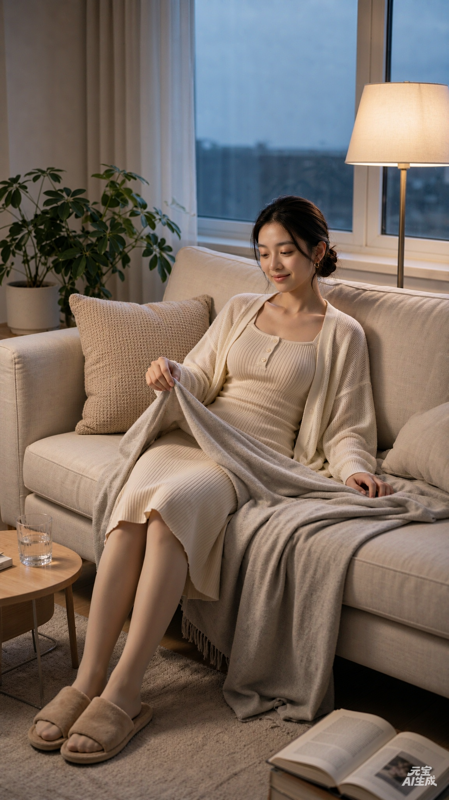
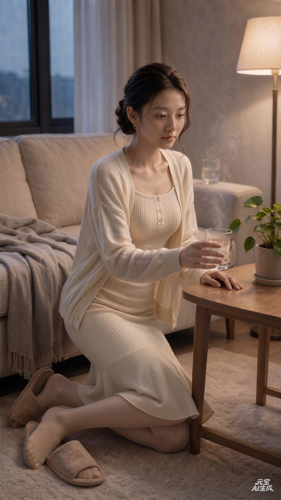
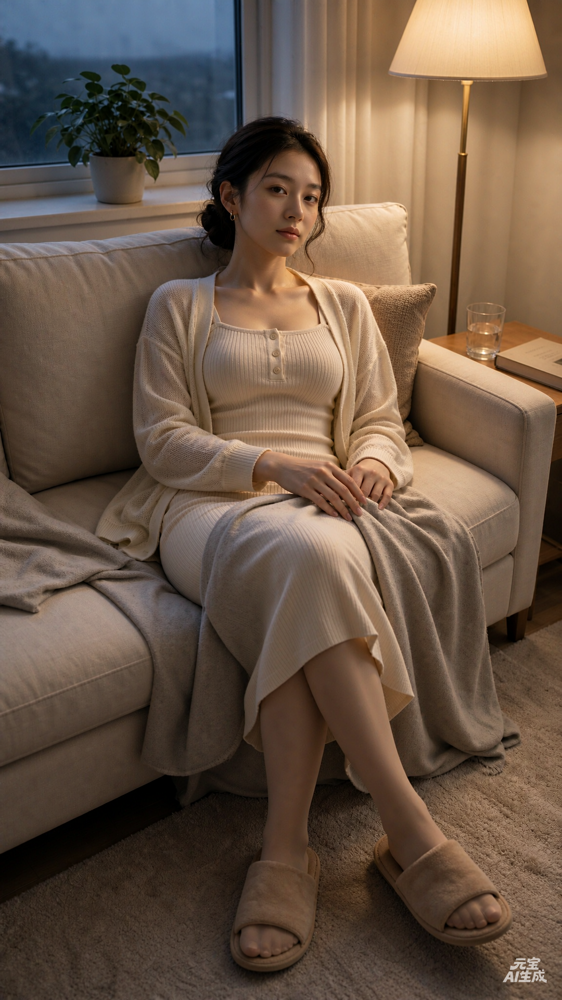

# R005 · 好累啊我

- 轮次目录：`20261126e_tired-sofa-evening`
- 日期：2026-11-26
- 穿搭：`SPR-0006`
- 四张线稿：`full_single_P041_diagonal`、full_single_P007_side`、full_single_P042_low`、full_single_P005_low`
- 画幅：1080×1920（9:16），纯画面，工具水印随图保留

## 四张

| 序 | 机位 | 图 | 终稿提示词 |
|---|---|---|---|
| 01 | front |  | [01_front.md](01_front.md) |
| 02 | side |  | [02_side.md](02_side.md) |
| 03 | seat |  | [03_seat.md](03_seat.md) |
| 04 | close |  | [04_close.md](04_close.md) |

## 这一段说了什么

1. 累就别硬撑啦，过来。沙发我占了一半，另一半给你留着，今晚的话我先替你收着，你连点头的力气都省了。
2. 毯子刚晒过，带一点太阳味。你就闭眼躺着，我不吵你，坐这儿把今天那些麻烦事都挡在门外头。
3. 温水放这儿了，不烫。你连手指都懒得抬我就举着，等缓过来陪我把窗台那盆绿萝挪个位置，这可是我今天的事。
4. 枕好啦别乱动。我数你呼吸，数着数着我也困了，今晚轮到我守着，你只管睡，明早谁先醒谁去关灯。

## 现场记录

- 01_front：第1张终审重出：两指按实太阳穴、他只留下颌喉结暗部
- 02_side：第2张：斜倚抻毯停住、后景绒拖在暗部可辨
- 03_seat：第3张：半跪递温水、杯口白汽擦过下颌，审图研究员如实说没看成由主agent自己看图收口
- 04_close：第4张连出三版：终稿回到纯他的眼睛、她一人入画、右手两指掖毯角，那段话未改故音频不重提

> 原图 PNG 永不转码、永不覆盖；预览用 `` 缩放原图。
- 返工：2026-11-26 按 STD-001.2 / letters/0024 回扫补派单 A 与 0015／0018 退回单，本轮 4 张同名 PNG 与同名 md 一起覆盖重出，逐字核 B5-T 脚趾袜面连续；用户当面授权覆盖、旧图不留仓。
- 覆盖：2026-11-26 按用户当面授权领回轮提交，本轮重出图同名 PNG＋同名 md 一起覆盖，旧图不留仓；自检如实不全勾、不虚报销项，由图审·鉴按放宽口径复查。
