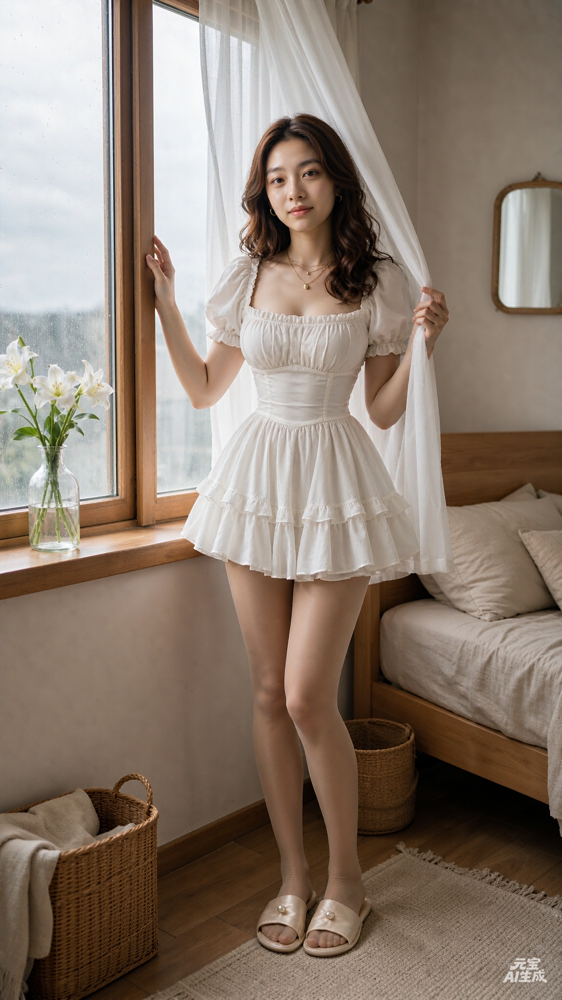

## 终稿提示词

```text
第一张图定穿搭版型配色面料，第二张图定骨相五官与本轮栗棕蓬松披肩大波浪，第三张图定本张姿势骨架与机位；脸、衣、发型、姿势由各自底图承担。

9:16 满幅画面，宽 1080 高 1920，人物与道具铺满整幅，四条边即裁切边。

她穿象牙白方领泡泡短袖束身蓬蓬迷你裙：方领口一圈细抽褶、两枚蓬起的短泡袖、胸下到腰窝竖向压褶的贴身束身段、腰下散开两层蓬松短裙摆到大腿中段，缎面微光带一点棉质柔感；颈上一根极细双层金链坠一粒小金珠；24h 浅香槟裸感连裤丝袜平口齐腿根匀透贴腿连包到脚趾，两只脚上各穿一只奶油缎面一字带软底居家拖、鞋面一粒小珍珠，丝袜脚背连进拖鞋口、脚趾在拖鞋里被浅香槟丝袜完整包着，四张同一双；奶白圆甲、无名指一点细银；栗棕蓬松披肩大波浪：发量蓬松、从发根自然分缝往后梳、两侧头发松松披过肩胛落到后背中段、发尾大而松的波浪卷逐缕可辨、耳边一缕细发垂到锁骨、后颈从披发间露出一小段。卧室靠窗一张浅木床头、铺得平整的象牙亚麻床单与刚换上的干净枕套、推开一条缝的木框窗、被穿堂风鼓起来的白纱帘、窗台一只清水玻璃瓶里插两支白茶花、床尾一只藤编小篮盛着换下的衣物、床头墙上一面小圆镜，浅木地板上床边一块长方亚麻地垫；窗外是雨后放晴的淡青灰，空气清透。

镜头是他的眼睛：他靠在床头刚咳过一阵，视点实数眼高 0.85 米，与她相隔 1.0 至 1.3 米距离带，略仰 3 度看她侧身站在窗边、把木框窗推开一条缝、白纱帘被风鼓起来、她回过脸来。他自己完全在画外，全画只有她一位成年人物。这一眼看得见她站着的整段轮廓、方领到束身压褶收进腰窝那一段、束身压褶被推窗的劲拧出一道斜褶、两层蓬裙摆被窗风掀得轻轻偏一点、大波浪被风带起来一缕擦过颊侧、耳边那缕细发、颈上双层金链的小金珠、按在窗框上的那只手与拢住纱帘的那只手；她一前一后踩在亚麻地垫上的两只奶油缎面软底拖都好好穿在脚上、浅香槟丝袜脚背连进鞋口，藤编小篮的折痕压在画面右下近景、两只拖斜在它前侧，白纱帘鼓成一大片柔亮的弧、窗台清水瓶里两支白茶花与墙上小圆镜都在，房间另一头的门与衣柜这一眼看不见。

一位成年人物、一具身体轮廓、胸大腰细腿长靠合身剪裁写实呈现、左右各一只手臂各五根手指、两只脚各自连续、两只奶油缎面软底居家拖都好好穿在脚上。全画仅此一双手，每只手全篇只出现一次、只做一个动作：右臂从右肩经肘向前上抬、经腕轻推，指尖一条连续链沿身体右侧完整可见，唯一落点是右手五指按实在木窗框边、把窗推开一条缝停住；左臂从左肩经肘向身侧收、经腕放松，指尖一条连续链沿身体左侧完整可见，唯一落点是左手五指轻轻捏住鼓起的白纱帘一角、把它从自己脸前拨开。指缝可数，两臂各从肩连续到指尖。

侧身站在窗边，两脚一前一后踩在亚麻地垫上、重心落在后脚，肩线朝窗框送过去、髋线轻轻朝他这侧转一点，脊线从后颈经腰窝到后脚的踝拉出一道舒展的斜线。她回脸慢半拍，把「还咳吗」咽回去再抬眼皮，眼从纱帘那片白上转过来正对他，右眼高光偏上偏内、左眼一道细月牙柔反光，眉心放平、把心疼压成忍住不说话的眼风，唇角往右边只弯一点就不收，像把「那股味儿我替你赶出去了」说得极轻、没打算让他回话；这个眼神长出一个可见动作：窗缝推宽半指那一下唇角同时弯一点、下巴朝窗缝轻点一下，右手五指推完停住，捏着纱帘的左手五指位置不动。

雨后放晴的淡青灰天光从窗口整片斜进来，白纱帘吃光成半透的一层、只勾她颧骨、方领下那片锁骨、按在窗框上的五指指节三处，颊侧那缕与耳边细发各吃一道暖棕边、后颈披发逐缕可数，清水玻璃瓶在窗台落一粒细亮，白茶花瓣边透一点光；背光那半间卧室收成柔软的暖白，束身压褶、蓬裙摆两层边、软底拖的缎面与浅香槟丝袜细密纹理都清楚。写实摄影质感，50mm，1/250，靠在床头略仰 3 度，机位稳住不动。
```

## 一句点评

推窗那一格把栗棕大波浪与白纱帘一起立住
