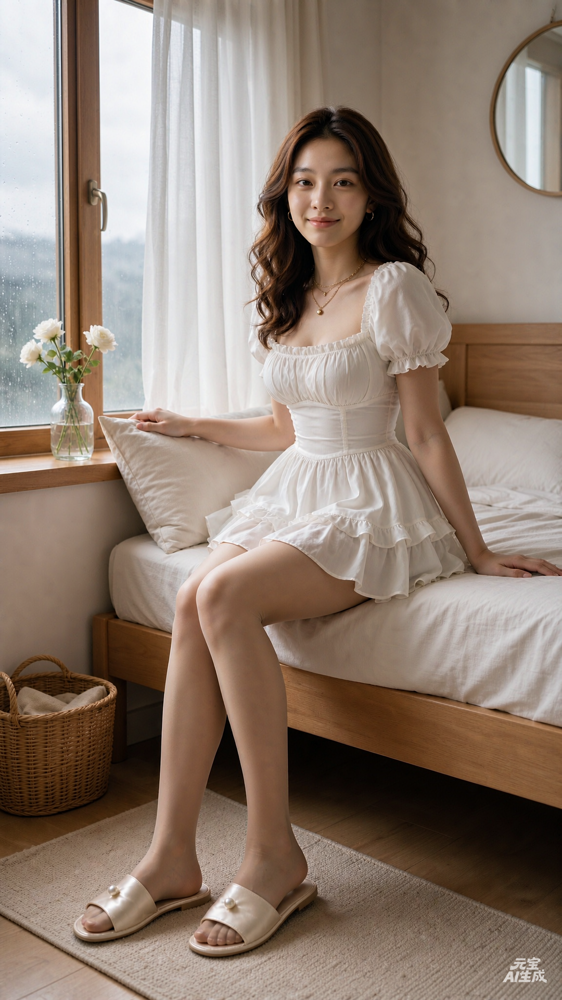

## 终稿提示词

```text
第一张图定穿搭版型配色面料，第二张图定骨相五官与本轮栗棕蓬松披肩大波浪，第三张图定本张姿势骨架与机位；脸、衣、发型、姿势由各自底图承担。

9:16 满幅画面，宽 1080 高 1920，人物与道具铺满整幅，四条边即裁切边。

她穿象牙白方领泡泡短袖束身蓬蓬迷你裙：方领口一圈细抽褶、两枚蓬起的短泡袖、胸下到腰窝竖向压褶的贴身束身段、腰下散开两层蓬松短裙摆到大腿中段，缎面微光带一点棉质柔感；颈上一根极细双层金链坠一粒小金珠；24h 浅香槟裸感连裤丝袜平口齐腿根匀透贴腿连包到脚趾，两只脚上各穿一只奶油缎面一字带软底居家拖、鞋面一粒小珍珠，丝袜脚背连进拖鞋口、脚趾在拖鞋里被浅香槟丝袜完整包着，四张同一双；奶白圆甲、无名指一点细银；栗棕蓬松披肩大波浪：发量蓬松、从发根自然分缝往后梳、两侧头发松松披过肩胛落到后背中段、发尾大而松的波浪卷逐缕可辨、耳边一缕细发垂到锁骨、后颈从披发间露出一小段。卧室靠窗一张浅木床头、铺得平整的象牙亚麻床单、刚换上又拍松的干净枕套、推开一条缝的木框窗、被穿堂风鼓起来的白纱帘、窗台一只清水玻璃瓶里插两支白茶花、床尾一只藤编小篮盛着换下的衣物、床头墙上一面小圆镜，浅木地板上床边一块长方亚麻地垫；窗外是雨后放晴的淡青灰，空气清透。

镜头是他的眼睛：他靠在床头，视点实数眼高 0.8 米，与她相隔 0.45 至 0.65 米距离带，平看略仰 2 度看她坐到床沿、把拍松的那一只干净亚麻枕套两角轻轻垫到他颈后。他自己完全在画外，全画只有她一位成年人物。这一眼大半画幅让给她俯过来的脸与肩：方领到束身压褶收进腰窝那一段、两层蓬裙摆在床沿堆出一小圈、大波浪从肩头滑下来一缕擦过她自己颊侧、发梢正好搭在枕垫软褶的起点、同一道弧线进画，耳边那缕细发、颈上双层金链的小金珠、捏着枕套两角的那只手与撑在床沿的另一只手，以及床边亚麻地垫上两只奶油缎面软底拖、浅香槟丝袜脚背连进鞋口；白纱帘在窗边鼓成柔亮一片、窗台清水瓶里两支白茶花、藤编小篮与墙上小圆镜都在，房间另一头的门与衣柜这一眼看不见。

一位成年人物、一具身体轮廓、胸大腰细腿长靠合身剪裁写实呈现、左右各一只手臂各五根手指、两只脚各自连续、两只奶油缎面软底居家拖都好好穿在脚上。全画仅此一双手，每只手全篇只出现一次、只做一个动作：右臂从右肩经肘向前下伸、经腕轻转，指尖一条连续链沿身体右侧完整可见，唯一落点是右手五指捏住那一只干净亚麻枕套的两角、先停半秒让拇指在枕套边压出一道浅折、再把它轻轻垫到他颈后抻平半寸停住；左臂从左肩经肘向下撑、经腕压平，指尖一条连续链沿身体左侧完整可见，唯一落点是左手五指按实在自己身侧的床沿木边上、把俯过去的上身稳稳撑住。指缝可数，两臂各从肩连续到指尖。

侧坐在床沿，一腿屈起收在身下、膝头往里收，一腿斜放下来让软底拖轻踩在亚麻地垫上、拖鞋尖微朝他转，整个人成一个括弧把他圈住，肩线朝他压下来、髋线留在床沿，脊线从后颈经腰窝到屈起的膝拉出一道柔弯的斜线，重心稳稳落在床沿。眼睑只落一半、视线先落在他喉结下方再抬上来正对他，右眼高光偏上偏内、左眼一道细月牙柔反光，眉梢先松着轻轻皱一下才展开、唇角往右边弯出一点浅浅的弧就不收、下唇轻咬一毫米又松开，像「你每咳一声我这边心就跟着揪一下」没说出口、只垫得慢了一点；这个眼神长出一个可见动作：捏着枕套两角那五指把枕套边再往他颈后抻平半寸、抻完停住，撑在床沿的左手五指位置不动。

雨后放晴的淡青灰天光从窗口斜进来，白纱帘吃光成半透的一层、只勾她颧骨、方领下那片锁骨、捏着枕套两角那只手的指节三处，亚麻枕套被垫起的那道软褶在天光里落一道浅影，清水玻璃瓶在窗台落一粒细亮；背光那半间卧室收成柔软的暖白，束身压褶、蓬裙摆两层边、软底拖的缎面与浅香槟丝袜细密纹理都清楚。写实摄影质感，50mm，1/250，靠床头平看略仰 2 度，机位稳住不动。
```

## 一句点评

那段话没改音频不重提不重拼
