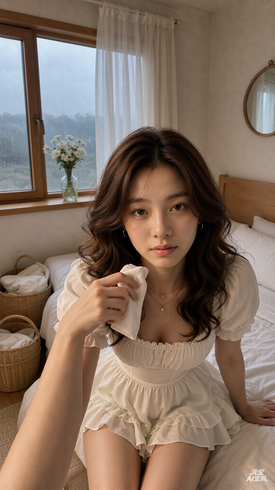

## 终稿提示词

```text
第一张图定穿搭版型配色面料，第二张图定骨相五官与本轮栗棕蓬松披肩大波浪，第三张图定本张姿势骨架与机位；脸、衣、发型、姿势由各自底图承担；第三张图的双手落点按本文重摆。

9:16 满幅画面，宽 1080 高 1920，人物与道具铺满整幅，四条边即裁切边。

她穿象牙白方领泡泡短袖束身蓬蓬迷你裙：方领口一圈细抽褶、两枚蓬起的短泡袖、胸下到腰窝竖向压褶的贴身束身段、腰下散开两层蓬松短裙摆到大腿中段，缎面微光带一点棉质柔感；颈上一根极细双层金链坠一粒小金珠；24h 浅香槟裸感连裤丝袜平口齐腿根匀透贴腿连包到脚趾，两只脚上各穿一只奶油缎面一字带软底居家拖、鞋面一粒小珍珠，丝袜脚背连进拖鞋口、脚趾在拖鞋里被浅香槟丝袜完整包着，四张同一双；奶白圆甲、无名指一点细银；栗棕蓬松披肩大波浪：发量蓬松、从发根自然分缝往后梳、两侧头发松松披过肩胛落到后背中段、发尾大而松的波浪卷逐缕可辨、耳边一缕细发垂到锁骨、后颈整截从披发间露出来。卧室靠窗一张浅木床头、铺得平整的象牙亚麻床单与刚垫好的干净枕套、推开一条缝的木框窗、已经停风垂下来的白纱帘、窗台一只清水玻璃瓶里插两支白茶花、床尾一只藤编小篮盛着换下的衣物、一方折得齐整的干净手帕、床头墙上一面小圆镜，浅木地板上床边一块长方亚麻地垫；窗外是雨后放晴转薄暮的淡青灰，空气清透。

镜头是他的眼睛：他躺平把头搁在刚垫好的枕套上，视点实数眼高 0.55 米、贴着枕头平视往上看，与她相隔 0.25 至 0.4 米距离带；镜头就是他的眼睛，他自己连后脑都完全在画外，全画只有她一位成年人物、一具身体轮廓。画面顶边由她垂落的栗棕大波浪压成一小片软帘、她两只眼睛从发帘底下露出来，画面下缘是象牙亚麻床单与枕套边糊成的一片软框，手帕折角那一点白落在软框边、正好停在画外他嘴角的方向，观众看不见人只看那一点白轻轻动。这一眼大半画幅让给她俯下来的脸与领口那一段：方领到束身压褶顺着俯身收下去的曲线、两枚泡袖的圆边、耳边那缕细发、发帘底下那双眼睛、捏着干净手帕一角的两指指腹与奶白甲面；清水瓶里两支白茶花虚在窗边、墙上小圆镜反一小片天光，远处房门、衣柜与整扇窗都在这一眼看不见的上方。

一位成年人物、一具身体轮廓、胸大腰细腿长靠合身剪裁写实呈现、左右各一只手臂各五根手指、两只脚各自连续、两只奶油缎面软底居家拖都好好穿在脚上。全画仅此一双手，每只手全篇只出现一次、只做一个动作：右臂从右肩经肘向下弯到画外他脸侧、经腕轻转，指尖一条连续链沿身体右侧完整可见，唯一落点是右手食指与中指两指指腹捏着那方折得齐整的干净手帕一角、轻轻按在画外他嘴角边一下、按完贴着不撤不加力、跟他脸一起微微起伏，像替他按住那声没出来的咳，其余三指自然收拢；左臂从左肩经肘向下撑、经腕压平，指尖一条连续链沿身体左侧完整可见，唯一落点是左手五指按实在自己身侧的床单上、把俯下去的上身稳稳撑住。指缝可数，两臂各从肩连续到指尖。

前倾坐在床沿、臀髋轻轻后坐留出一层不敢压上去的分寸，一膝微立、另一腿舒舒展展斜放下来让软底拖轻搭在亚麻地垫上，肩线朝他低下来、髋线留在床沿，脊线从后颈经腰窝到微立的膝拉出一道柔弯的斜线，重心稳稳落在床沿。眉心放平不皱、唇角那点弧收干净抿成一条软线，呼吸比他慢半拍、随他胸口轻轻点一次头就不动，眼睑从发帘底下落下来正对镜头，右眼高光偏上偏内、左眼一道细月牙柔反光，像她比他还稳、把那点心疼全压进不说话里；这个眼神长出一个可见动作：捏着手帕角那两指贴着画外他嘴角轻轻起伏一下就停住、贴着不撤，撑在床单上的左手五指位置不动。

雨后放晴转薄暮的淡青灰天光从窗口只剩一线，全画唯一的亮留给手帕那道折边，颊侧、方领、锁骨与颈上小金珠都收进柔软的暖白里，白纱帘停风垂着、白茶花影不动，前三张做事的动静到这张全关掉；背光那半间卧室收成柔软的暖白，束身压褶、蓬裙摆两层边、软底拖的缎面与浅香槟丝袜细密纹理都清楚。写实摄影质感，50mm，1/250，贴着枕头平视，机位稳住不动。
```

## 一句点评

第3张连出三版终审回退第一版;第4张按建议换线稿用发帘压画顶加手帕一点白收尾与R005收法不撞;上一轮沙发薄毯温水绿萝落地灯零复用本轮另起推窗换干净枕套白茶花手帕
