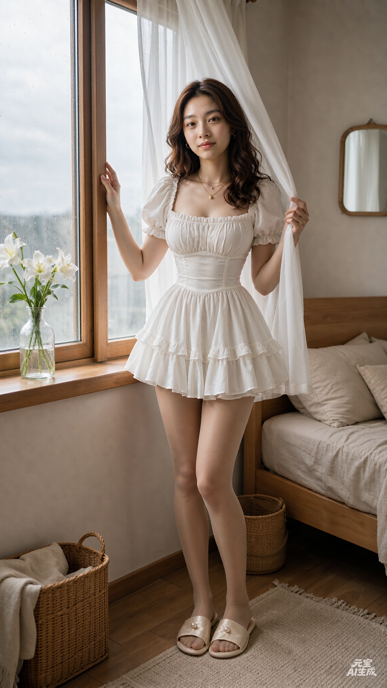
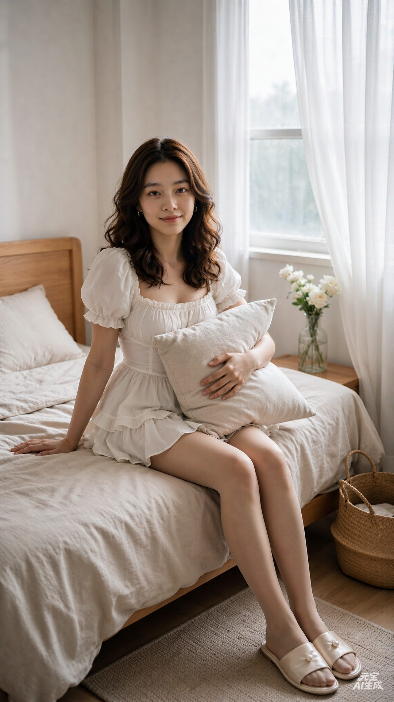
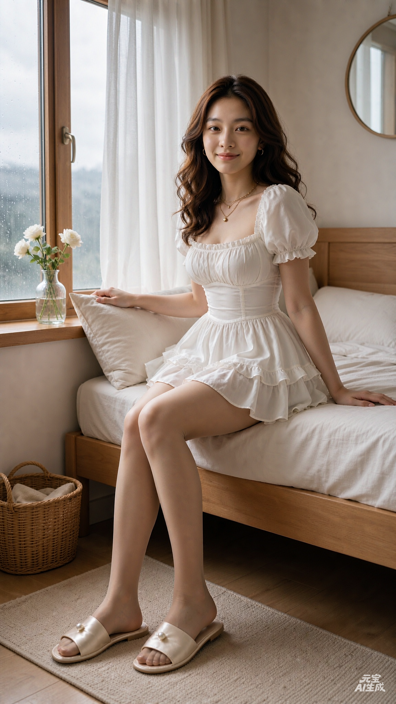
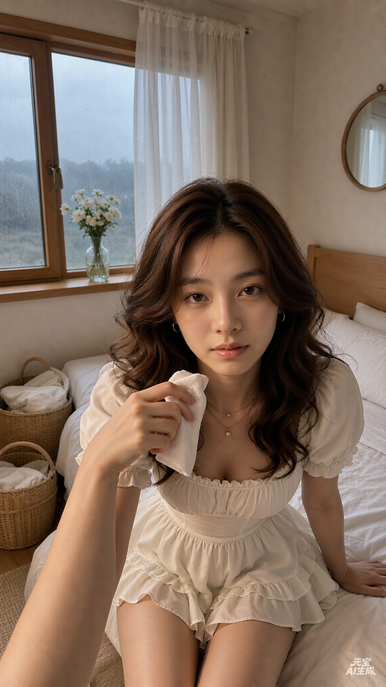

# R006 · 一闻到大肠杆菌就不停咳嗽

- 轮次目录：`20261126f_fresh-window-care`
- 日期：2026-11-26
- 穿搭：`SPR-0014`
- 四张线稿：`full_single_P021_diagonal`、full_single_P001_side`、full_single_P044_side`、full_single_P070_low`
- 画幅：1080×1920（9:16），纯画面，工具水印随图保留

## 四张

| 序 | 机位 | 图 | 终稿提示词 |
|---|---|---|---|
| 01 | front |  | [01_front.md](01_front.md) |
| 02 | side |  | [02_side.md](02_side.md) |
| 03 | seat |  | [03_seat.md](03_seat.md) |
| 04 | close |  | [04_close.md](04_close.md) |

## 这一段说了什么

1. 咳成这样还硬撑着不吭声，窗我替你推开了，风进来那股闷气就散啦，你只管靠着别动。
2. 枕套刚换的，晒了一上午太阳味。你别抢着起来，抱着闻闻就好，今晚这一整屋都归我收拾。
3. 垫高一点你咳着才顺。别皱眉啦，我手慢是我自己要慢，谁让你一咳我这边就跟着乱。
4. 手帕折了四层，按着别说话。窗合上了，茶花也不动，我就这么守到你自己睡着为止。

## 现场记录

- 01_front：推窗那一格把栗棕大波浪与白纱帘一起立住
- 02_side：两只奶油缎面软底拖都在脚上
- 03_seat：那段话没改音频不重提不重拼
- 04_close：第3张连出三版终审回退第一版;第4张按建议换线稿用发帘压画顶加手帕一点白收尾与R005收法不撞;上一轮沙发薄毯温水绿萝落地灯零复用本轮另起推窗换干净枕套白茶花手帕

> 原图 PNG 永不转码、永不覆盖；预览用 `` 缩放原图。
