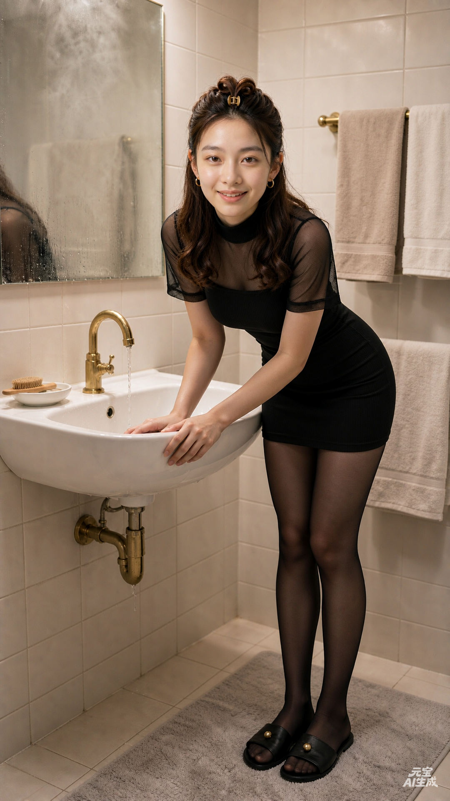

## 终稿提示词

```text
第一张图定穿搭版型配色面料，第二张图定骨相五官与本轮栗棕半扎发，第三张图定本张姿势骨架与机位；脸、衣、发型、姿势由各自底图承担，第三张图的双手落点按本文重摆；本张是站立俯身，两腿站直、膝不弯不跪、不画成蹲姿或跪姿。

9:16 满幅画面，宽 1080 高 1920，人物与道具铺满整幅，四条边即裁切边。

她穿黑色半高领短袖网纱贴身迷你裙：半高领口贴合颈根、两枚到手肘上方的黑色薄透网纱短袖、领口下一圈同色细罗纹、胸下到大腿中段是贴身的黑色细罗纹针织裙身，裙摆齐平收在大腿中段；24h 黑色匀透连裤丝袜平口齐腿根、贴腿连包到脚趾，两只脚上各穿一只黑色缎面一字带软底居家拖、鞋面各一粒小哑金珠，黑丝脚背连进拖鞋口、脚趾在拖鞋里被黑丝完整包着，四张同一双；雾红圆甲、无名指一点细哑金；一对小哑金耳圈；栗棕半扎发：头顶前半区向后梳拢、后脑偏高处一枚哑金小抓夹松松束起一小束、束起那束发尾卷成两三个松卷垂到后颈，其余头发从耳侧自然披下越过肩胛落到后背中段、下半段是松而大的波浪卷逐缕可辨，耳边各一缕细发垂到锁骨，发际线柔和、后颈从披发间露出一小段。洗漱间一方白瓷台盆、黄铜龙头还挂着两三滴水、台面一只白瓷小碟盛着一枚木柄发梳、一面蒙着薄水汽的方镜、叠好的米白大浴巾搭在台沿、墙上一排黄铜小挂钩挂着两条干净毛巾、脚下一块浅灰短绒地垫，暖白瓷砖墙；屋里是刚放过热水的薄薄水汽。

镜头是他的眼睛：他刚洗完头坐在台盆前的矮凳上，额发还湿着，视点实数眼高 0.95 米，与她相隔 0.5 至 0.7 米距离带，抬头仰看 12 度看她从台盆另一侧俯身探过来。他自己完全在画外，全画只有她一位成年人物。这一眼看得见她俯下来的整段轮廓、半高领到贴身罗纹收进腰窝那一段、两枚网纱短袖被俯身压出的软弧、裙摆齐在大腿中段、黑丝从裙摆下整段连到两只黑缎软底拖、脚背连进鞋口，半扎的抓夹与那束向前翘起的松卷在俯身时正对着他、两三个卷各自分开、抓夹金面反一粒黄豆大的暖点、右侧鬓角一缕被水汽沾深一个色的发贴着耳圈弯下去、耳边那两缕细发垂下来、一对小哑金耳圈、额前被水汽沾软的几缕碎发；白瓷台盆边沿占画面下缘一整条、黄铜龙头那两三滴水、白瓷小碟里的木柄发梳、蒙雾的方镜与墙上两条干净毛巾都在，门外玄关与这间屋子另一头这一眼看不见。

一位成年人物、一具身体轮廓、胸大腰细腿长靠合身剪裁写实呈现、左右各一只手臂各五根手指、两只脚各自连续、两只黑色缎面软底居家拖都好好穿在脚上。全画仅此一双手，每只手全篇只出现一次、只做一个动作：右臂从右肩经肘向前下探、经腕压平，指尖一条连续链沿身体右侧完整可见，唯一落点是右手五指按实在白瓷台盆的右沿上、把俯下去的上身稳稳撑住；左臂从左肩经肘向前下探、经腕压平，指尖一条连续链沿身体左侧完整可见，唯一落点是左手五指按实在白瓷台盆的左沿上、与右手一起把她架在他上方。指缝可数，两臂各从肩连续到指尖。

两脚一前一后踩在浅灰短绒地垫上、两腿都站直、重心落在前脚，她的整张脸与胸口都朝镜头、正脸对着他、两只眼睛与眉眼完整可见、不画成侧背或后脑，肩线朝他压下来、髋线留在台盆另一侧，脊线从后颈经腰窝到后脚的踝拉出一道舒展的斜线，薄网纱短袖随俯身垂下一线；两只手都从各自肩头完整伸到台盆左右沿、两条手臂各一条链都看得见、不藏在身侧。她视线先落在他湿着往前贴的额发上停一拍才抬眼、抬时下巴不跟着抬留在低压位置，右眼高光偏上偏内、左眼一道细月牙柔反光，眉梢松着、上唇比下唇先动一线像半个字咽回去、鼻尖往下点约一厘米、唇角往右边只弯一点就不收，像「水还热着呢，你低一点嘛」说得极轻、没打算让他回话；这个眼神长出一个可见动作：按在台盆右沿那五指往他这侧挪了半指、挪完停住，前脚脚趾在黑缎拖里微微蜷一下像随时要下凳替他带门，左沿那五指位置不动。

洗漱间顶灯是暖白的一整片柔光，从她左上斜下来，全画两处最亮留给她的鼻尖与白瓷台盆沿那一道窄亮，颧骨、半高领下那片锁骨、按在台盆沿的两处指节各收半档，半扎那束松卷边缘透一点暖棕、网纱短袖的细网纹在光里可数，黄铜龙头那两三滴水各反一粒细亮，裙摆以下融进一片雾灰；背后蒙雾的方镜吃光成一片柔灰，黑丝细密纹理与黑缎拖鞋面都清楚。写实摄影质感，50mm，1/250，坐着抬头仰看 12 度，机位稳住不动。
```

## 一句点评

她俯身撑住台盆沿正对镜头那一眼最稳
