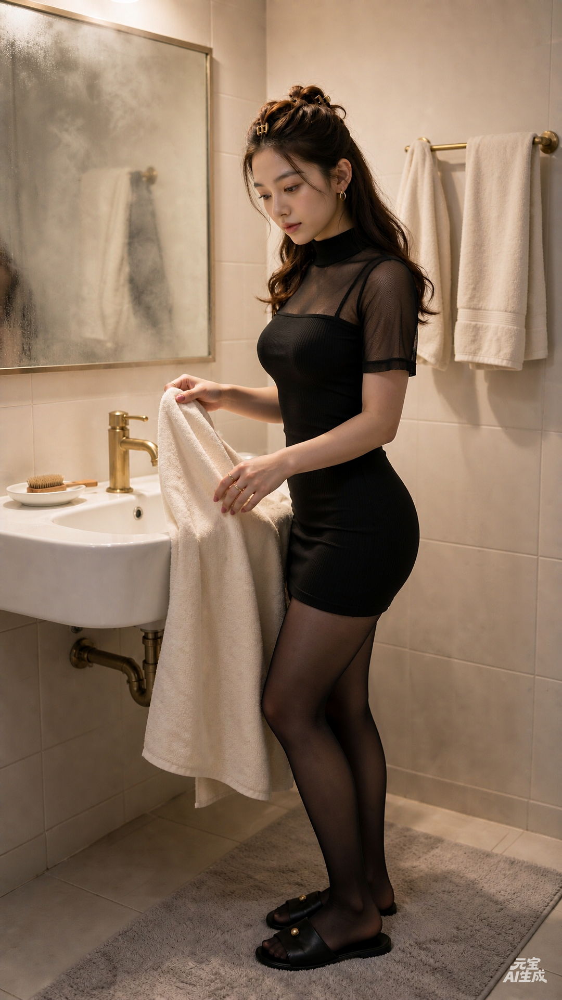

## 终稿提示词

```text
第一张图定穿搭版型配色面料，第二张图定骨相五官与本轮栗棕半扎发，第三张图定本张姿势骨架与机位；脸、衣、发型、姿势由各自底图承担，第三张图的双手落点按本文重摆。

9:16 满幅画面，宽 1080 高 1920，人物与道具铺满整幅，四条边即裁切边。

她穿黑色半高领短袖网纱贴身迷你裙：半高领口贴合颈根、两枚到手肘上方的黑色薄透网纱短袖、领口下一圈同色细罗纹、胸下到大腿中段是贴身的黑色细罗纹针织裙身，裙摆齐平收在大腿中段；24h 黑色匀透连裤丝袜平口齐腿根、贴腿连包到脚趾，两只脚上各穿一只黑色缎面一字带软底居家拖、鞋面各一粒小哑金珠，黑丝脚背连进拖鞋口、脚趾在拖鞋里被黑丝完整包着，四张同一双；雾红圆甲、无名指一点细哑金；一对小哑金耳圈；栗棕半扎发：头顶前半区向后梳拢、后脑偏高处一枚哑金小抓夹松松束起一小束、束起那束发尾卷成两三个松卷垂到后颈，其余头发从耳侧自然披下越过肩胛落到后背中段、下半段是松而大的波浪卷逐缕可辨，耳边各一缕细发垂到锁骨，发际线柔和、后颈从披发间露出一小段。洗漱间一方白瓷台盆、黄铜龙头、台面一只白瓷小碟盛着一枚木柄发梳、一面蒙着薄水汽的方镜、墙上黄铜小挂钩挂着两条干净毛巾、脚下一块浅灰短绒地垫，暖白瓷砖墙；屋里是刚放过热水的薄薄水汽，一条米白大浴巾被她双手抖开在身前。

镜头是他的眼睛：他坐在台盆前的矮凳上刚把脸擦过，视点实数眼高 1.05 米，与她相隔 0.8 至 1.0 米距离带，平看略仰 4 度看她侧身站在台盆右端、把那条米白大浴巾在身前抖开、正要往他这边送。他自己完全在画外，全画只有她一位成年人物。这一眼看得见她侧站的整段轮廓、半高领到贴身罗纹收进腰窝那一段、两枚网纱短袖的圆边、裙摆齐在大腿中段、黑丝从裙摆下整段连到两只黑缎软底拖、脚背连进鞋口，半扎的抓夹与那束松卷在侧脸后头露出来、耳边那两缕细发、一对小哑金耳圈、抖开的米白大浴巾铺成一大片柔亮的面、浴巾两角被她两手各捏一只；白瓷台盆与黄铜龙头在画面左侧收成一条边、白瓷小碟里的木柄发梳、蒙雾的方镜与墙上两条干净毛巾都在，门外玄关这一眼看不见。

一位成年人物、一具身体轮廓、胸大腰细腿长靠合身剪裁写实呈现、左右各一只手臂各五根手指、两只脚各自连续、两只黑色缎面软底居家拖都好好穿在脚上。全画仅此一双手，每只手全篇只出现一次、只做一个动作：右臂从右肩经肘向身前抬、经腕轻抖，指尖一条连续链沿身体右侧完整可见，唯一落点是右手五指捏住米白大浴巾的右上角、把它向外抖开停住；左臂从左肩经肘向身前抬、经腕轻抖，指尖一条连续链沿身体左侧完整可见，唯一落点是左手五指捏住米白大浴巾的左上角、与右手一起把浴巾抖成一面停住。指缝可数，两臂各从肩连续到指尖。

斜侧约 60 度站在台盆右端、双肩转成斜线不正对镜头、左肩略前、髋往后坐半寸，前脚朝他踏前半步、两脚一前一后踩在浅灰短绒地垫上、重心实落在后脚、裙摆随踏步荡出一点，脊线从后颈经腰窝到后脚的踝拉出一道舒展的斜线。眼从浴巾那片白的上缘压下来、垂眼落在画面左下画外矮凳上他的眼睛、下颌微收一点，像低头看一个刚被自己照顾好的人，右眼高光偏上偏内、左眼一道细月牙柔反光，眼神比浴巾暗半档、颧骨那点高光收掉，眉心平、右侧眉尾随唇角轻挑一线、唇角只往右边弯出一点浅浅的弧、嘴唇轻轻合着不露齿，像「毛巾烘得暖暖的，转过来」说得又轻又稳；这个眼神长出一个可见动作：捏着浴巾右上角那五指把浴巾往画面左下送、右下角进到画面下缘约三分之一像碰到他膝盖、送完眼没走多留一拍等他接，前脚掌悄悄碾一下地垫像下一秒要绕过去给他擦后颈，捏着左上角的左手五指位置不动。

洗漱间顶灯是暖白的一整片柔光，从她左上斜下来，米白大浴巾吃光成全画最亮的一块、靠胸口那侧带一层烘过的微暖黄、下摆软褶压一点浅灰影、水汽里粘一丝暖雾，浴巾下缘离小腹留一掌缝、黑裙侧腰线从缝里漏一段；只勾她颧骨、半高领下那片锁骨、捏着浴巾两角的两处指节三处，垂眼时那束松卷顺着后脑往下垂成一段绳状松卷、像随手一夹、哑金抓夹反一点暖光、耳边细发被浴巾气流掀开半寸、网纱短袖的细网纹在光里可数，露出的黑裙侧腰缝比原先再窄一点，黄铜龙头反一粒细亮、白瓷台盆边沿一道窄亮，黑裙不加光压住；背后蒙雾的方镜吃光成一片柔灰，黑丝细密纹理与黑缎拖鞋面都清楚。写实摄影质感，50mm，1/250，坐着平看略仰 4 度，机位稳住像怕一动水汽又扑上来。
```

## 一句点评

烘过的米白浴巾往左下送出去那半寸最柔
