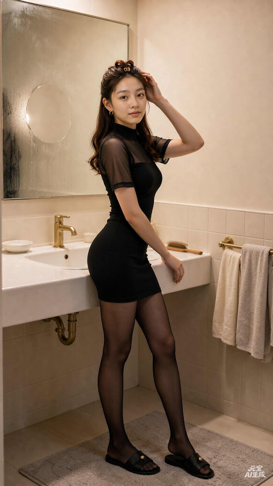

## 终稿提示词

```text
第一张图定穿搭版型配色面料，第二张图定骨相五官与本轮栗棕半扎发，第三张图定本张姿势骨架与机位；脸、衣、发型、姿势由各自底图承担，第三张图的双手落点按本文重摆。

9:16 满幅画面，宽 1080 高 1920，人物与道具铺满整幅，四条边即裁切边。

她穿黑色半高领短袖网纱贴身迷你裙：半高领口贴合颈根、两枚到手肘上方的黑色薄透网纱短袖、领口下一圈同色细罗纹、胸下到大腿中段是贴身的黑色细罗纹针织裙身，裙摆齐平收在大腿中段；24h 黑色匀透连裤丝袜平口齐腿根、贴腿连包到脚趾，两只脚上各穿一只黑色缎面一字带软底居家拖、鞋面各一粒小哑金珠，黑丝脚背连进拖鞋口、脚趾在拖鞋里被黑丝完整包着，四张同一双；雾红圆甲、无名指一点细哑金；一对小哑金耳圈；栗棕半扎发：头顶前半区向后梳拢、后脑偏高处一枚哑金小抓夹松松束起一小束、束起那束发尾卷成两三个松卷垂到后颈，其余头发从耳侧自然披下越过肩胛落到后背中段、下半段是松而大的波浪卷逐缕可辨，耳边各一缕细发垂到锁骨，发际线柔和、后颈从披发间露出一小段。洗漱间一方白瓷台盆、黄铜龙头、台面一只白瓷小碟盛着一枚木柄发梳、一面蒙着薄水汽的方镜、镜面上被指腹擦出巴掌大一块清亮的圆、圆边缘带两道没擦匀的指痕、高度正对她眼睛、圆内一粒细亮，墙上黄铜小挂钩挂着两条干净毛巾、脚下一块浅灰短绒地垫，暖白瓷砖墙；屋里是刚放过热水的薄薄水汽，方镜整面只映一片均匀柔灰的暖光与水汽细珠、绝对干净、镜里没有任何人形轮廓、没有第二个人、没有抬手头肩躯干的影子。

镜头是他的眼睛：他把脸擦干、往矮凳背上靠了半寸，视点实数眼高 1.0 米，与她相隔 0.6 至 0.8 米距离带，平看略仰 6 度看她站在蒙雾的方镜前、一只手抬到后脑把被水汽沾软的那束松卷别回抓夹、另一只手撑在台沿、回过脸来。他自己完全在画外，全画只有她一位成年人物。这一眼看得见她侧转过来的整段轮廓、半高领到贴身罗纹收进腰窝那一段、两枚网纱短袖的圆边、裙摆齐在大腿中段、黑丝从裙摆下整段连到两只黑缎软底拖、脚背连进鞋口，半扎的抓夹与那束被别回去的松卷、抬到后脑的那只手的五指、耳边那两缕细发、一对小哑金耳圈；蒙雾方镜占画面左侧一大片均匀柔灰、镜里只有水汽细珠没有人形、那一小块被擦亮的圆透出后面的暖白瓷砖、白瓷台盆与黄铜龙头收在画面下缘、白瓷小碟里的木柄发梳与墙上两条干净毛巾都在，门外玄关这一眼看不见。

一位成年人物、一具身体轮廓、胸大腰细腿长靠合身剪裁写实呈现、左右各一只手臂各五根手指、两只脚各自连续、两只黑色缎面软底居家拖都好好穿在脚上。全画仅此一双手，每只手全篇只出现一次、只做一个动作：右臂从右肩经肘向上后弯、经腕轻转，指尖一条连续链沿身体右侧完整可见，唯一落点是右手五指轻轻抚到后脑那枚哑金抓夹上、把被水汽沾软的一缕松卷别回夹下停住；左臂从左肩经肘向下后撑、经腕压平，指尖一条连续链沿身体左侧完整可见，唯一落点是左手五指按实在白瓷台盆的近侧沿上、把侧转过来的上身稳稳撑住。指缝可数，两臂各从肩连续到指尖。

站在方镜前，两脚一前一后踩在浅灰短绒地垫上、后脚脚尖轻轻踮起一点，肩线朝他松松转过来、髋线留在台边，脊线从后颈经腰窝到后脚的踝拉出一道柔弯的斜线，抬手别发时腰窝那道罗纹被拉出一道紧弧、裙摆随抬手只微微偏移仍齐平大腿中段。眼从镜面那片柔灰上转过来正对他，右眼高光偏上偏内、左眼一道细月牙柔反光，右侧眉梢只提起一半就停住、眼睑随之下压一线，像提前知道他要说什么，唇角弯出浅弧、话像已说出口、随即下唇抿住半个笑压回去，像「镜子全起雾了，我拿梳子把这边理一理」带着一点自己的小脾气；这个眼神长出一个可见动作：抚在抓夹上那五指把那缕松卷再压实一点、压完停住，撑在台沿的左手五指位置不动。

洗漱间顶灯是暖白的一整片柔光，从她左上斜下来只勾她颧骨、半高领下那片锁骨、抚到后脑那五指的指节与撑在台沿那五指的指节四处，抬起那条右臂的肘比原先下放约一拳、让哑金抓夹与束起那束松卷完整露在肘弯上方、小臂与锁骨各挂一丝凝珠，半扎那束松卷边缘透一点暖棕、网纱短袖的细网纹在光里可数，方镜被指腹擦亮的那一小块圆完整可见、边缘带两道没擦匀的指痕、高度正对她眼睛、圆内反一粒细亮，黄铜龙头那粒反光压成闷的一点；镜面柔灰压在画面左侧三分之一、整片均匀干净没有第二个人影、她那枚哑金抓夹顶在画面上三分之一、人像从雾里转出来，其余柔灰把光吃软，黑丝细密纹理与黑缎拖鞋面都清楚。写实摄影质感，50mm，1/250，靠着凳背平看略仰 6 度，像刚靠稳凳背还有一点没坐实的微顿，视线先落她后脑那只手再随回脸停在眼睛上。
```

## 一句点评

指腹擦亮的圆把满镜水汽收干净
