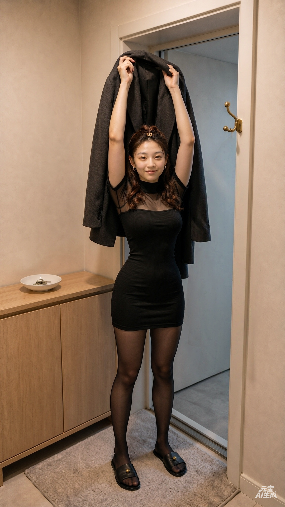

## 终稿提示词

```text
第一张图定穿搭版型配色面料，第二张图定骨相五官与本轮栗棕半扎发，第三张图定本张姿势骨架与机位；脸、衣、发型、姿势由各自底图承担，第三张图的双手落点按本文重摆，双臂上举的骨架保留、肩胛不外翻，重心往画外他这侧送。

9:16 满幅画面，宽 1080 高 1920，人物与道具铺满整幅，四条边即裁切边。

她穿黑色半高领短袖网纱贴身迷你裙：半高领口贴合颈根、两枚到手肘上方的黑色薄透网纱短袖、领口下一圈同色细罗纹、胸下到大腿中段是贴身的黑色细罗纹针织裙身，裙摆齐平收在大腿中段；24h 黑色匀透连裤丝袜平口齐腿根、贴腿连包到脚趾，两只脚上各穿一只黑色缎面一字带软底居家拖、鞋面各一粒小哑金珠，黑丝脚背连进拖鞋口、脚趾在拖鞋里被黑丝完整包着，四张同一双；雾红圆甲、无名指一点细哑金；一对小哑金耳圈；栗棕半扎发：头顶前半区向后梳拢、后脑偏高处一枚哑金小抓夹松松束起一小束、束起那束发尾卷成两三个松卷垂到后颈，其余头发从耳侧自然披下越过肩胛落到后背中段、下半段是松而大的波浪卷逐缕可辨，耳边各一缕细发垂到锁骨，发际线柔和、后颈从披发间露出一小段。玄关一方浅木矮柜、柜面一只白瓷小碟盛着两把钥匙、门边黄铜挂钩空着、深灰外套全屋只有一件、就是她两手举在头顶那件、挂钩上不挂别的衣物、门内一块浅灰短绒地垫、门缝外是傍晚淡青灰的一线天光，玄关墙是暖白，屋里那盏顶灯把这一小块照得暖。

镜头是他的眼睛：他洗完头擦干、从洗漱间走到玄关站定，视点实数眼高 1.55 米，与她相隔 0.7 至 0.9 米距离带，平看略俯 3 度看她踮着脚把那件深灰外套举过自己头顶、递到他手边。他自己完全在画外，全画只有她一位成年人物。这一眼看得见她踮脚举起的整段舒展轮廓、半高领到贴身罗纹收进腰窝那一段、两枚网纱短袖随双臂上举拉出的软弧、裙摆齐在大腿中段、黑丝从裙摆下整段连到两只黑缎软底拖、脚背连进鞋口、前脚踮起后脚踩实地垫，半扎的抓夹与那束松卷、举起的双臂从肩到指尖两条完整的链、耳边那两缕细发、一对小哑金耳圈、被她两手举在头顶的深灰外套铺成一小片柔软的灰；浅木矮柜与柜面白瓷小碟里两把钥匙收在画面下缘、门边黄铜挂钩空着、门缝外那一线淡青灰都在，洗漱间与屋子另一头这一眼看不见。

一位成年人物、一具身体轮廓、胸大腰细腿长靠合身剪裁写实呈现、左右各一只手臂各五根手指、两只脚各自连续、两只黑色缎面软底居家拖都好好穿在脚上。全画仅此一双手，每只手全篇只出现一次、只做一个动作：右臂从右肩经肘向上举、经腕轻托，指尖一条连续链沿身体右侧完整可见，唯一落点是右手五指托住深灰外套的右肩线、把外套举过她自己头顶递向画外他手边停住；左臂从左肩经肘向上举、经腕轻托，指尖一条连续链沿身体左侧完整可见，唯一落点是左手五指托住深灰外套的左肩线、与右手一起把外套平平举稳。指缝可数，两臂各从肩连续到指尖。

踮着脚站在门内短绒地垫上，前脚脚尖点地、前脚那只黑缎拖鞋头微翘、鞋底前沿压进短绒压倒一小片、后脚踩实，肩线朝他送上去、髋线留在地垫上，脊线从后颈经腰窝到踮起那只脚的踝拉出一道拔起来、到肩胛处往画外右侧微送半寸的线。下巴微收、眼睛从灰外套下沿露出来看他、仰着脸从举起的双臂之间正对他，右眼高光偏上偏内、左眼一道细月牙柔反光，眉梢松着、唇角由右边先起一点弧、下唇像刚咽回半句、不收成对称的完整笑，像忽然想起什么、舌尖轻抵了下右上唇又放下、眼神没躲，像「外套拿着，门口风凉」说完了还留半句没说；这个眼神长出一个可见动作：托着外套右肩线那五指把外套往他手边送、靠他那侧的外套布角低垂三五厘米、被右手指尖攥出一道浅褶、布角刚碰到画外他掌心高度就停住、指尖还托着没松，左腕与右手同势微微上托、托着左肩线的左手五指位置不动。

玄关顶灯是暖白的一整片柔光，从她左上斜下来只勾她颧骨、半高领下那片锁骨、举起的两处指节三处，深灰外套的羊毛纹理吃光起一层细绒、半扎那束松卷边缘透一点暖棕、网纱短袖的细网纹在光里可数，白瓷小碟里两把黄铜钥匙各反一粒细亮；门缝外那一线淡青灰把暖光衬得更软，黑裙罗纹、黑丝细密纹理与黑缎拖鞋面都清楚。写实摄影质感，50mm，1/250，站定平看略俯 3 度，机位稳住不动。
```

## 一句点评

踮脚举起的灰羊毛把画顶留给了要出门的人
