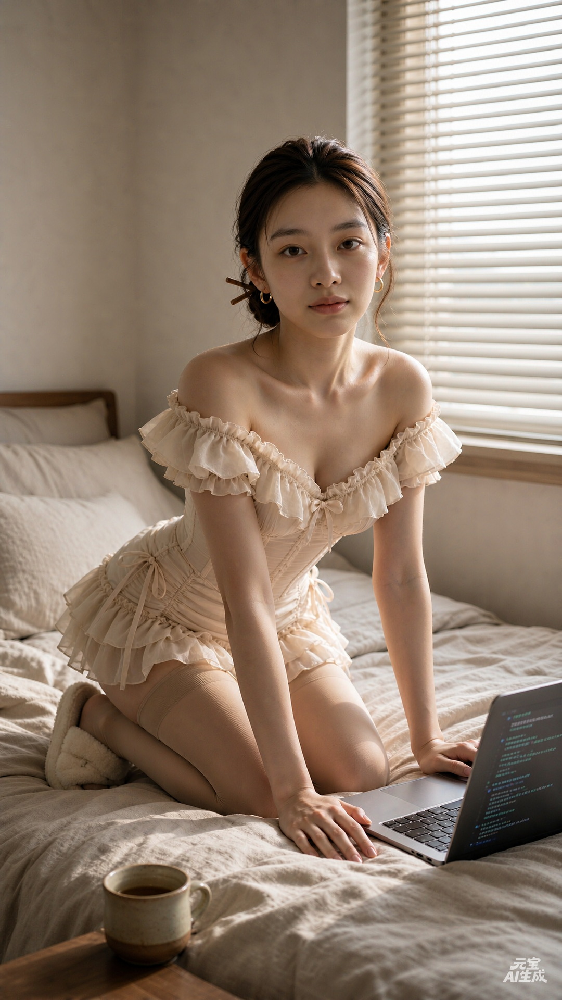

## 终稿提示词

```text
第一张图定穿搭版型配色面料，第二张图定骨相五官与本轮慵懒低盘发，第三张图定本张跪坐双手前撑的姿势骨架与机位；脸、衣、发型、姿势由各自底图承担，第三张图的双手落点按本文重摆；本张是双膝跪在床面、两小腿交叠收在身后、臀部坐在自己脚跟上、上身从髋部整体前折压过来的跪坐前撑，不是坐在床沿把腿垂到地面、不是站姿、不是平视定妆照。

9:16 满幅画面，宽 1080 高 1920，人物与道具铺满整幅、她的头与肩接近画面上缘、上方不留大片空墙，四条边即裁切边。

她穿米杏色一字肩抽褶贴身迷你连衣短裙：横一字领口贴合肩头、肩头两侧各一片双层薄透米杏荷叶边短袖、领口正中一枚同色小蝴蝶结、前中一道细密抽褶束身、两侧各一根同色细抽绳、胸下到大腿中段是贴身细罗纹抽褶裙身、裙摆两层同色细木耳边齐平收在大腿中段、无开衩；24h 浅茶色匀透连裤丝袜平口齐腿根、贴腿连包到脚趾；两只脚上各穿一只奶白色羊羔绒软底露趾居家拖、鞋面无任何金属扣，浅茶丝袜脚背连进拖鞋口、脚趾在拖鞋前口被丝袜完整包着，两只拖鞋都好好穿在两只脚上、脚背平落在床面、画面里没有第三只拖鞋、没有光着丝袜的脚，四张同一双；奶白圆甲、无名指一点细哑金；一对细哑金小耳圈；栗棕偏暖的慵懒低盘发：全部头发向后梳拢、后颈偏低处松松挽成一个压得比标准更低的扁软低髻、髻心偏左、一枚哑木小发簪斜别、左耳后露簪尾一小截并有两缕松出来乱一点的软卷贴左颈侧、耳侧各一缕细碎发垂到锁骨、鬓角碎发自然、后颈整段露出来。卧室床边：亚麻床品松松堆着、一台笔记本电脑斜摊在枕边、下沿与整块键盘都被隆起的被角挡住、画面里只看得见屏幕的代码区上半、屏幕里一行行整齐的深色等宽代码字符、行首有细小缩进与几块冷色高亮、右上角一枚小圆标、没有可辨认的单词、床边矮几上一只粗陶小杯里剩一点昨晚的茶根、百叶帘缝里一道晨光斜落在被面、浅木地板，屋里是刚醒过来那种安静。

镜头是他的眼睛：他赖在床上没起身，镜头贴着枕面从下往上、视点实数眼高 0.45 米，与她相隔 0.4 至 0.6 米距离带，仰看 15 度看她双膝跪在床面、上身从髋部前折、从枕头这一侧俯过来；这一眼看得见她下颌底面与鼻底、看不见她头顶发旋，画面下缘留一道枕沿与隆起的被角，全画是低机位仰看、不是平视也不是俯拍。他自己完全在画外，全画只有她一位成年人物。这一眼看得见她俯下来的整段轮廓、被仰角拉长的一截颈线、横一字领口到细密抽褶收进腰窝那一段、两片荷叶边短袖被俯身压出的软弧、裙摆齐在大腿中段、裙摆木耳边翻开一点、浅茶丝袜从裙摆下整段连到两只奶白绒软底拖、脚背连进拖鞋口、脚趾在拖鞋前口被丝袜完整包着，左耳后那截哑木簪尾与贴着左颈的两缕软卷、耳侧两缕细碎发、一对细哑金小耳圈、领口正中那枚小蝴蝶结；斜摊枕边的笔记本电脑只露屏幕代码区上半、键盘整块被隆起被角挡住不入画、屏上冷色高亮块、粗陶小杯里那点茶根、百叶帘缝落在被面上的一道暖白光条都在，厨房茶台与水盆那一头这一眼看不见。

一位成年人物、一具身体轮廓、胸大腰细腿长靠合身剪裁写实呈现、左右各一只手臂各五根手指、两只脚各自连续、两只奶白色羊羔绒软底露趾居家拖都好好穿在脚上。全画仅此一双手，每只手全篇只出现一次、只做一个动作：右臂从右肩经肘向他枕侧靠内一掌处前下探、经腕压平，指尖一条连续链沿身体右侧完整可见，唯一落点是右手五指按实在他枕侧靠内一掌的亚麻床面上、把俯下去的上身稳稳撑住并拉出一道斜线；左臂从左肩经肘向前上探、经腕轻转，指尖一条连续链沿身体左侧完整可见，唯一落点是左手五指整只搭在笔记本电脑屏幕的最上边框、把屏往自己这侧转一点停住，五指都在屏框上、掌心不碰键盘、不打字、不落在键盘上。指缝可数，两臂各从肩连续到指尖。

双膝跪在床面、两小腿交叠收在身后、臀部坐在自己脚跟上、重心落在按床那只手，按床那五指指腹陷进亚麻、掌根略塌，肩只压下一寸、像撑着没睡醒的体重，髋线留在床沿，脊线从后颈经腰窝到收起的膝拉出一道柔弯的斜线，两片荷叶边短袖随俯身垂下一线。她先把视线落在那屏代码上停一拍，下巴微收向锁骨、视线压下来停一瞬就松，才把眼抬到他脸上，说时鼻息轻出一下像没调好音量、说完眼皮慢一拍才抬到他脸上，右眼高光偏上偏内、左眼一道细月牙柔反光，眉梢松着、上唇比下唇先动一线像半个字咽回去、唇角往右边只弯一点就不收，像「WorkBuddy 给你写的我还得审一眼呢，嘴臭先别凑过来」说得极轻、没打算让他回话；这个眼神长出一个可见动作：搭在屏幕最上边框那五指把屏往自己这侧又转半寸、转完停住，右脚在奶白绒拖里微蜷一下又松开、拖鞋没动，按在床面那五指位置不动。

百叶帘缝里那道暖白晨光从她右后斜下来，只落在她脸侧、横一字领口与搭在屏框那五指的指节三处，光条止于右膝外侧的被面、不碰裙摆与丝袜；笔记本电脑屏的冷蓝光只在左侧下颌到锁骨留一条窄边、不铺满左颊，两光之间留一条不加光的暗过渡，交界停在颧骨上，屏上一行行等宽字符与几块冷色高亮清楚、亚麻床品的织纹与粗陶小杯的哑光都清楚，浅茶丝袜细密纹理与奶白绒软底拖的绒面也清楚。写实摄影质感，50mm，1/250，贴着枕面仰看 15 度，机位稳住不动。
```

## 一句点评

她跪在床沿俯过来看那屏代码那一眼压住了整组起拍
