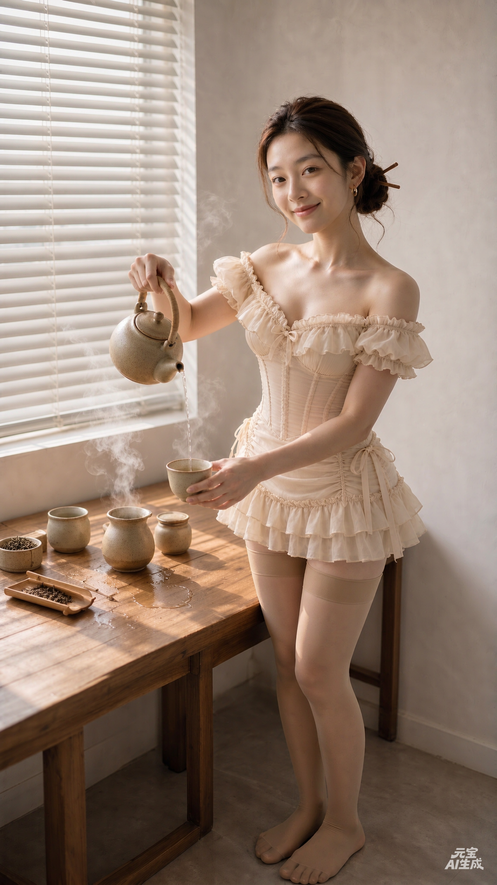

## 终稿提示词

```text
返工复核锚（STD-001.2 B5-T）：丝袜从腿根到脚尖同色连续，脚踝、脚背无横向分界、无袜口、无趾根收边；脚趾由与腿部同色的袜面完整包住，五趾轮廓在袜面里各自分明，露趾鞋与凉鞋前口里袜面一直连到趾尖并与鞋口平顺衔接；四张同一层腿部覆盖、同一双鞋。本张已按此逐字复核并重出。

第一张图定穿搭版型配色面料，第二张图定骨相五官与本轮慵懒低盘发，第三张图定本张姿势骨架与机位；脸、衣、发型、姿势由各自底图承担，第三张图的双手落点按本文重摆；本张是站立提壶，两腿站直、一臂上举一臂前扶。

9:16 满幅画面，宽 1080 高 1920，人物与道具铺满整幅，四条边即裁切边。

她穿米杏色一字肩抽褶贴身迷你连衣短裙：横一字领口贴合肩头、肩头两侧各一片双层薄透米杏荷叶边短袖、领口正中一枚同色小蝴蝶结、前中一道细密抽褶束身、两侧各一根同色细抽绳、胸下到大腿中段是贴身细罗纹抽褶裙身、裙摆两层同色细木耳边齐平收在大腿中段、无开衩；24h 浅茶色匀透连裤丝袜平口齐腿根、贴腿连包到脚趾；两只脚上各穿一只奶白色羊羔绒软底露趾居家拖、鞋面无任何金属扣，浅茶丝袜脚背连进拖鞋口、脚趾在拖鞋前口被丝袜完整包着，四张同一双；奶白圆甲、无名指一点细哑金；一对细哑金小耳圈；栗棕偏暖的慵懒低盘发：全部头发向后梳拢、后颈偏低处松松挽成一个扁软低髻、髻心偏左、一枚哑木小发簪斜别、左耳后露簪尾一小截并有一缕松出来的软卷贴左颈侧、耳侧各一缕细碎发垂到锁骨、鬓角碎发自然、后颈整段露出来。木茶台一角：一把粗陶侧把壶、两只粗陶小杯、一枚竹茶则、一只盖半开的陶茶叶罐、壶嘴一缕细细热气、被冲那只小杯杯口同时腾起一小团更白更急的汽、台面一小片浅水痕，百叶帘缝里一道晨光斜落在台面、两道细影横切过那团汽，屋里是水刚烧开那种安静。

镜头是他的眼睛：他坐在茶台旁的高凳上还没完全醒，视点实数眼高 1.1 米，与她相隔 0.8 至 1.0 米距离带，平看略仰 3 度看她站在茶台前、提起粗陶壶往一只小杯里冲下一条细热水线、侧过脸来。他自己完全在画外，全画只有她一位成年人物。这一眼看得见她站着的整段轮廓、横一字领口到细密抽褶收进腰窝那一段、两片荷叶边短袖的圆边、裙摆齐在大腿中段、浅茶丝袜从裙摆下整段连到两只奶白绒软底拖、脚背连进拖鞋口、脚趾在拖鞋前口被丝袜完整包着，左耳后那截哑木簪尾与贴着左颈的一缕软卷、耳侧两缕细碎发、一对细哑金小耳圈、后颈整段露出；粗陶侧把壶与壶嘴到杯心那条不断不溅的细热水线、被冲的那只粗陶小杯与杯口那团更白更急的汽、竹茶则、盖半开的陶茶叶罐、台面那一小片浅水痕都在，卧室那头与水盆那一头这一眼看不见。

一位成年人物、一具身体轮廓、胸大腰细腿长靠合身剪裁写实呈现、左右各一只手臂各五根手指、两只脚各自连续、两只奶白色羊羔绒软底露趾居家拖都好好穿在脚上。全画仅此一双手，每只手全篇只出现一次、只做一个动作：右臂从右肩经肘向上抬、经腕稳住，指尖一条连续链沿身体右侧完整可见，唯一落点是右手五指握在粗陶侧把壶的提梁上、把壶嘴对着一只粗陶小杯冲下一条细热水线停住；左臂从左肩经肘向前下探、经腕压平，肘往外开一点、小指微翘离杯壁，指尖一条连续链沿身体左侧完整可见，唯一落点是左手五指轻扶在那只粗陶小杯的杯壁外侧、把杯稳稳扶住。指缝可数，两臂各从肩连续到指尖。

斜侧站在木茶台前，两脚一前一后踩在浅木地板上、重心落在后脚，髋只往台边送半寸不顶、裙摆离台沿留一拳空，肩还留着刚出被子的松、一只拖鞋跟轻蹭浅木地板像刚站稳，肩线朝他松松转过来一点、髋线留在台边，脊线从后颈经腰窝到后脚的踝拉出一道舒展的斜线，两片荷叶边短袖随提壶垂下一线。眼先从那条细热水线上抬到他那儿、下巴还低着看杯，等握提梁那五指把水线收细停住，脸才侧过来正对他，右眼高光偏上偏内、左眼一道细月牙柔反光，眉心平、右侧眉尾随唇角轻挑一线、唇角往右边弯出一点浅浅的弧、嘴唇轻轻合着不露齿、下唇往内抿一下刚松开像话到嘴边又压回茶里、颊侧一线极浅用力、唇角那点弧比眼神晚半拍弯出来，像「茶先压一压你那嘴，起来再说」说得又轻又稳；这个眼神长出一个可见动作：握在提梁上那五指把水线收细一点、收完停住，扶着杯壁那五指位置不动。

百叶帘缝里那道暖白晨光从她左侧斜下来，只留她横一字领口、粗陶壶身与扶杯那五指的指节三处亮，其余压成一层浅暖暗、把亮留给后一格抬眼；壶口那缕细气与杯口那团更白更急的汽在光里成半透明的软白、汽到她扶杯指节边就散、百叶帘两道细影横切过这团汽，粗陶哑光与木茶台纹理清楚、台面那一小片浅水痕反一粒细亮，浅茶丝袜细密纹理与奶白绒软底拖的绒面都清楚。写实摄影质感，50mm，1/250，坐着平看略仰 3 度，像刚睁眼的人托着下巴看过去，画面最上一沿压一层极淡暖灰睡意，焦点只在她眼与壶嘴那条水线上，茶台前沿与地板轻虚出去。
```

## 一句点评

粗陶壶嘴那条细水线把水刚烧开说清了
