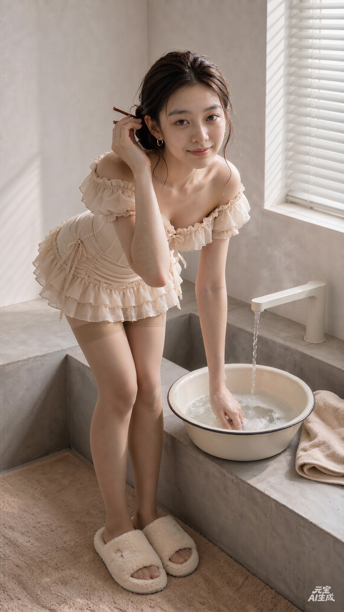

## 终稿提示词

```text
第一张图定穿搭版型配色面料，第二张图定骨相五官与本轮慵懒低盘发，第三张图定本张姿势骨架与机位；脸、衣、发型、姿势由各自底图承担，第三张图的双手落点按本文重摆；本张是站立俯身对着浅盆洗头、洗到一半，两腿站直、膝不弯不跪，不是拢头发回头看、不是抱头摆拍。

9:16 满幅画面，宽 1080 高 1920，人物与道具铺满整幅，四条边即裁切边。

她穿米杏色一字肩抽褶贴身迷你连衣短裙：横一字领口贴合肩头、肩头两侧各一片双层薄透米杏荷叶边短袖、领口正中一枚同色小蝴蝶结、前中一道细密抽褶束身、两侧各一根同色细抽绳、抽绳垂带坠向地面轻搭大腿、胸下到大腿中段是贴身细罗纹抽褶裙身、裙摆两层同色细木耳边齐平收在大腿中段、无开衩；24h 浅茶色匀透连裤丝袜平口齐腿根、贴腿连包到脚趾；两只脚上各穿一只奶白色羊羔绒软底露趾居家拖、鞋面无任何金属扣，浅茶丝袜脚背连进拖鞋口、脚趾在拖鞋前口被丝袜完整包着，后脚那只拖往左收一指宽完整落在绒面上，四张同一双；奶白圆甲、无名指一点细哑金；一对细哑金小耳圈；栗棕偏暖的慵懒低盘发：全部头发向后梳拢、后颈偏低处松松挽成一个扁软低髻、髻心偏左、一枚哑木小发簪斜别、左耳后露簪尾一小截并有一缕松出来的软卷贴左颈侧、耳侧各一缕细碎发垂到锁骨、鬓角碎发自然、后颈整段露出来；颈侧并两三绺湿发近栗黑贴着颈、发梢各带一粒将落的水珠、右鬓发根压一道湿痕、耳侧碎发只深半色、低髻顶留一寸没湿到的浅栗、低髻前坠一寸、簪尾在左耳后晃住，一眼看得出刚洗到一半。浅灰水泥台面上一只哑白搪瓷浅盆、浅盆往右让一点露出浅灰水泥台面的断口、盆里一点清水与几粒细泡沫、墙上一只短直平出的哑白出水嘴落下细细一线水、不画高弧鹅颈弯管、台面一角叠着一条浅杏色毛巾、脚下一块浅棕短绒地垫，百叶帘缝里一道晨光斜进来，盆到她下颌之间补一层极淡白雾、水汽只糊住下颌以下、眉眼那层干而清、地垫是干的没有水印。

镜头是他的眼睛：他靠在水边这一角的门框上，视点实数眼高 1.0 米，与她相隔 0.6 至 0.8 米距离带，平看略仰 6 度看她俯身对着哑白搪瓷浅盆洗头、把被水沾软的那缕发捋顺、回过脸来。他自己完全在画外，全画只有她一位成年人物。这一眼看得见她俯下来的整段轮廓、横一字领口到细密抽褶收进腰窝那一段、两片荷叶边短袖被俯身压出的软弧、薄透那层贴小臂内侧透出一线肤色软弧、袖口边沿有一点水星打湿的深色、裙摆齐在大腿中段、浅茶丝袜从裙摆下整段连到两只奶白绒软底拖、脚背连进拖鞋口、脚趾在拖鞋前口被丝袜完整包着，左耳后那截哑木簪尾与被水沾深的颈侧湿缕、右鬓那道湿痕、耳侧两缕细碎发、一对细哑金小耳圈、湿发梢上将落的水珠；哑白搪瓷浅盆与盆里那点清水几粒泡沫、短直平出的哑白出水嘴那一线细水、露出的水泥台面断口、台角叠好的浅杏色毛巾、浅棕短绒地垫都在，卧室那头与茶台那一头这一眼看不见。

一位成年人物、一具身体轮廓、胸大腰细腿长靠合身剪裁写实呈现、左右各一只手臂各五根手指、两只脚各自连续、两只奶白色羊羔绒软底露趾居家拖都好好穿在脚上。全画仅此一双手，每只手全篇只出现一次、只做一个动作：右臂从右肩经肘向上后弯、经腕轻转，指尖一条连续链沿身体右侧完整可见，唯一落点是右手五指撩起颈侧那缕湿发、把水顺着发尾捋进哑白搪瓷浅盆里停住，不是抱头、不是拢发回头看；左臂整条从肩经肘向前下探、经腕压平，从肩到指尖一条连续链完整可见、不藏在身侧、不落在水泥台面上，唯一落点是左手五指按实在哑白搪瓷浅盆的近侧盆沿上、把俯下去的上身稳稳撑住。指缝可数，两臂各从肩连续到指尖。

两脚一前一后踩在浅棕短绒地垫上、两腿都站直、重心落在前脚，肩线朝他压下来、髋线留在台面另一侧，脊线从后颈经腰窝到后脚的踝拉出一道舒展的斜线，两片荷叶边短袖随俯身垂下一线。下巴先抬一线再正对他、又收 2 至 3 度，像刚发觉门框那边有人、晚了半拍才递眼神，右眼高光偏上偏内、左眼一道细月牙柔反光，右侧眉梢只提起一半就停住、眼睑随之下压一线，像提前知道他要说什么，唇角弯出浅弧、唇缝开一线不张嘴、下唇朝门框方向微顶、半个笑压到一半没压住、嘴角送出半个字口型就没再说、鼻尖一点水珠随这口气颤了一下，像「水不凉，你别在门口探头，我洗完就轮到你」带着一点自己的小脾气；这个眼神长出一个可见动作：撩着湿发那五指把那缕发再捋顺一点、捋完停住，撑在盆沿那五指里食指极轻点了一下盆沿、像把「轮到你」钉住、点完停住。

百叶帘缝里那道暖白晨光从她左侧斜下来，只勾她颧骨、撩发那五指的指节与撑盆沿那五指的指节三处，整格比前后冷半度、只有湿发梢那粒将落的水珠和哑白搪瓷盆沿是暖的，短直出水嘴那一线细水反一粒细亮、盆沿一道窄亮、左耳后那截哑木簪尾吸光成一点闷棕；盆到下颌那一层极淡白雾把下颌以下的光吃软、眉眼全干而清，浅茶丝袜细密纹理、奶白绒软底拖的绒面与干燥的浅棕短绒地垫都清楚，她洗头时脚踩干地垫离盆一拳、丝袜整段不断无水痕。写实摄影质感，50mm，1/250，靠着门框平看略仰 6 度，机位稳住不动。
```

## 一句点评

颈侧湿发与短直出水嘴把洗到一半立住了
