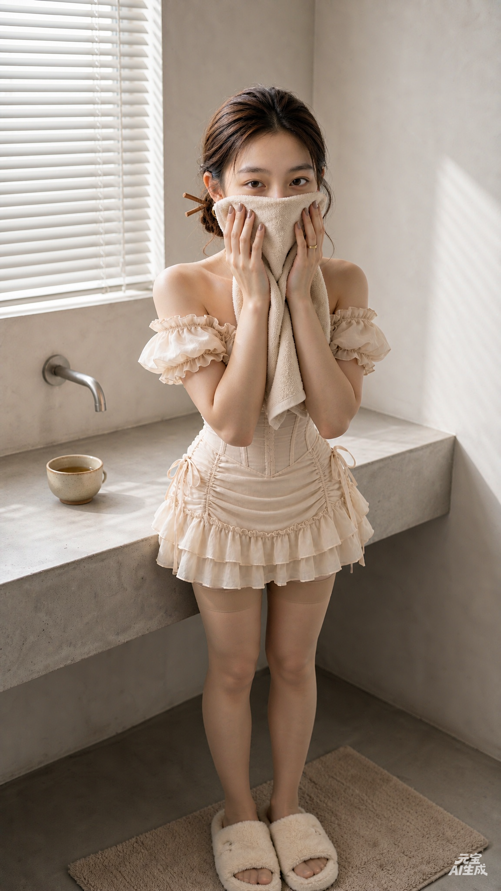

## 终稿提示词

```text
第一张图定穿搭版型配色面料，第二张图定骨相五官与本轮慵懒低盘发，第三张图定本张姿势骨架与机位；脸、衣、发型、姿势由各自底图承担，第三张图的双手落点按本文重摆；本张是站定、双手齐脸同高把一条浅杏色毛巾按在下半张脸上，两腿站直、不踮脚不仰头、脊线是安静的直线不含后仰、肩线不回转、两肘内收贴肋不外扬、人不迎不避等他先看过来，画顶留给百叶帘缝那一道晨光与毛巾上沿、发顶沉在毛巾下。

9:16 满幅画面，宽 1080 高 1920，人物与道具铺满整幅，四条边即裁切边。

她穿米杏色一字肩抽褶贴身迷你连衣短裙：横一字领口贴合肩头、肩头两侧各一片双层薄透米杏荷叶边短袖、领口正中一枚同色小蝴蝶结、前中一道细密抽褶束身、两侧各一根同色细抽绳、胸下到大腿中段是贴身细罗纹抽褶裙身、裙摆两层同色细木耳边齐平收在大腿中段、无开衩；24h 浅茶色匀透连裤丝袜平口齐腿根、贴腿连包到脚趾；两只脚上各穿一只奶白色羊羔绒软底露趾居家拖、鞋面无任何金属扣，浅茶丝袜脚背连进拖鞋口、脚趾在拖鞋前口被丝袜完整包着，四张同一双；奶白圆甲、无名指一点细哑金；一对细哑金小耳圈；栗棕偏暖的慵懒低盘发：全部头发向后梳拢、后颈偏低处松松挽成一个扁软低髻、髻心偏左、一枚哑木小发簪斜别、左耳后露簪尾一小截并有一缕松出来的软卷贴左颈侧、耳侧各一缕细碎发垂到锁骨、鬓角碎发自然、后颈整段露出来。浅灰水泥台面一角：一条浅杏色毛巾被她两手按在下半张脸上、台面一只粗陶小杯里剩一点泡好的茶、墙上一只细颈弯管出水口已经关住不流水、脚下一块浅棕短绒地垫、百叶帘缝里一道晨光斜进来在墙面落下几道细影，屋里是洗完脸那种干净安静。

镜头是他的眼睛：他洗完头擦干、走到水边这一角站定，视点实数眼高 1.55 米，与她相隔 0.5 至 0.7 米距离带，平看略俯 2 度看她把下半张脸埋进浅杏色毛巾、只露一双眼睛从毛巾上沿看他。他自己完全在画外，全画只有她一位成年人物。这一眼看得见她站定的整段轮廓、横一字领口到细密抽褶收进腰窝那一段、两片荷叶边短袖的圆边、裙摆齐在大腿中段、浅茶丝袜从裙摆下整段连到两只奶白绒软底拖、脚背连进拖鞋口、脚趾在拖鞋前口被丝袜完整包着，左耳后那截哑木簪尾与贴着左颈的一缕软卷、耳侧两缕细碎发、一对细哑金小耳圈、被两手按在脸上的那条浅杏色毛巾铺成全画最亮的一块暖杏、毛巾下角被捏出一折；台面那只粗陶小杯里剩的一点茶、关住的细颈弯管、浅棕短绒地垫、百叶帘缝落在墙面的几道细影都在，门外与屋子另一头这一眼看不见。

一位成年人物、一具身体轮廓、胸大腰细腿长靠合身剪裁写实呈现、左右各一只手臂各五根手指、两只脚各自连续、两只奶白色羊羔绒软底露趾居家拖都好好穿在脚上。全画仅此一双手，每只手全篇只出现一次、只做一个动作：右臂从右肩经肘向上前抬、经腕轻捏，指尖一条连续链沿身体右侧完整可见，唯一落点是右手五指捏住浅杏色毛巾的右上角、把毛巾按在自己脸颊与下颌上停住；左臂从左肩经肘向上前抬、经腕轻捏，指尖一条连续链沿身体左侧完整可见，唯一落点是左手五指捏住浅杏色毛巾的左上角、与右手一起把毛巾平平按稳、下角捏出一折。指缝可数，两臂各从肩连续到指尖。

两脚一前一后踩在浅棕短绒地垫上、两腿都站直、重心落在后脚，肩往回收半寸、下巴微埋进毛巾、发顶沉在毛巾下，脊线从后颈经腰窝到后脚的踝拉出一道安静的直线，肩线不回转、两肘内收贴肋不外扬，两片荷叶边短袖随抬手拉出两道软弧。毛巾上沿只露出一双眼睛正对他，右眼高光偏上偏内、左眼一道细月牙柔反光，眉梢松着、眼尾平着、下眼睑略松像没睡醒就这么看他、眼神没躲，像「脸洗好了，茶也凉了，你那包烟自己买去」说完了还留半句没说；这个眼神长出一个可见动作：捏着毛巾右上角那五指把毛巾往眼下又提半分、提完停住，停住的那一息里眼睫慢眨一下、嘴角没动，捏着左上角的左手五指位置不动。

百叶帘缝里那道暖白晨光从她左侧斜下来，浅杏毛巾的绒面最亮、她露出的眼周次一档、台面粗陶小杯里那点茶的闷亮压到最弱，百叶帘最外一道细影斜搭到浅棕短绒地垫边缘收住下角；画顶最高处留给百叶帘缝那一道晨光与毛巾上沿、发顶在毛巾下面、不压画顶，浅茶丝袜细密纹理、奶白绒软底拖的绒面与浅棕短绒地垫都清楚。写实摄影质感，50mm，1/250，站定平看略俯 2 度，人不迎不避等他先看过来，机位稳住不动。
```

## 一句点评

浅杏毛巾上沿只露一双眼睛收得最静
