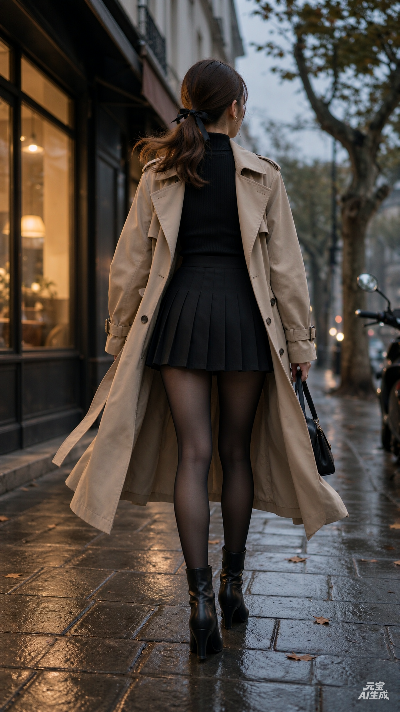

## 终稿提示词

```text
第一张图定穿搭版型配色面料（只取这身衣服，人台朝向按本文改为背对镜头），第二张图定骨相五官与本轮低侧马尾（本张只取后颈、右颈与侧后半边脸那一小条骨相，不出现正脸），第三张图定本张低机位步态骨架与机位；脸、衣、发型、姿势由各自底图承担，第三张图的双手落点按本文重摆。本张是她背对镜头在前面走、只从肩后露出半边侧后脸的一点下颌与耳根，低侧马尾被街风往后甩开，两腿一前一后踩在青石板上。人物整体背对镜头往前走，全画看不见她的双眼、看不见正面五官、看不见她迎向镜头，只给后颈、缎带结、右颈整段与小半边侧颊。

9:16 满幅画面，宽 1080 高 1920，人物与道具铺满整幅，四条边即裁切边。

她穿米驼色长风衣整件敞开着、翻领与肩章、双排扣、袖口带扣袢、腰间同色系带松松垂在两侧、衣长到小腿中段、两片衣襟被街风往后掀开一点；里面黑色半高领细罗纹贴身长袖针织上衣、下摆收进黑色高腰细密刀褶百褶迷你裙、裙摆齐平收在大腿中段；黑色匀透连裤丝袜平口齐腿根、从裙摆下经大腿膝小腿到脚背整段匀透连续、无横向分界无袜口无吊袜带、贴腿整段连包到脚趾；两只脚上各穿一只黑色软皮尖头低跟短靴、靴筒止于小腿肚最丰满处下方一指、离膝盖还留一整掌、膝下到膝窝那一整段黑丝小腿完整露在靴口之外、靴口一圈软皮松松塌下来堆出两道软褶、尖头低粗跟哑光软皮，黑丝脚背连进靴口、脚趾在靴里被丝袜完整包着，两只短靴都好好穿在脚上、四张同一双；左腋下夹一只黑色软皮单肩小包、细皮带垂在身侧；深莓红短圆甲、食指一点细哑银；一对细哑银小耳圈；栗棕偏暖的低侧马尾：全部头发向后梳拢、在后颈偏左贴近左肩的位置松松低束成一束、束口一条哑黑缎带绕两圈系一个软结、两端短短垂下、马尾的松大波浪垂到锁骨下方并随步子往后甩开一点、耳侧与鬓角各一缕细碎发垂到锁骨、右颈整段露出来。傍晚老街比正午暗一档：湿亮青石板路映着淡青灰天光、街边咖啡馆玻璃窗里只留两三团极淡的暖色光晕与模糊色块、一辆自行车后视镜反一小块软白、梧桐叶影落在石板上、街尽头平铺一层淡青灰暮色、拐角那家旧唱片店整间压暗只留一条竖暖黄落在她右肩与右耳根、门头无任何可辨文字与字母、全画无可辨招牌文字。

镜头是他的眼睛：他在她身后走，视点实数眼高 1.6 米，与她相隔 1.8 至 2.2 米距离带，平看略俯 2 度看她走在前面、背对镜头、上身微侧过来一点、低侧马尾被风往后甩；视平线落在她后颈与低侧马尾之间，低机位只拉长腿线与靴筒、透视平稳。他自己完全在画外，全画只有她一位清晰成年人物，街的远处空着。这一眼看得见她背影微侧的整段轮廓、米驼风衣两片被风掀开的衣襟与垂在两侧的系带、黑色半高领细罗纹收进腰窝那一段、黑百褶裙摆齐在大腿中段、黑丝从裙摆下整段连到膝下那一整段露出的小腿、两只黑色软皮尖头堆褶短靴、脚背连进靴口、脚趾在靴里被丝袜完整包着，左肩后低束的马尾与那枚哑黑缎带软结、被风往后甩开的松大波浪、马尾梢往画面右后扫出画缘、右颈整段、小半边侧颊与耳根那点薄热、耳侧两缕细碎发、一对细哑银小耳圈、左腋下夹着的小包细皮带；咖啡馆玻璃窗里那两三团暖色光晕、自行车后视镜那一小块软白、梧桐叶影与湿亮石板、她右脚前一道被踩散的暖黄短影都在。这一眼看不见她的双眼与正脸，看不见街拐角那头，看不见他自己。

一位成年人物、一具身体轮廓、胸大腰细腿长靠合身剪裁写实呈现、左右各一只手臂各五根手指、两只脚各自连续、两只黑色软皮尖头堆褶短靴都好好穿在脚上。全画仅此一双手，每只手全篇只出现一次、只做一个动作：右臂从右肩经肘向前上收、右肘微微撑开让动作在肩线外看得见、经腕轻拢，指尖一条连续链沿身体右侧完整可见，唯一落点是右手五指拢在米驼风衣的右襟边、把被风掀开的衣襟往胸前收半寸停住；左臂从左肩经肘向下垂、经腕轻提，指尖一条连续链沿身体左侧完整可见，唯一落点是左手五指拎着黑色单肩小包的细皮带、把包稳在左髋侧停住。指缝可数，两臂各从肩连续到指尖。

两腿一前一后踩在青石板上、前脚脚尖刚点住地、重心落在后脚，肩线朝街前方松松送过去、髋线留在身后，脊线从后颈经腰窝到后脚的踝拉出一道舒展的斜线，风衣两片衣襟随步子往后掀。她眼尾往左前方咖啡馆玻璃窗那一侧先扫过极轻一线就收回来、视线不沾镜头，下唇抿住半秒才松开、松开时右耳根那点薄热已经漫到耳垂，唇角往右边只弯一点就不收，像「后面那位，看够了就走快点」说得极轻、只说给风听；这个神态长出一个可见动作：拢在右襟边那五指把衣襟又往胸前收半寸、收完停住，拎着包带那五指位置不动，左肩后那束马尾随这一下再往后甩开一点，只看得见她把步子放慢了半拍、像等这一眼追上来。

淡青灰暮色从街尽头平铺过来、天光压暗一档，旧唱片店整间压暗只留一条竖暖黄落在她右肩风衣与右耳根两处，湿石板在她右脚前拖一道踩散的暖黄短影，咖啡馆玻璃窗里的暖色光晕软得化开，湿亮青石板反一小片青灰、黑丝细密纹理与黑色软皮短靴靴口那两道堆褶都清楚。写实街拍摄影质感，50mm，1/250，隔着两步平看略俯 2 度，机位稳住不动。
```

## 一句点评

隔两步背影把身后那一眼立住了
