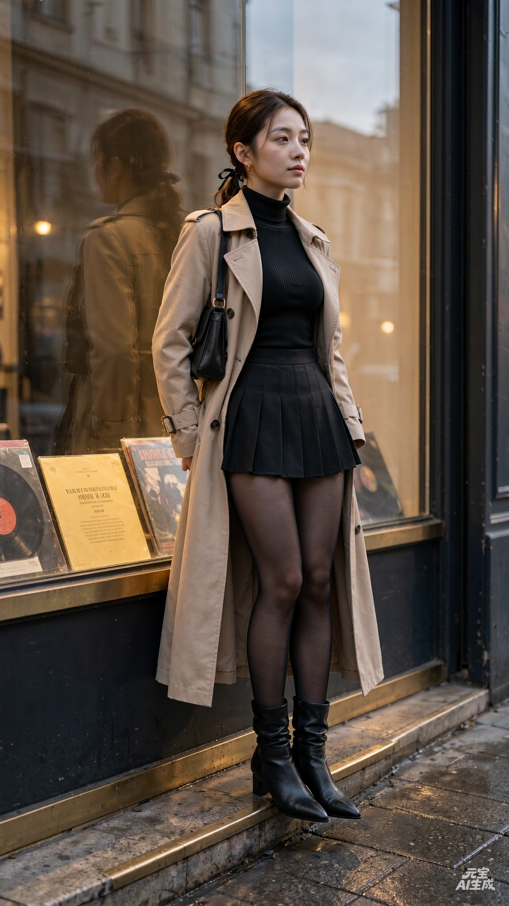

## 终稿提示词

```text
第一张图定穿搭版型配色面料，第二张图定骨相五官与本轮低侧马尾，第三张图定本张侧站挺胸骨架与机位；脸、衣、发型、姿势由各自底图承担，第三张图的双手落点按本文重摆；本张是她在旧唱片店橱窗前停步侧身站着、两手在身后轻轻扣住、上身挺起来一点，两腿一前一后踩在店门门槛石上。

9:16 满幅画面，宽 1080 高 1920，人物与道具铺满整幅，四条边即裁切边。

她穿米驼色长风衣整件敞开着、翻领与肩章、双排扣、袖口带扣袢、腰间同色系带松松垂在两侧、衣长到小腿中段、两片衣襟被街风往后掀开一点、只露出腰窝到胯侧一条窄长黑、风衣肩背仍贴着肩胛；里面黑色半高领细罗纹贴身长袖针织上衣、下摆收进黑色高腰细密刀褶百褶迷你裙、裙摆齐平收在大腿中段；黑色匀透连裤丝袜平口齐腿根、从裙摆下经大腿膝小腿到脚背整段匀透连续、无横向分界无袜口无吊袜带、贴腿整段连包到脚趾；两只脚上各穿一只黑色软皮尖头低跟短靴、靴筒止于小腿肚最丰满处下方一指、离膝盖还留一整掌、膝下到膝窝那一整段黑丝小腿完整露在靴口之外、靴口一圈软皮松松塌下来堆出两道软褶、尖头低粗跟哑光软皮，黑丝脚背连进靴口、脚趾在靴里被丝袜完整包着，两只短靴都好好穿在脚上、四张同一双；左腋下夹一只黑色软皮单肩小包、细皮带垂在身侧；深莓红短圆甲、食指一点细哑银；一对细哑银小耳圈；栗棕偏暖的低侧马尾：全部头发向后梳拢、在后颈偏左贴近左肩的位置松松低束成一束、束口一条哑黑缎带绕两圈系一个软结、两端短短垂下、马尾的松大波浪垂到锁骨下方、耳侧与鬓角各一缕细碎发垂到锁骨、右颈整段露出来。旧唱片店门口：湿亮青石板一直铺到店门、一道被踩得温润的铜条包边门槛石横在画面下三分之一、整面落地玻璃橱窗、窗里几张斜立着的黑胶封套、封套上只有纯色块与一道抽象弧线、连最细的字迹也不留、一张纯色暖黄纸签、木框门边一道磨亮的铜条；橱窗玻璃里只留两三团极淡的暖色光晕与模糊色块、映出她自己一个淡到几乎化开、只到肩线为止的侧后影、与她同款米驼风衣同款低侧马尾、只留米驼与栗棕两片软色、不映出五官不映出正面人像、全画不出现第二张可辨的脸与第二个可辨人形、玻璃上有一道细细的街灯反光，傍晚淡青灰天光与橱窗暖黄光在门槛石上交界、冷边里嵌一线湿青石板反上来的暖黄、像店门在地上画了条线她刚好踩着，全画无可辨招牌文字。

镜头是他的眼睛：他在她身后侧旁停住，视点实数眼高 1.55 米，与她相隔 1.2 至 1.5 米距离带，平看略仰 1 度看她侧身站在橱窗前、装作看封套、其实在等玻璃里那点化开的侧后影与身后那两团光晕；视线在她侧脸与玻璃里那两团光晕之间停半秒才落回她腰线，像怕被她从玻璃里逮住。他自己完全在画外，全画只有她一位清晰成年人物，街对面空着。这一眼看得见她侧过来的整段轮廓、米驼风衣敞开的翻领与垂在两侧的系带、黑色半高领细罗纹收进腰窝那一段、挺起来一点的胸线、黑百褶裙摆齐在大腿中段、黑丝从裙摆下整段连到膝下那一整段露出的小腿、两只黑色软皮尖头堆褶短靴、脚背连进靴口、脚趾在靴里被丝袜完整包着，左肩后低束的马尾与哑黑缎带软结、松大波浪垂到锁骨下、右颈整段、耳侧两缕细碎发、一对细哑银小耳圈、左腋下夹着的黑色软皮单肩小包细皮带；整面落地玻璃与里头斜立的几张黑胶封套、纯色暖黄纸签、磨亮的铜条、湿亮青石板与门槛石、玻璃里那一团化开的侧后影与两三团暖色光晕都在。这一眼看不见她正脸，看不见店里面，看不见他自己。

一位成年人物、一具身体轮廓、胸大腰细腿长靠合身剪裁写实呈现、左右各一只手臂各五根手指、两只脚各自连续、两只黑色软皮尖头堆褶短靴都好好穿在脚上。全画仅此一双手，每只手全篇只出现一次、只做一个动作：右臂从右肩经肘向后下探、经腕轻扣，指尖一条连续链沿身体右侧完整可见，唯一落点是右手五指贴在自己后腰米驼风衣的后片上、松松停住；左臂从左肩经肘向后下探、经腕轻扣，指尖一条连续链沿身体左侧完整可见，唯一落点是左手五指搭在右手腕背上、两手在身后轻轻扣住停住、指节吃着橱窗那道暖光。指缝可数，两臂各从肩连续到指尖。

两脚一前一后踩在湿亮青石板与门槛石上、前脚压在那一线反上来的暖黄上踩实、后脚脚尖点在青石板上，重心落在前脚，肩线朝橱窗松松转过来一点、髋线留在身后，脊线从后颈经腰窝到后脚的踝拉出一道舒展的斜线，风衣两片衣襟被街风往后掀开一点。她眼尾往玻璃里那两团光晕扫过极轻一线就收回到封套上，右耳根浮起一点薄热，唇角刚弯起一点就被下唇抿回去、像知道自己被玻璃出卖了，像「等下你陪我进去挑一张，门口装不认识我可不行」说得极轻；这个神态长出一个可见动作：扣在身后那两只手把指节互相收紧一点、收完停住，左肩后那束马尾随这一下轻轻晃了半寸，四下里只有马尾梢和衣摆在动。

橱窗暖黄光从她左前斜过来，只落在她侧脸、黑色半高领细罗纹的胸口与扣在身后那两只手的指节三处，淡青灰暮色在门槛石上留一道冷边、冷边里那一线暖黄被她前脚压着，两光交界停在颧骨上；玻璃里那一团侧后影淡到只剩米驼色与栗棕发色两片软色、黑胶封套的纯色块与那道抽象弧线清楚、磨亮铜条反一粒细亮，黑丝细密纹理与黑色软皮短靴靴口那两道堆褶都清楚。写实街拍摄影质感，50mm，1/250，隔一步平看略仰 1 度，机位稳住不动。
```

## 一句点评

橱窗玻璃里只留一团化开的侧后影
