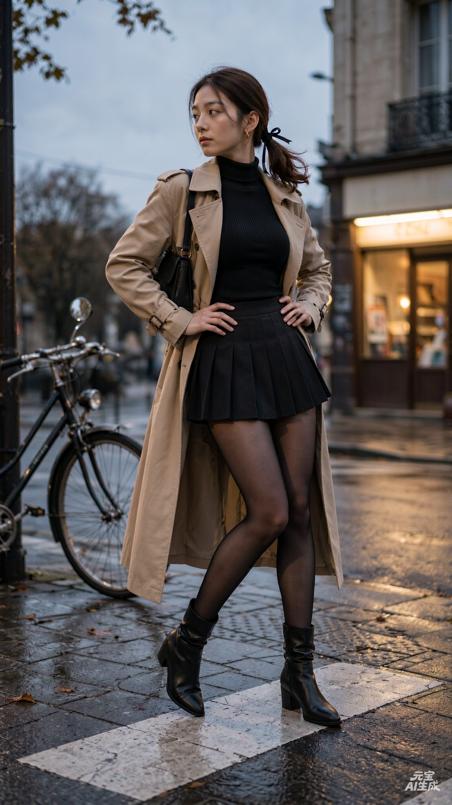

## 终稿提示词

```text
第一张图定穿搭版型配色面料，第二张图定骨相五官与本轮低侧马尾（本张只取侧后半张脸的骨相，不取正脸全貌），第三张图定本张斜侧单膝内收后仰骨架与机位（只取两腿一前一后与单膝内收的腿线，双手按本文重摆，不取线稿里双手扶腰的动作）；脸、衣、发型、姿势由各自底图承担。本张是她过街时停了半步、单膝微微内收、上身轻轻后仰、身子斜侧背对镜头、只有脖子以上往路对面侧回半张脸、眼珠弹向画面左下那两团暖光、眼睛全程不看镜头，全画看不见她双眼同时正对镜头、看不见正脸全貌、看不见她迎向镜头，两腿一前一后踩在青石板路中央。

9:16 满幅画面，宽 1080 高 1920，人物与道具铺满整幅，四条边即裁切边。

她穿米驼色长风衣整件敞开着、翻领与肩章、双排扣、袖口带扣袢、腰间同色系带松松垂在两侧、衣长到小腿中段、两片衣襟被街风往后掀开一点；里面黑色半高领细罗纹贴身长袖针织上衣、下摆收进黑色高腰细密刀褶百褶迷你裙、裙摆齐平收在大腿中段；黑色匀透连裤丝袜平口齐腿根、从裙摆下经大腿膝小腿到脚背整段匀透连续、无横向分界无袜口无吊袜带、贴腿整段连包到脚趾；两只脚上各穿一只黑色软皮尖头低跟短靴、靴筒止于小腿肚最丰满处下方一指、离膝盖还留一整掌、膝下到膝窝那一整段黑丝小腿完整露在靴口之外、靴口一圈软皮松松塌下来堆出两道软褶、尖头低粗跟哑光软皮，黑丝脚背连进靴口、脚趾在靴里被丝袜完整包着，两只短靴都好好穿在脚上、四张同一双；左腋下夹一只黑色软皮单肩小包、细皮带垂在身侧；深莓红短圆甲、食指一点细哑银；一对细哑银小耳圈；栗棕偏暖的低侧马尾：全部头发向后梳拢、在后颈偏左贴近左肩的位置松松低束成一束、束口一条哑黑缎带绕两圈系一个软结、两端短短垂下、马尾的松大波浪垂到锁骨下方并随这一停往后甩开一点、耳侧与鬓角各一缕细碎发垂到锁骨、右颈整段露出来。老街路口：湿亮青石板路中央、一道被磨白的旧斑马线、路边停着一辆深色自行车、车把上一枚小圆后视镜反一小块街天光、路对面两团提亮一档的极淡暖色光晕与模糊色块、梧桐叶影斜落在石板上、街尽头淡青灰暮色、拐角旧唱片店那一线暖黄已经退到画面边缘、整间店招只留一条暖黄色带、无任何字母与数字、门头完全虚化成色块、黑胶封套上无任何可辨文字，街的远处只剩暖灰色块、没有可辨人形与脸。

镜头是他的眼睛：他在她身后过街，视点实数眼高 1.6 米，与她相隔 0.9 至 1.2 米距离带，平看略仰 2 度看她停了半步、斜侧背对镜头、把脸往路对面侧回一半、眼先撞上他这道视线又立刻往画面左下的路对面偏回去、视线不落在镜头上。他自己完全在画外，全画只有她一位清晰成年人物，路对面空着。这一眼最先撞见的是她侧回那半张脸上往旁边躲的眼，其次才是衣襟、系带与裙摆：米驼风衣两片被风掀开的衣襟与垂着的系带、黑色半高领细罗纹收进腰窝那一段、轻轻后仰拉出的一道紧弧、黑百褶裙摆齐在大腿中段、单膝内收那一线、黑丝从裙摆下整段连到膝下那一整段露出的小腿、两只黑色软皮尖头堆褶短靴、脚背连进靴口、脚趾在靴里被丝袜完整包着，左肩后低束的马尾与哑黑缎带软结、被这一停甩开一点的松大波浪、右颈整段、耳侧两缕细碎发、一对细哑银小耳圈、左腋下夹着的小包细皮带；磨白的旧斑马线、自行车小圆后视镜那一小块街天光、梧桐叶影、路对面那两团提亮的暖色光晕都在。这一眼看不见她整张正脸，看不见街拐角那头，看不见他自己。

一位成年人物、一具身体轮廓、胸大腰细腿长靠合身剪裁写实呈现、左右各一只手臂各五根手指、两只脚各自连续、两只黑色软皮尖头堆褶短靴都好好穿在脚上。全画仅此一双手，每只手全篇只出现一次、只做一个动作：右臂从右肩经肘向后收、经腕压平，指尖一条连续链沿身体右侧完整可见，唯一落点是右手五指按在右侧腰窝的米驼风衣上、把轻轻后仰的上身稳住停住；左臂整条链从左肩经肘向后上折、越过左肩后、经腕轻转，指尖一条连续链沿身体左侧完整可见，唯一落点是左手五指捏住低侧马尾束口那枚哑黑缎带的软结、把被风甩开的马尾带离左肩半寸停住，左手全程离开腰、不搭在腰上、不掐腰。指缝可数，两臂各从肩连续到指尖。

两脚一前一后踩在青石板路中央、前脚踩实、后脚脚尖轻点、单膝微微内收，重心落在前脚，肩线朝街前方松松送过去、髋线留在身后，脊线从后颈经腰窝到后脚的踝拉出一道柔弯的斜线、后仰只取约六度、像被他的视线轻轻拽住、肩送过来髋留在原地，风衣两片衣襟随这一停往后掀。她把脸往路对面侧回一半，眼先撞上身后他那道视线、停约半秒就走，眼珠比脸快一线弹向画面左下那两团提亮的暖光，下巴与鼻尖往路对面偏回约一寸、偏到一半停住不再回正，躲开的方向正对那两团暖光、像拿街上的热闹当挡箭牌，右眼高光偏上偏内、左眼一道细月牙柔反光，右侧眉梢只提起一半就停住、眼睑随之下压一线，右耳根浮起一点薄热、下唇抿住半个字口型、唇角往右边只弯一点就不收，像「街上人多我不好意思看你，只许你在我后面看」带着一点自己的小脾气；这个神态长出一个可见动作：捏着缎带软结那五指把马尾往肩后又拢半寸、拢完停住，按在腰窝那五指位置不动。

淡青灰暮色从街尽头平铺过来，旧唱片店那一线暖黄退到画面边缘、只在她左肩风衣与右耳根留两点软亮，主光从她右后方斜压下来、自行车小圆后视镜把街天光反成一粒细白、湿亮青石板映出她一道斜长影、影的前脚已踏实而后脚那点影还拖在半步之后没跟上、磨白旧斑马线一道白边刚好切在后脚靴尖前三厘米处，黑丝细密纹理与黑色软皮短靴靴口那两道堆褶都清楚；裙摆与马尾还在往前荡、人已经停了，像往前走被截住的一帧。写实街拍摄影质感，50mm，1/250，隔着一步平看略仰 2 度，机位稳住不动。
```

## 一句点评

过街那半秒眼珠躲向路对面暖光
