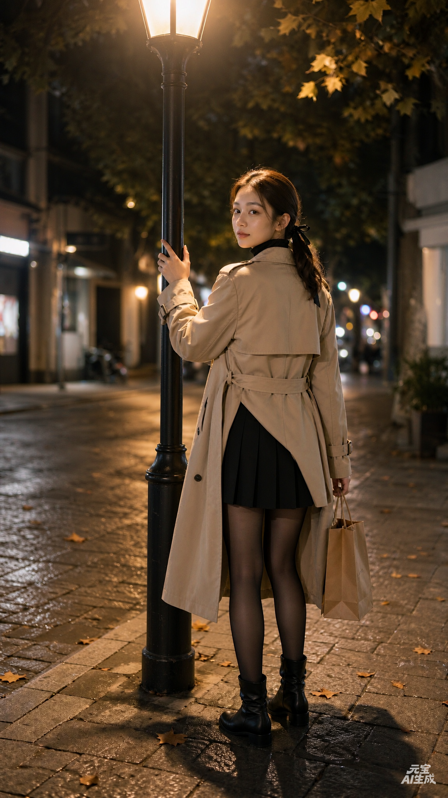

## 终稿提示词

```text
第一张图定穿搭版型配色面料，第二张图定骨相五官与本轮低侧马尾，第三张图定本张对立式平衡站姿骨架与机位；脸、衣、发型、姿势由各自底图承担，第三张图的双手落点按本文重摆；本张是她在路灯下停住、肩线与胸口与髋仍朝街前方、只有脖子以上侧回半张脸从肩头掠来看他、这回眼神落定不走，两腿一前一后站定、重心落在后脚，画顶留给梧桐叶影与路灯那一圈暖晕、发顶沉在肩线之下。身子始终朝画面纵深的街前方，全画看不见她整张正脸、看不见她挺胸迎向镜头。

9:16 满幅画面，宽 1080 高 1920，人物与道具铺满整幅，四条边即裁切边。

她穿米驼色长风衣整件敞开着、翻领与肩章、双排扣、袖口带扣袢、腰间同色系带松松垂在两侧、衣长到小腿中段、街风到这一步歇了、两片衣襟掀开后落回贴腿侧、只衣角还翘一点；里面黑色半高领细罗纹贴身长袖针织上衣、下摆收进黑色高腰细密刀褶百褶迷你裙、裙摆齐平收在大腿中段；黑色匀透连裤丝袜平口齐腿根、从裙摆下经大腿膝小腿到脚背整段匀透连续、无横向分界无袜口无吊袜带、贴腿整段连包到脚趾；两只脚上各穿一只黑色软皮尖头低跟短靴、靴筒止于小腿肚最丰满处下方一指、离膝盖还留一整掌、膝下到膝窝那一整段黑丝小腿完整露在靴口之外、靴口一圈软皮松松塌下来堆出两道软褶、尖头低粗跟哑光软皮，黑丝脚背连进靴口、脚趾在靴里被丝袜完整包着，两只短靴都好好穿在脚上、四张同一双；左腋下夹一只黑色软皮单肩小包、细皮带垂在身侧；深莓红短圆甲、食指一点细哑银；一对细哑银小耳圈；栗棕偏暖的低侧马尾：全部头发向后梳拢、在后颈偏左贴近左肩的位置松松低束成一束、束口一条哑黑缎带绕两圈系一个软结、两端短短垂下、马尾的松大波浪垂到锁骨下方、耳侧与鬓角各一缕细碎发垂到锁骨、右颈整段露出来。老街路灯下：一根哑黑铸铁路灯杆、灯罩刚亮成一圈暖晕、梧桐叶影落在灯杆与青石板上、湿亮石板把她一道长影拉向画面下缘他站着的那一侧、街的远处只剩几粒虚化灯点与淡青灰暮色、脚边搁下又提起来的那一只牛皮纸袋、袋口折得齐齐、细绳提手，四下是刚入夜那种干净安静，整体亮度接住前三张的淡青灰暮色、只比第 3 张暖半档。

镜头是他的眼睛：他在她身后收近脚步，视点实数眼高 1.65 米，与她相隔 0.5 至 0.7 米距离带，平看略俯 1 度看她在路灯下停住、身子仍朝街前方、只把脸侧回一半、眼尾从肩头掠过来落在他身上。他自己完全在画外，全画只有她一位清晰成年人物，街的远处空着。这一眼看得见她站定的整段侧前轮廓、米驼风衣敞开的翻领与垂着的系带、黑色半高领细罗纹收进腰窝那一段、黑百褶裙摆齐在大腿中段、黑丝从裙摆下整段连到膝下那一整段露出的小腿、两只黑色软皮尖头堆褶短靴、脚背连进靴口、脚趾在靴里被丝袜完整包着，左肩后低束的马尾与哑黑缎带软结、松大波浪垂到锁骨下、右颈整段、耳侧两缕细碎发、一对细哑银小耳圈、左腋下夹着的小包细皮带；哑黑铸铁路灯杆与灯罩那一圈暖晕、梧桐叶影、湿亮石板上那道拉长的影子、脚边那一只牛皮纸袋都在。这一眼看不见她整张正脸，看不见街的那一头，看不见他自己。

一位成年人物、一具身体轮廓、胸大腰细腿长靠合身剪裁写实呈现、左右各一只手臂各五根手指、两只脚各自连续、两只黑色软皮尖头堆褶短靴都好好穿在脚上。全画仅此一双手，每只手全篇只出现一次、只做一个动作：右臂从右肩经肘向右前抬、经腕轻扶，指尖一条连续链沿身体右侧完整可见，唯一落点是右手五指搭在哑黑铸铁路灯杆齐肩高处、把站定的身子稳住停住；左臂从左肩经肘向下垂、经腕轻拎，指尖一条连续链沿身体左侧完整可见，唯一落点是左手五指拎着那一只牛皮纸袋的细绳提手、袋身垂在左膝侧停住。指缝可数，两臂各从肩连续到指尖。

两脚一前一后站定在湿亮青石板上、重心落在后脚，肩往回收半寸、肩线与胸口与髋仍朝画面纵深的街前方、只把脸侧回一半，脊线从后颈经腰窝到后脚的踝拉出一道安静的直线，风衣两片衣襟落回贴腿侧、只衣角还翘一点。眼尾从自己左肩头掠过来落在他身上，落点的那一瞬眼睑停住、瞳仁定在他那一处、下颌往肩头再压低半分钉住这个角度，是过街那一下躲开之后第一次不躲，右眼高光偏上偏内、左眼一道细而平的高光，眉梢松着、下眼睑略松、唇角往她自己那侧单边提起两毫米带出一点算准他会跟上来的小脾气、随即收住，那半句只放在没转过来的后半张脸里，像「看够了没，跟上」说完了还留半句没说；这个眼神长出一个可见动作：拎着纸袋细绳那五指把绳在指间绕紧半圈、绕完停住、绕完的那只手不松，搭在路灯杆那五指位置不动，把主动权收在自己这一侧。

路灯那一圈暖晕从她右后落下来，浅浅勾在米驼风衣右肩、她露出的半边下颌与拎纸袋那五指的指节三处，梧桐叶影从画顶右上斜下、扫过她那道长影的中段、影尖越过磨白旧斑马线最后一点白再往画面下缘偏右送出约 15% 画高、越过灯柱基座出画、停在画外他站的位置，湿亮石板把影尖先送到他那一侧；画顶最高处留给梧桐叶影与灯罩那一圈暖晕、发顶沉在肩线之下还离顶一个头位，黑丝细密纹理、黑色软皮短靴靴口那两道堆褶与牛皮纸袋的纸纹都清楚。写实街拍摄影质感，50mm，1/250，收近一步平看略俯 1 度，机位稳住不动。
```

## 一句点评

路灯下身子仍朝前只侧回半张脸影尖先到他
