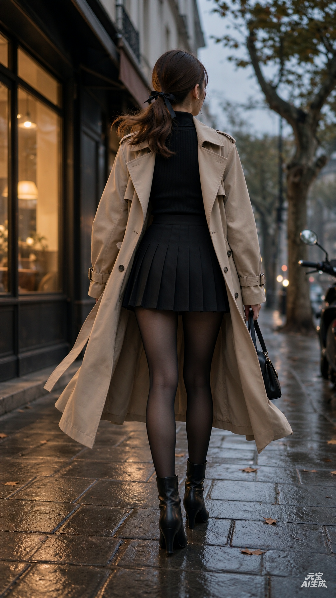
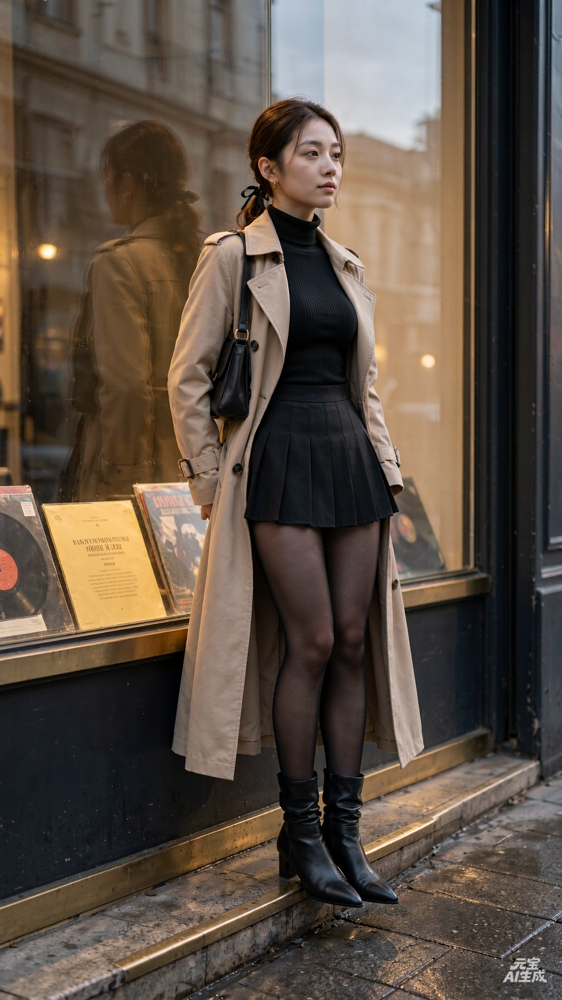
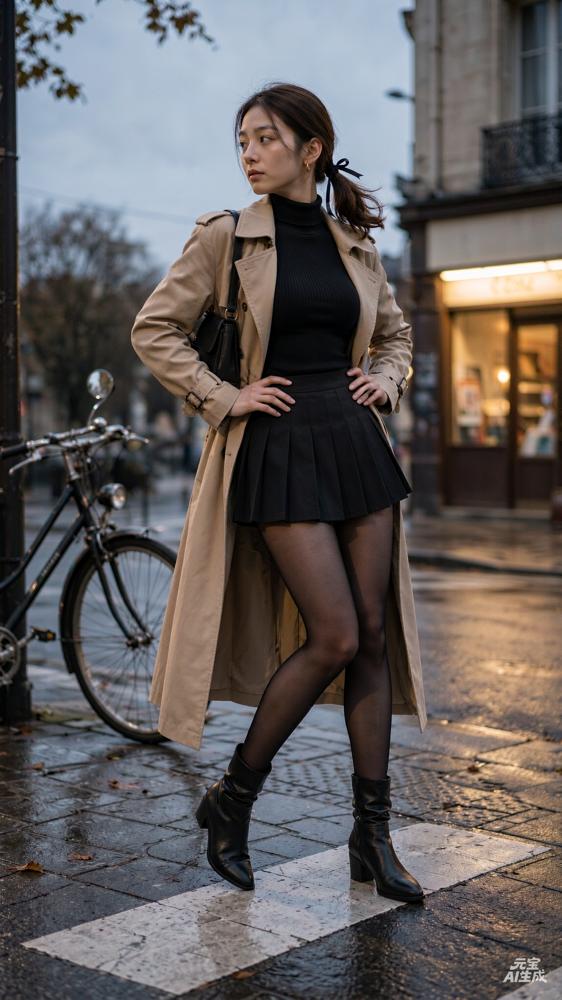
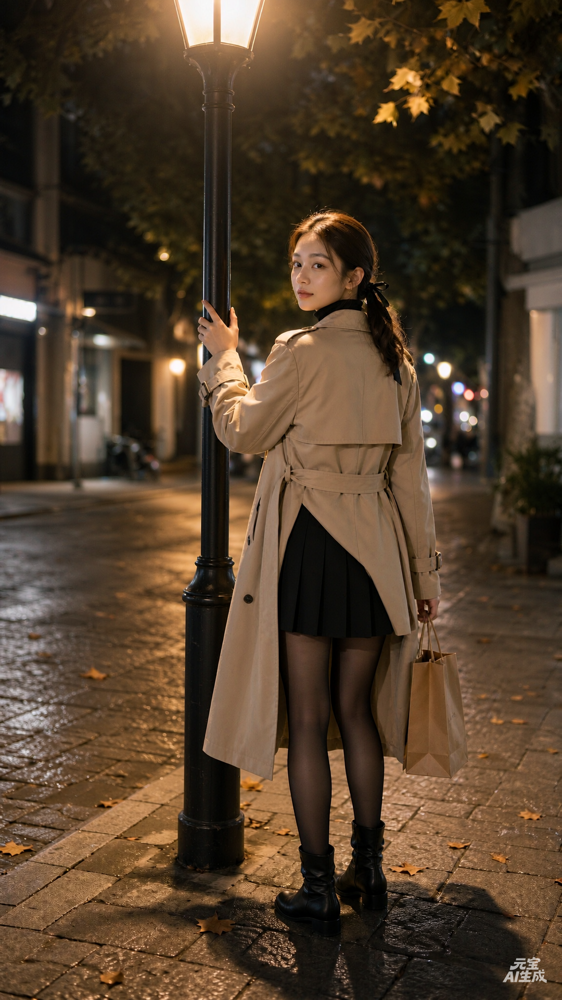

# R009 · 老街身后那一眼

- 轮次目录：`20261126i_evening-street-gaze`
- 日期：2026-11-26
- 穿搭：`SPR-0186`
- 四张线稿：`full_sexy_P007_low`、full_sexy_P013_side`、full_sexy_P015_diagonal`、full_single_P015_front`
- 画幅：1080×1920（9:16），纯画面，工具水印随图保留

## 四张

| 序 | 机位 | 图 | 终稿提示词 |
|---|---|---|---|
| 01 | front |  | [01_front.md](01_front.md) |
| 02 | side |  | [02_side.md](02_side.md) |
| 03 | seat |  | [03_seat.md](03_seat.md) |
| 04 | close |  | [04_close.md](04_close.md) |

## 这一段说了什么

1. 别走那么近，让人看见你一直盯我，我耳根都热了。你就在后面慢慢走，我不回头，回头就算我输。
2. 橱窗里那张封套好看吧。等下你陪我进去挑一张，门口装不认识我可不行，我记着呢。
3. 刚才那眼我看见了，别装。街上人多我不好意思看你，只许你在我后面看，看多久都行。
4. 看够了没，跟上。路灯都替我数到第三根了，你再不来，我就自己拐进唱片店不等你了。

## 现场记录

- 01_front：隔两步背影把身后那一眼立住了
- 02_side：橱窗玻璃里只留一团化开的侧后影
- 03_seat：过街那半秒眼珠躲向路对面暖光
- 04_close：路灯下身子仍朝前只侧回半张脸影尖先到他

> 原图 PNG 永不转码、永不覆盖；预览用 `` 缩放原图。
