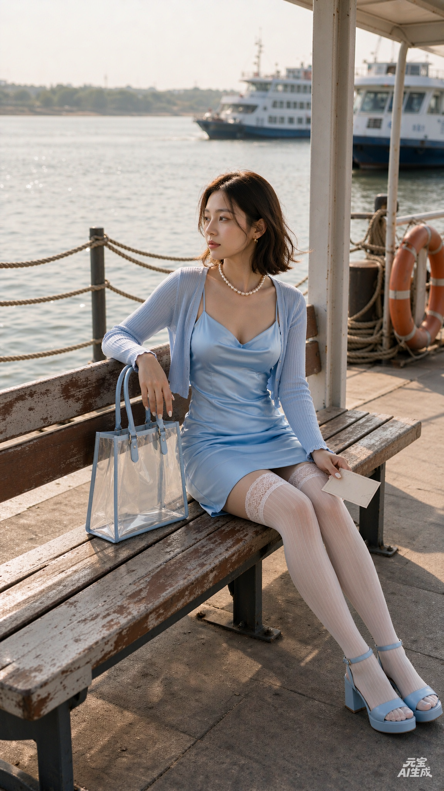

## 终稿提示词

```text
第一张图定穿搭版型配色面料，第二张图定骨相五官与本轮雾棕锁骨微卷，第三张图定本张侧坐伸腿骨架与机位；脸、衣、发型、姿势由各自底图承担，第三张图的双手落点按本文重摆。本张是江边候船亭里她侧坐在旧木长椅上、两腿朝画面右侧伸着、一侧手肘往后撑住看江面，画面左侧留一段晒白的空椅面与旧漆磨痕，他坐的位置空着、他自己完全在画外，全画只有她一位清晰成年人物。

9:16 满幅画面，宽 1080 高 1920，人物与道具铺满整幅，四条边即裁切边。

她穿天蓝色缎面吊带贴身短连衣裙、垂坠领口两层软褶、细肩带、胸下收进腰窝那一段拉出细密水光、裙摆齐平收在大腿中段、右侧一道开衩到胯侧；外面罩一件同色天蓝薄透长袖短开衫、整件敞着不扣、袖口一小圈波浪薄纱、右片敞襟滑到臂弯露出半个肩头、左片仍贴着肩胛；象牙白匀透连裤丝袜平口齐腿根、从裙摆下经大腿膝小腿到脚背整段匀透连续、贴腿整段连包到脚趾、大腿上一圈白色细蕾丝袜口花边平贴腿面；两只脚上各穿一只天蓝软皮一字带粗跟防水台凉鞋、脚踝一道细带、丝袜脚背连进鞋口、脚趾在凉鞋里被丝袜完整包着，两只凉鞋都好好穿在脚上、四张同一双；一只透明蓝边 PVC 托特包挂在撑椅那侧椅背上、包身垂到椅腿边、蓝边里映着一小条远处渡轮的白影；一串小珍珠项链贴着锁骨、一对细哑金小耳圈、奶白圆甲；雾棕色齐锁骨松散微卷：发长刚到锁骨、发尾一缕一缕松松外卷、偏分、发际线柔和、两侧各一缕细软碎发垂到颊边与锁骨，江风把右颊那一缕轻轻吹起一点。江边候船亭：被坐得温润的旧木长椅、画面左侧一段晒白空椅面与旧漆磨痕、木栈板上一道道长条木纹、江面铺着午后碎金、桩上盘好的粗缆绳与一只白救生圈、远处渡轮正慢慢靠岸、她膝上搁着薄薄一张渡口厚纸小方票、票面一道浅蓝压边水印、一角撕出来的毛边、空白面朝上无任何文字字母数字、全画无可辨招牌文字。

镜头是他的眼睛：他坐在同一排长椅另一头，视点实数眼高 1.15 米，与她相隔 1.4 至 1.6 米距离带，平看不俯不仰看她侧坐伸腿、侧肘后倚、整段轮廓松松铺在长椅上；江面碎金那道亮线压在她颧骨下沿，视平线落在她锁骨与垂坠领之间。他自己完全在画外，长椅另一头空着。这一眼看得见她侧坐的整段轮廓、天蓝缎面垂坠领那两层软褶与收进腰窝的水光、薄透短开衫滑到臂弯露出的半个肩头与袖口小波浪、裙摆齐在大腿中段与右侧那道开衩、白色蕾丝袜口花边、象牙白丝袜从裙摆下整段连到膝下那一截小腿、两只天蓝一字带粗跟防水台凉鞋与脚背上连进鞋口的丝袜、脚趾在凉鞋里被丝袜完整包着，锁骨上那串小珍珠、一对细哑金小耳圈、齐锁骨的雾棕微卷与颊边两缕细碎发、膝上那张厚纸小方票、椅背上垂着的透明蓝边托特包与蓝边里那一小条渡轮白影；画面左侧晒白空椅面与旧漆磨痕、木栈板长条木纹、江面碎金、盘好的缆绳与白救生圈、远处靠岸的渡轮都在。这一眼看不见渡轮舱里，看不见他自己。

一位成年人物、一具身体轮廓、胸大腰细腿长靠合身剪裁写实呈现、左右各一只手臂各五根手指、两只脚各自连续、两只天蓝软皮一字带粗跟防水台凉鞋都好好穿在脚上。全画仅此一双手，每只手全篇只出现一次、只做一个动作：右臂从右肩经肘向后下撑、右肘向外开一拳、右肩比左肩再低一点、经腕压平，指尖一条连续链沿身体右侧完整可见，唯一落点是右手五指按在身后旧木长椅面上、把侧倚的上身稳住停住、整只手死不动当锚；左臂从左肩经肘向下落、经腕轻搁，指尖一条连续链沿身体左侧完整可见，唯一落点是左手五指捏着那张厚纸小方票一角搁在左膝上、把压平的空白票面顺膝往外斜转一点朝长椅那头亮半秒、转完捏着不松手。指缝可数，两臂各从肩连续到指尖，四下里只有票角动那一下。

两腿一前一后顺着木栈板朝画面右侧伸出去、前脚脚跟轻点、后脚脚踝搭在板沿上，重心落在撑住的那侧坐骨，肩线朝江面松松送过去、髋线留在长椅上，脊线从后颈经腰窝到伸直的腿拉出一道懒懒塌下来的斜线，短开衫两片敞襟随坐姿垂开。她眼尾往江面那道碎金扫过极轻一线就收回来、视线不沾镜头，下唇抿住半秒才松开、松开时右耳根那点薄热已经漫到耳垂，唇角往右边只弯一点就不收，像「船来之前你先别说话，让我把这点太阳看完」说得极轻、只说给江风听；这个神态长出一个可见动作：捏着票角那五指把空白票面又往长椅那头斜亮一点、亮完停住，撑在长椅上那五指一点不动，颊边那缕发被风吹到唇角她没拨，只看得见她把呼吸放慢了半拍、像等这一眼坐稳。

午后暖阳从江面斜过来，浅浅勾在缎面垂坠领、白色蕾丝袜口与捏票那五指的指节三处，木长椅被晒出一层温润的浅棕、左侧空椅面晒得发白，江面碎金在裙摆缎面上反一小片软亮，薄透开衫的细网纹、丝袜细密竖纹、一字带凉鞋的软皮与锁骨上珍珠粒粒都清楚。写实街拍摄影质感，50mm，1/250，隔着一截空椅平看不俯，机位稳住不动。
```

## 一句点评

候船长椅侧坐把空白票亮给空椅那头
