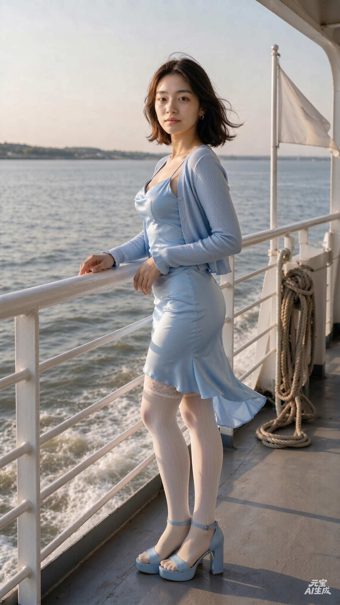

## 终稿提示词

```text
返工复核锚（STD-001.2 B5-T）：丝袜从腿根到脚尖同色连续，脚踝、脚背无横向分界、无袜口、无趾根收边；脚趾由与腿部同色的袜面完整包住，五趾轮廓在袜面里各自分明，露趾鞋与凉鞋前口里袜面一直连到趾尖并与鞋口平顺衔接；四张同一层腿部覆盖、同一双鞋。本张已按此逐字复核并重出。

第一张图定穿搭版型配色面料，第二张图定骨相五官与本轮雾棕锁骨微卷，第三张图定本张侧身站立发丝飘扬骨架与机位（只取侧身站姿的脊线与一前一后两腿，双手按本文重摆）；脸、衣、发型、姿势由各自底图承担。本张是渡轮甲板栏杆边她斜侧约 30 度站着、江风把薄开衫与裙摆往后掀、发丝往后飘，只把脸回一半给他看。他刚从候船长椅站起来还没直完腰，这一眼从他身后侧旁斜着落过去，他自己完全在画外，全画只有她一位清晰成年人物，人在画面里斜着放不居中、膝盖以下裁掉一点。

9:16 满幅画面，宽 1080 高 1920，人物与道具铺满整幅，四条边即裁切边。

她穿天蓝色缎面吊带贴身短连衣裙、垂坠领口两层软褶、细肩带、胸下收进腰窝那一段拉出细密水光、裙摆齐平收在大腿中段、右侧一道开衩到胯侧、开衩那片裙角带迈步没落稳的余摆；外面罩一件同色天蓝薄透长袖短开衫、整件敞着不扣、袖口一小圈波浪薄纱、两片敞襟被江风往后掀开、后摆兜成一小片鼓弧贴后腰又滑开、吊带肩带稳稳留在肩上不被风带离；象牙白匀透连裤丝袜平口齐腿根、从裙摆下经大腿膝小腿到脚背整段匀透连续、贴腿整段连包到脚趾、大腿上一圈白色细蕾丝袜口花边平贴腿面；两只脚上各穿一只天蓝软皮一字带粗跟防水台凉鞋、约五厘米粗跟、前掌一小层防水台、脚踝一道细带、丝袜脚背连进鞋口、脚趾在凉鞋里被丝袜完整包着，两只凉鞋都好好穿在脚上、四张同一双；一只透明蓝边 PVC 托特包刚搁在脚边甲板上、一根提手被风带歪、包里映着一点江天光；一串小珍珠项链贴着锁骨、一对细哑金小耳圈、奶白圆甲；雾棕色齐锁骨松散微卷：发长刚到锁骨、发尾一缕一缕松松外卷、偏分、两侧各一缕细软碎发被江风往后吹起、发梢扫过右颈、一缕粘在唇边她不拨，四张同一款发型。渡轮甲板：白漆铁栏杆横杆与竖柱、横杆近景压一层薄水雾、她手心在雾上擦出一道指痕、栏杆外江面被船头犁开两道长长白浪、浪头刚翻起白沫扫过画面下沿、桩上盘好的粗缆绳、对岸淡青灰岸线、左侧中景一面纯素色三角旗被风扯成一条笔直的线、旗面无任何图案文字字母数字、午后偏暖的天光把甲板晒成浅灰白、全画无可辨文字。

镜头是他的眼睛：他刚从候船长椅站起来还没直完腰，视点实数眼高 1.45 米、比上一格近一档，与她相隔 1.0 至 1.3 米距离带，平看略俯 2 度看她斜侧扶着栏杆、江风把开衫与发丝一并往后掀、只把脸回一半；视线先落在她被风兜成鼓弧的开衫后摆，再顺着肩线走到她回过来的那半张脸。他自己完全在画外，甲板另一头空着。这一眼看得见她斜侧的整段轮廓、缎面垂坠领两层软褶与腰窝那道水光、被风往后掀开的薄透短开衫两片敞襟与后摆那片鼓弧、裙摆齐在大腿中段与右侧带余摆的开衩裙角、白色蕾丝袜口花边、象牙白丝袜从裙摆下整段连到膝下那一截小腿、白浪反光在小腿丝袜上一闪、两只天蓝一字带粗跟防水台凉鞋与脚背连进鞋口的丝袜、脚趾在凉鞋里被丝袜完整包着，锁骨上那串小珍珠、一对细哑金小耳圈、齐锁骨微卷被风往后吹起的发梢与右颈、脚边提手被风带歪的透明蓝边托特包；白漆栏杆横杆与那一层薄水雾与指痕、江面两道白浪与浪头白沫、盘好的缆绳、对岸淡青灰岸线与左侧中景被扯直的纯素色三角旗都在。这一眼看不见船舱里面，看不见他自己。

一位成年人物、一具身体轮廓、胸大腰细腿长靠合身剪裁写实呈现、左右各一只手臂各五根手指、两只脚各自连续、两只天蓝软皮一字带粗跟防水台凉鞋都好好穿在脚上。全画仅此一双手，每只手全篇只出现一次、只做一个动作：右臂从右肩经肘向右前抬、整条臂撑直吃住迎面的风、经腕轻搭，指尖一条连续链沿身体右侧完整可见，唯一落点是右手五指搭在白漆铁栏杆横杆上、手心捂出一小片干、把被风推着的身子稳住停住；左臂从左肩经肘向下收、经腕轻攥，指尖一条连续链沿身体左侧完整可见，唯一落点是左手五指攥到腰侧那片敞襟薄纱的中段、手背朝外顶出去、指缝里小半片纱鼓成一道弧往外弹、手松一点那片纱又鼓出去一截。指缝可数，两臂各从肩连续到指尖。

两脚一前一后站在浅灰白甲板上、前脚踩实、后脚脚尖随船身晃离地半寸，上身被风推得往后让约 10 度、肩线朝栏杆外的江面松松送过去、髋线侧顶留在身后、胯往画面左前顶半寸，脊线从后颈经腰窝到后脚的踝拉出一道迎风微仰的斜线，整个人斜着扛住风而不是站直等快门。她眼尾从自己肩头掠过来落在他身上、落定半秒才往江面那两道白浪移开，移开眼那下鼻尖轻轻一皱、一缕头发粘在唇边她不拨，唇角抿完没来得及提、只剩一点不服，像「风这么大，你倒是过来替我按着呀」带着一点自己的小脾气；这个神态长出一个可见动作：攥着薄纱那五指松开一点、让指缝里那片纱又往外鼓出一截、鼓完停住，撑在栏杆上那五指位置不动，发梢随这一下再往后飘开一点。

午后偏暖天光从她右后斜压下来、不加橙调，浅浅勾在缎面右肩、兜成鼓弧的开衫后摆与白漆栏杆横杆三处，江面白浪那一小片软白反到小腿丝袜上一闪、亮点落在腿上，薄透开衫的细网纹、丝袜细密竖纹、一字带凉鞋的软皮、珍珠粒粒与发丝逐缕都清楚。写实街拍摄影质感，50mm，1/500，隔着一步平看略俯 2 度，机位稳住不动。
```

## 一句点评

甲板斜侧扛住江风素色旗扯成直线
