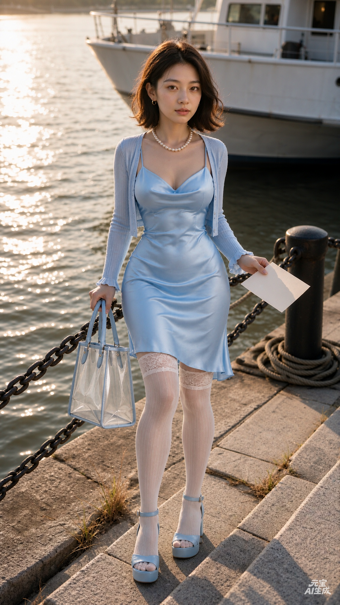

## 终稿提示词

```text
第一张图定穿搭版型配色面料，第二张图定骨相五官与本轮雾棕锁骨微卷，第三张图定本张扭身站立骨架与机位（只取扭身站姿的肩髋反向与前后脚台阶高差，双手按本文重摆，不取线稿里双臂展开的动作）；脸、衣、发型、姿势由各自底图承担。本张是下船时她在江边石阶上停半步、前脚踩上一级刚好让她从上往下压着他递、身子仍朝石阶上方、只把脸回一半、把一张空白厚纸小方票往身后递，他自己完全在画外、他的手也完全在画外，全画只有她一位清晰成年人物。

9:16 满幅画面，宽 1080 高 1920，人物与道具铺满整幅，四条边即裁切边。

她穿天蓝色缎面吊带贴身短连衣裙、垂坠领口两层软褶、细肩带、胸下收进腰窝那一段拉出细密水光、裙摆齐平收在大腿中段、右侧一道开衩到胯侧、上阶那一下露出半边腿线；外面罩一件同色天蓝薄透长袖短开衫、整件敞着不扣、袖口一小圈波浪薄纱、两片敞襟随扭身往后荡开一点；象牙白匀透连裤丝袜平口齐腿根、从裙摆下经大腿膝小腿到脚背整段匀透连续、贴腿整段连包到脚趾、大腿上一圈白色细蕾丝袜口花边平贴腿面；两只脚上各穿一只天蓝软皮一字带粗跟防水台凉鞋、约五厘米粗跟、前掌一小层防水台、脚踝一道细带、丝袜脚背连进鞋口、脚趾在凉鞋里被丝袜完整包着，两只凉鞋都好好穿在脚上、四张同一双；一只透明蓝边 PVC 托特包挂在左肩、包身垂在左髋侧；一串小珍珠项链贴着锁骨、一对细哑金小耳圈、奶白圆甲；雾棕色齐锁骨松散微卷：发长刚到锁骨、发尾一缕一缕松松外卷、偏分、两侧各一缕细软碎发垂到颊边与锁骨，四张同一款发型。江边下船石阶：粗砺浅灰花岗岩台阶一层层往坡上收、石面哑面吃光不反光、码头磨圆的缺角、阶缝里一撮干黄压弯的细草、阶旁一根哑黑铁链桩与盘好的缆绳、身后江面铺着午后碎金、渡轮白漆船舷退到画面边缘、她指间一张渡口空白厚纸小方票、票面只有一道浅蓝压边水印与一角撕出来的毛边、整张票空白干净无任何印花字迹文字字母数字、空白面朝着他、全画无可辨招牌文字。

镜头是他的眼睛：他跟在她身后下船，视点实数眼高 1.55 米，与她相隔 0.8 至 1.0 米距离带，平看略仰 2 度、镜头不随她上阶抬、钉在她下颌高，看她在石阶上停半步、身子朝上、只把脸回一半、一只手把船票往身后递过来；视线先撞见她回过来的那半张脸，再落到递到画面下缘的那张白票上。他自己完全在画外、他的手也完全在画外，石阶上方空着。这一眼看得见她扭身站定的整段轮廓、缎面垂坠领两层软褶与腰窝那道水光、薄透短开衫往后荡开的两片敞襟、裙摆齐在大腿中段与右侧开衩露出的半边腿线、白色蕾丝袜口花边、象牙白丝袜从裙摆下整段连到膝下那一截小腿、两只天蓝一字带粗跟防水台凉鞋与脚背连进鞋口的丝袜、脚趾在凉鞋里被丝袜完整包着，锁骨上那串小珍珠、一对细哑金小耳圈、齐锁骨微卷与颊边两缕细碎发、左肩挂着的透明蓝边托特包、递到画面下缘的那张空白厚纸小方票；哑面花岗岩台阶与磨圆缺角、阶缝里那撮干黄细草、哑黑铁链桩与盘好的缆绳、身后江面碎金与退到边缘的白漆船舷都在。这一眼看不见石阶坡顶，看不见他自己。

一位成年人物、一具身体轮廓、胸大腰细腿长靠合身剪裁写实呈现、左右各一只手臂各五根手指、两只脚各自连续、两只天蓝软皮一字带粗跟防水台凉鞋都好好穿在脚上。全画仅此一双手，每只手全篇只出现一次、只做一个动作：右臂从右肩经肘向右后落、经腕轻扶，指尖一条连续链沿身体右侧完整可见，右手中景、大半截指节被哑黑铁链桩吞进去只露两点指尖，唯一落点是右手五指搭在铁链桩顶上、把扭身的身子稳住停住、整只手静止当锚；左臂从左肩经肘向后下伸、整只前臂往下压低一档、经腕轻送，指尖一条连续链沿身体左侧完整可见，左手是全画最前景、手背迎着江光、亮过右手三倍，唯一落点是左手五指捏着那张空白厚纸小方票一角往身后他那一侧递出、票角贴住画面下缘留足一指空、江风掀起票面一个小角、递到就停住不松手。指缝可数，两臂各从肩连续到指尖，一暗一亮分得清。

两脚一前一后踩在花岗岩台阶上、前脚踩实上一级、后脚脚尖点在下一级、重心落在前脚，肩线朝石阶上方松松送过去、髋线留在身后，脊线从后颈经腰窝到后脚的踝拉出一道柔弯的斜线、弧顶往后压到扶桩那侧肩胛，扭身只取肩回半寸、人仍朝坡上。她把脸回一半，眼先落在他身上、被江风眯了一下随即笑开、眯和笑是同一个动作的两半、眯完眼皮往外撑开不往回收，回过来这半边耳廓透着粉、被风一吹又散一点，唇角弯一半拿牙咬住下唇里那点笑，像「接好，别把票弄湿了，弄湿了你自己去补」说得极轻；这个神态长出一个可见动作：捏票那五指把票角往身后又送出一寸、送完停住不松，扶铁链桩那五指位置不动，把这一下的主动权收在自己这一侧。四下里只留送票手腕和半张脸两个动点，肩髋与扶桩手全是静止的锚。

午后暖阳从江面斜过来、整幅光压暗半档，碎金只留在她回过来的半边下颌与票角两处，浅浅勾在缎面领口与左手手背上，粗砺花岗岩哑面吃光、阶缝那撮干黄细草反一点软绿，缎面水光、薄透开衫细网纹、丝袜细密竖纹、一字带凉鞋软皮、珍珠粒粒与空白厚纸小方票的纸纹毛边都清楚。写实街拍摄影质感，50mm，1/250，隔着半步平看略仰 2 度，机位稳住不动。
```

## 一句点评

石阶回身把空白票递到画面下缘
