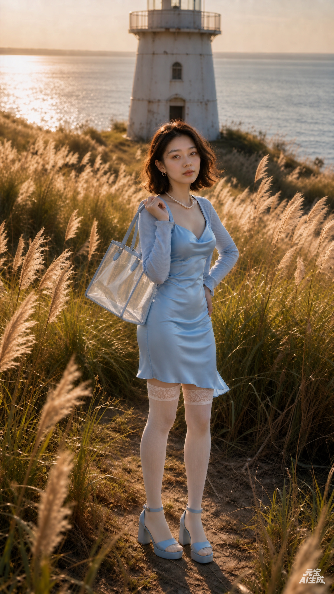

## 终稿提示词

```text
返工复核锚（STD-001.2 B5-T）：丝袜从腿根到脚尖同色连续，脚踝、脚背无横向分界、无袜口、无趾根收边；脚趾由与腿部同色的袜面完整包住，五趾轮廓在袜面里各自分明，露趾鞋与凉鞋前口里袜面一直连到趾尖并与鞋口平顺衔接；四张同一层腿部覆盖、同一双鞋。本张已按此逐字复核并重出。

第一张图定穿搭版型配色面料，第二张图定骨相五官与本轮雾棕齐锁骨松散微卷，第三张图定本张站立骨架与机位（只取低机位的腿线与重心，双手按本文重摆，不取线稿里双手扶腰的动作）；脸、衣、发型、姿势由各自底图承担。本张是对岸芦苇坡上她站定、身子与肩髋朝画面左前的坡顶旧灯塔、机位转到她斜侧约 30 度、只把脸回一半、眼尾从自己左肩底下掠过来落在身后他身上落定不走，右手把透明蓝边托特包贴在右肩侧只露一道蓝边、左手提到腰后高度朝身后他那一侧弯成钩子勾一下指尖。他自己完全在画外、他的手也完全在画外，全画只有她一位清晰成年人物，草径下方空着。

9:16 满幅画面，宽 1080 高 1920，人物与道具铺满整幅，四条边即裁切边。

她穿天蓝色缎面吊带贴身短连衣裙、垂坠领口两层软褶、细肩带、胸下收进腰窝那一段拉出细密水光、裙摆齐平收在大腿中段、右侧一道开衩到胯侧、坡风把开衩那片裙角掀起一点；外面罩一件同色天蓝薄透长袖短开衫、整件敞着不扣、袖口一小圈波浪薄纱、两片敞襟随坡风往后荡开；象牙白匀透连裤丝袜平口齐腿根、从裙摆下经大腿膝小腿到脚背整段匀透连续、贴腿整段连包到脚趾、大腿上一圈白色细蕾丝袜口花边平贴腿面；两只脚上各穿一只天蓝软皮一字带粗跟防水台凉鞋、约五厘米粗跟、前掌一小层防水台、脚踝一道细带、丝袜脚背连进鞋口、脚趾在凉鞋里被丝袜完整包着，两只凉鞋都好好穿在脚上、四张同一双；一只透明蓝边 PVC 托特包贴在右肩侧、两根提手已经转正、右手搭着、包身大半藏在身后、画面里只露包角一道蓝边反光；一串小珍珠项链贴着锁骨、一对细哑金小耳圈、奶白圆甲；雾棕色齐锁骨松散微卷：发长刚到锁骨、绝不过锁骨十公分、发尾一缕一缕松松外卷、偏分、两侧各一缕细软碎发垂到颊边与锁骨、坡风把右颊那一缕吹到唇边又离开，与前三张同一款发型，不是过肩披肩大卷、不是低马尾、不是盘发、不是半扎发，后颈到发顶这一弧背后压着一小片逆光暗芦秆、把发丝托出轮廓。对岸芦苇坡：一坡细长芦苇与毛茸茸的芦花穗、被踩出的一条浅黄草径、坡顶一座白身旧灯塔只露半截塔身与一圈栏杆、灯塔整体降一档明度、塔尖被两三穗芦花挡住一截、身后江面泛青天蓝压一层薄银铺开成一片、无碎金无橙霞、远处几粒虚化灯点、夕阳把芦花穗染成浅金、全画无任何可辨文字字母数字。

镜头是他的眼睛：他跟在她身后上坡，视点实数眼高 1.35 米、转到她斜侧约 30 度，与她相隔 0.6 至 0.8 米距离带，平看略仰 3 度低机位看她在坡上站定、肩髋朝画面左前坡顶、只把脸回一半、眼尾从自己左肩底下掠过来落在他身上落定不走；近眼压低看镜头下方他站的那一处，低机位只拉长小腿到凉鞋那一截、透视平稳。他自己完全在画外、他的手也完全在画外。这一眼看得见她斜侧站定的整段轮廓、缎面垂坠领两层软褶与腰窝那道水光、薄透短开衫往后荡开的两片敞襟、裙摆齐在大腿中段与右侧被坡风掀起一点的开衩裙角、白色蕾丝袜口花边、象牙白丝袜从裙摆下整段连到膝下那一截小腿、两只天蓝一字带粗跟防水台凉鞋与脚背连进鞋口的丝袜、脚趾在凉鞋里被丝袜完整包着，锁骨上那串小珍珠、一对细哑金小耳圈、齐锁骨雾棕微卷与吹到唇边又离开的那一缕、右肩侧只露一道蓝边的透明托特包；一坡芦苇与芦花穗、浅黄草径、坡顶半截降了明度的白身旧灯塔、身后泛青压薄银的江面与远处几粒虚化灯点都在。这一眼看不见灯塔里面，看不见他自己。

一位成年人物、一具身体轮廓、胸大腰细腿长靠合身剪裁写实呈现、左右各一只手臂各五根手指、两只脚各自连续、两只天蓝软皮一字带粗跟防水台凉鞋都好好穿在脚上。全画仅此一双手，每只手全篇只出现一次、只做一个动作：右臂从右肩经肘向上收、经腕轻搭，指尖一条连续链沿身体右侧完整可见，唯一落点是右手五指搭住已经转正的透明蓝边 PVC 托特包两根提手、把包贴在右肩侧稳住停住、整只手静止；左臂从左肩经肘向后抬到腰后高度、经腕轻勾，指尖一条连续链沿身体左侧完整可见，唯一落点是左手五指弯成钩子朝身后他那一侧勾一下、勾完停住不收回半拍，全画动态只留这一只手。指缝可数，两臂各从肩连续到指尖。

两脚一前一后站在浅黄草径上、两膝近并、后膝微屈前收半寸、前脚踩实、后脚脚尖点地、重心落在后脚，肩往前推半寸，后跟落定那下蹭起两三粒草屑还在往下掉，肩线与胸口与髋仍朝画面左前坡顶旧灯塔、只把脸回一半，脊线从后颈经腰窝到后脚的踝拉出一道安静的直线，短开衫两片敞襟落回贴腿侧、只衣角还被坡风掀起一点。眼尾从自己左肩头掠过来落在他身上，落点的那一瞬眼睑停住、瞳仁定在他那一处、下颌压低半分又松一点、像刚发现自己在看他，眉梢松着、下眼睑略松、唇缝刚启、被那缕发扫过去、话搁在齿后没笑开，像「爬到灯塔顶看落日，谁先喊累谁请吃冰」说完了还留半句没说；这个眼神长出一个可见动作：勾指尖那五指弯完停住不收回半拍、提包那五指搭着不动，把主动权收在自己这一侧。坡风把芦花穗压向画面下缘、穗尖扫过草径尽头那片空地，像替她把那半句先送到他跟前；地上只在她脚底压一团短影，影子不过靴尖。

夕阳从坡顶那座白身旧灯塔方向斜铺下来，浅浅勾在缎面右肩、她露出的半边下颌与被坡风掀起的那片开衩裙角三处，金色只给芦花穗与开衩裙角那道水光、江面泛青压一层薄银，芦花穗逆光成一圈圈软金边、画顶最高一线留给两三穗芦花、灯塔那一圈暖晕压低一档、发顶沉在肩线之下还离顶一个头位，草径被晒成浅黄；缎面水光、薄透开衫细网纹、丝袜细密竖纹、一字带凉鞋软皮、珍珠粒粒与透明托特包那道蓝边反光都清楚。写实街拍摄影质感，50mm，1/250，收近一步斜侧平看略仰 3 度，机位稳住不动。
```

## 一句点评

芦苇坡提包勾指尖画顶留给芦花与灯塔
