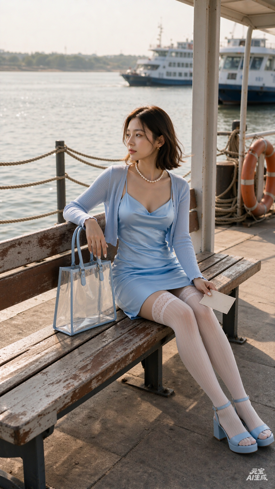
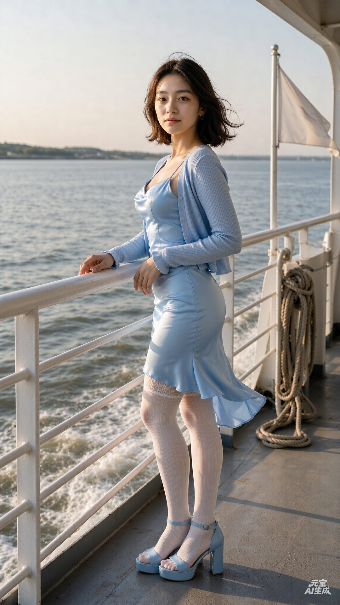
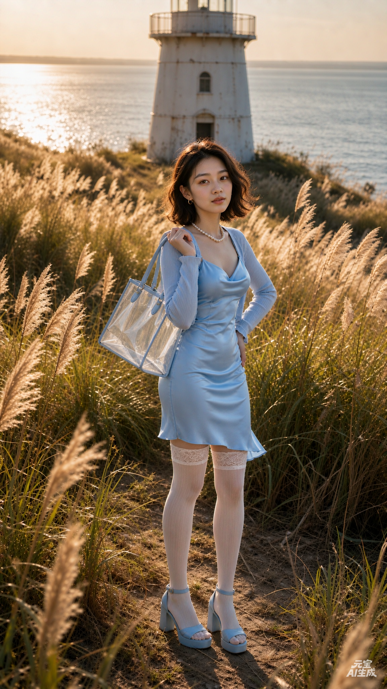

# R010 · 渡轮去对岸看旧灯塔

- 轮次目录：`20261126j_ferry-lighthouse`
- 日期：2026-11-26
- 穿搭：`SUM-0069`
- 四张线稿：`full_sexy_P023_side`、full_single_P029_side`、full_single_P077_diagonal`、full_single_P018_low`
- 画幅：1080×1920（9:16），纯画面，工具水印随图保留

## 四张

| 序 | 机位 | 图 | 终稿提示词 |
|---|---|---|---|
| 01 | front |  | [01_front.md](01_front.md) |
| 02 | side |  | [02_side.md](02_side.md) |
| 03 | seat |  | [03_seat.md](03_seat.md) |
| 04 | close |  | [04_close.md](04_close.md) |

## 这一段说了什么

1. 船来之前你先别说话呀，让我把这点太阳看完，你坐那头就好，别把我这半边椅子也占啦。
2. 风这么大，你倒是过来替我按着呀，我这只手可腾不出来，船一晃我就赖你身上了。
3. 接好，别把票弄湿了，弄湿了你自己去补，我才不陪你排队，石阶滑，你慢点上来。
4. 爬到灯塔顶看落日，谁先喊累谁请吃冰，我先走啦，你勾着点，别在芦苇里把我跟丢。

## 现场记录

- 01_front：候船长椅侧坐把空白票亮给空椅那头
- 02_side：甲板斜侧扛住江风素色旗扯成直线
- 03_seat：石阶回身把空白票递到画面下缘
- 04_close：芦苇坡提包勾指尖画顶留给芦花与灯塔

> 原图 PNG 永不转码、永不覆盖；预览用 `` 缩放原图。
