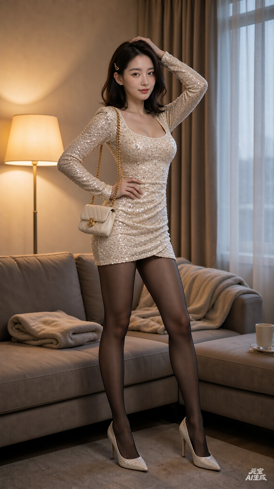

## 终稿提示词

```text
9:16 竖版满画幅，画面从顶到底由人物、道具与光填满。第 1 张底图只取服装的版型、配色与面料质感，人物头部与五官完全以第 2 张底图的完整脸型、发际线与颈肩衔接为准，头顶至下巴完整成形的成年女性头部自然接在肩线上；第 3 张底图提供本张姿势的骨架与机位，本张姿势以它为准。

自家客厅沙发傍晚，画左一盏暖黄落地灯把光筛成米黄落在肩头亮片与脸侧，画右窗纱薄暮余光勾出发梢与另一侧肩线；暖灰沙发、一条折起的绒毯、矮几上一杯温水、一部手机、一小瓶白花，窗帘垂成一整片暖灰。低饱和三色：香槟白、炭灰、暖木棕。

一位唐唐，成年头身比，胸大、腰细、腿长，靠合身剪裁与线条写实呈现；一具身体轮廓，左右各一只手臂、各五根手指，两条腿各自连续，两只脚各自完整。她斜侧身朝镜头方向站定、胯部侧顶成一道柔和 S 形，一手抬到脑后把发拢住、一手扶在腰侧，头轻轻转回约 30°看向镜头，颈肩平顺连续、下巴与锁骨落在同一条自然转向线上，嘴角轻轻往上收住；镜头离地 155cm、距约 3.8m，平视，画面里完整呈现一位人物，全身轮廓与沙发扶手一起进画，画左落地灯正落在脸颊与右肩亮片上，两只象牙白亮片尖头高跟鞋连着包住脚尖的炭黑袜面完整落在画面下沿之内。本张画面就是唐唐一人，画框上沿留出发顶、下沿收住鞋底，暖黄落地灯为主光、画右薄暮只作窗纱上一层冷灰边。

象牙白／香槟金亮片方领长袖迷你连衣裙，U 形方领露锁骨、长袖袖口微张、全身密缀细小圆亮片与碎钻、胸腰细密抓褶、裙摆斜裁不规则不对称落在大腿中段；金链象牙白菱格小方包斜挎在身侧，一条细金链从她右肩斜跨过胸前完整连到左胯的包身、链身每一段都看得见，包身完整在画框内、金色方扣朝镜头可见。两条腿覆一层炭黑薄透连裤丝袜，细密哑光织纹，从髋经膝、小腿、脚背连续包到脚尖，脚尖由同色袜面完整包住，五趾轮廓在袜面里各自分明，膝前与脚背有一层很浅的柔亮，与象牙白亮片尖头高跟鞋的鞋口平顺衔接，四张完全相同。丝袜为连裤一体，髋部到裙摆下缘之间由同色袜面连续铺满。象牙白亮片尖头细直跟浅口高跟鞋，两只鞋各自完整踩在暖木地板上，亮片鞋面与细直跟清晰可见。香槟金珠光圆短甲、甲缘一道极细珍珠白弧线，左右各五根手指各自分开。

及肩下三厘米的中长发，中分线落在正中骨缝，左侧头发别到左耳后完整露出左耳与左耳垂、右侧留一缕薄发帘自然垂落遮住右耳尖，左耳后别一枚哑光香槟金细月牙小发夹只露月牙尖端一点金，整体是松散的S形低波浪卷、卷峰落在颧骨到下颌线之间，发尾向外微翘一厘米呈钝切面不打薄，后颈发梢向内轻扣贴住颈窝不留碎发，雾感暖蜜茶棕里压一层极淡香槟金雾、发根到发尾明度均匀无高光条，在每一张里完全相同。四张同一套衣服、同一款发型、同一款美甲、同一层腿部覆盖、同一双鞋、同一张脸。
```

## 一句点评

斜侧身回望，颈肩平顺，金链完整连到金扣小方包
