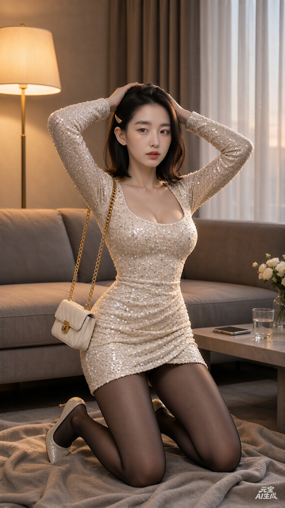

## 终稿提示词

```text
9:16 竖版满画幅，画面从顶到底由人物、道具与光填满。第 1 张底图只取服装的版型、配色与面料质感，人物头部与五官完全以第 2 张底图的完整脸型、发际线与颈肩衔接为准，头顶至下巴完整成形的成年女性头部自然接在肩线上；第 3 张底图提供本张姿势的骨架与机位，本张姿势以它为准。

自家客厅沙发傍晚，画左一盏暖黄落地灯把光筛成米黄落在肩头亮片与脸侧，画右窗纱薄暮余光勾出发梢与另一侧肩线，两道光在暖灰沙发上叠成一片软亮；暖灰沙发、一条折起的绒毯、矮几上一杯温水、一部手机、一小瓶白花，窗帘垂成一整片暖灰。低饱和三色：香槟白、炭灰、暖木棕。

一位唐唐，成年头身比，胸大、腰细、腿长，靠合身剪裁与线条写实呈现；一具身体轮廓，左右各一只手臂、各五根手指，两条腿各自连续，两只脚各自完整。她跪坐在沙发前的绒毯上，双手抬到头顶把发拢顺，两肘向左右撑开、肘尖距画框左右各留一拳，指尖与发顶留两指，头微偏画面左侧约10°、视线平送进镜头，嘴角轻轻往上收住；镜头离地 105cm、微仰 6°、距约 2.2m，全身自鞋尖到发顶完整入画，两肩齐平、上身立直，举到头顶的两只手各五指分开、各自从肩连续延伸到指尖，跪坐的两腿折角与鞋尖一起完整进画，裙摆下缘摊在小腿上方，绒毯褶压住脚背两侧、鞋尖完整露在毯面之上。本张画面就是唐唐一人，画框上沿留出发顶、下沿收住绒毯，暖黄落地灯为主光。

象牙白／香槟金亮片方领长袖迷你连衣裙，U 形方领露锁骨、长袖袖口微张、全身密缀细小圆亮片与碎钻、胸腰细密抓褶、裙摆斜裁不规则不对称落在大腿中段；金链象牙白菱格小方包搁在沙发坐垫边，金色方扣清晰可见。两条腿覆一层炭黑薄透连裤丝袜，细密哑光织纹，从髋经膝、小腿、脚背连续包到脚尖，脚尖由同色袜面完整包住，五趾轮廓在袜面里各自分明，膝前与脚背有一层很浅的柔亮，与象牙白亮片尖头高跟鞋的鞋口平顺衔接，四张完全相同。丝袜为连裤一体，髋部到裙摆下缘之间由同色袜面连续铺满。象牙白亮片尖头细直跟浅口高跟鞋，两只鞋各自完整落在绒毯上，亮片鞋面与细直跟清晰可见，跪坐时两只脚背与脚尖上的细密哑光织纹连续可见。香槟金珠光圆短甲、甲缘一道极细珍珠白弧线，左右各五根手指各自分开。

及肩下三厘米的中长发，中分线落在正中骨缝，左侧头发别到左耳后完整露出左耳与左耳垂、右侧留一缕薄发帘自然垂落遮住右耳尖，左耳后别一枚哑光香槟金细月牙小发夹只露月牙尖端一点金，整体是松散的S形低波浪卷、卷峰落在颧骨到下颌线之间，发尾向外微翘一厘米呈钝切面不打薄，后颈发梢向内轻扣贴住颈窝不留碎发，雾感暖蜜茶棕里压一层极淡香槟金雾、发根到发尾明度均匀无高光条，在每一张里完全相同。四张同一套衣服、同一款发型、同一款美甲、同一层腿部覆盖、同一双鞋、同一张脸。
```

## 一句点评

跪坐把发拢到头顶，暖黄灯落在亮片上
